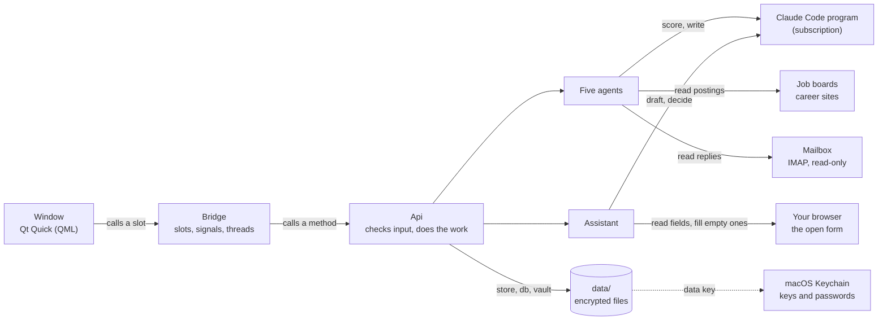

# JobHelper

A desktop assistant for a job search, for macOS. Five cooperating agents find postings, score
them against your CV, write an adapted CV and a cover letter for the good ones, and keep track
of what you applied to and what the companies answered. A sixth, the assistant, fills in a
company's application form in your own browser, answers questions about your search, and does
things in the app after your yes. It runs on **your Claude subscription** through the Claude
Code program – no API key, no per-token bill – and everything it knows about you stays on your
Mac, encrypted.


-41CD52?logo=qt&logoColor=white)
-D97757)


---

## Contents

- [Overview](#overview)
- [Key features](#key-features)
- [The assistant](#the-assistant)
- [Architecture](#architecture)
- [How it works](#how-it-works)
- [Tech stack](#tech-stack)
- [Project structure](#project-structure)
- [Getting started](#getting-started)
- [Usage](#usage)
- [Configuration](#configuration)
- [Security and privacy](#security-and-privacy)
- [Testing](#testing)
- [Documentation](#documentation)
- [Engineering notes](#engineering-notes)
- [Known limits](#known-limits)

---

## Overview

Looking for a job means doing the same things over and over: reading postings, deciding which
ones fit, rewriting the CV and a letter for each, typing the same details into every company's
form, keeping a list of where you applied, and reading the answers. JobHelper does the
repetitive part of all of them and leaves the decisions to the person.

It is built around three promises:

- **It never acts in your name.** It does not apply, does not send email or a form, and opens
  the mailbox read-only. You read, you decide, you send.
- **It never claims what your CV does not show.** Every adapted CV, letter, form answer and
  interview answer is checked in plain code against your own CV after the model wrote it.
- **It never bills per use.** Every model call goes through the Claude Code program and so
  through the subscription; the app refuses to run while a paid API key is set.

Nothing about one particular person is built in: it works from whatever CV it is given, in any
profession, for any city.

## Key features

- **Search without keys.** Reads jobs.cz, prace.cz, LinkedIn's public pages, the career sites
  of the companies you list, and remote boards. Every posting it drops is kept with the reason
  and most can be brought back.
- **Scoring you can read.** Each posting gets a score from 0 to 100 with the reason in words and
  a side-by-side list of the posting's keywords that are, and are not, in your CV.
- **Documents per job.** An adapted CV (profile and skills reworded for the posting, the rest
  untouched) and a cover letter in your own letter's layout, as Word files and PDFs.
- **Honesty checks.** A required language the CV does not show caps the score; a term of the
  posting stated as experience is sent back to the model, and what remains is shown to you.
- **Applications tracked by your mailbox.** Replies are read (never changed), classified as
  invitation, rejection, offer or confirmation, and filed to the right application.
- **Before and after applying.** A checklist per job, drafted answers for that job's form,
  dates with notifications and calendar files, follow-up drafts, notes per company, and an
  interview preparation built from your CV.
- **Learning from results.** Which roles lead to interviews, which skills the postings ask for
  that your CV lacks, what postings pay, how long companies take, why jobs score low.
- **A weekly run.** macOS can do the search and the email scan once a week with the window
  closed.
- **Pauses, never fails, on the limit.** When the subscription limit is used up the run saves,
  says when the limit resets, and resumes from the same job.

## The assistant

A sixth robot stands at the end of the assembly line. It blinks, follows the pointer with its
eyes, and tells you what needs your attention when the app opens.


**It fills in application forms** in the browser you already use (Chrome, Brave, Edge, Opera,
Opera GX or Safari):

- your name, contacts, address and links, your jobs and degrees row by row with their dates,
  and your salary with its currency, from a **My details** page;
- answers to the form's open questions, drafted from your CV for that job, or taken from
  **My answers**, where you answer once what every form asks;
- lists, yes/no buttons and menus that sites draw themselves, when your details or your CV
  settle the answer;
- then it lists what it filled and what it left and why, and can read the form back and say
  what looks wrong before you send.

It writes into empty fields only. The only things it presses are a menu, an entry of a menu, a
yes/no button, a button that adds a row for another job, and the box that says you work
somewhere now. It never presses Submit or Next, never ticks a box that agrees to something,
and never touches a password, a file or a personal question.

**You can talk to it** in your own words:

| You say | What happens |
|---|---|
| *Which applications have had no reply for two weeks?* | It answers from your own data and lists the jobs |
| *Why did this score 62?* | It explains from the stored reason and keywords |
| *I sent it: mark it applied and remind me in ten days* | One question lists both steps; nothing changes before your yes, and **Undo** takes it back |
| *Make the second paragraph of this letter shorter* | The new version is shown first and saved after your yes |
| *Is the posting in my browser worth applying to?* | It is scored with the same scorer a search uses and can be added to New Jobs |
| *Answer Quillon that Tuesday suits me* | A reply to copy; the app never sends mail |
| *Let us practise the interview for Quillon* | Question by question, with feedback; weak answers come first next time |
| *Remember that I do not want consulting firms* | Kept for later talks |

Filling in a form costs nothing. Anything else is one call to Claude, with only the jobs the
request is likely about.

## Architecture



The window never touches a file. A QML file calls a slot of the bridge, the slot calls a method
of `Api`, and the method checks the input, does the work and answers with a plain dictionary.
Long work (a search, a scan, a rewrite) runs in a thread and answers through a signal.


## How it works

A search runs the first four agents in order; an email scan runs the fifth.


1. **Profiler** reads the CV once and works out the level, the roles to look for and the
   search queries.
2. **Scout** asks the job boards, then filters without a model call: language, level, years of
   experience, part-time, age of the posting, location, roles already applied to. Postings that
   came back empty are read once more, and older ones are asked whether they are still open.
3. **Scribe** skips what is plainly another profession, scores the rest five postings per
   call, and for each posting at or above your limit writes the adapted CV first and the letter
   to match it. Both are checked in code before they are saved.
4. **Tracker** rebuilds the Excel tables.
5. **Postman** reads new mail, decides without a model call which messages are worth a
   question (on 150 days of real mail: 242 messages, down from 661 under the earlier rule, with
   every filed reply still getting through), and files each reply to its application.


What Claude writes is never taken on trust:


The assistant works the same way. A form is read, planned in plain code, filled, and checked:


And a request in free words is decided by Claude but carried out by the app:


## Tech stack

| Layer | Technology | Why |
|---|---|---|
| Language | Python 3.10+ | Mature libraries for Word, Excel, mail and web pages; the official Claude library is Python |
| Window | Qt Quick (QML) with PySide6 | A native, GPU-drawn window with no browser inside |
| Model | Claude through `claude-agent-sdk` and the Claude Code program | Uses the subscription instead of a per-use API bill |
| Documents | `python-docx`, `pypdf`, LibreOffice (optional) | Edits the person's own Word file, so fonts and layout survive |
| Tables | `openpyxl` | Excel files can be opened and shared without the app |
| Storage | Encrypted JSON files and SQLite | One person's data is small; no server to install |
| Web | `requests`, `beautifulsoup4`, `lxml` | Reads the public pages of boards that have no common interface |
| Mail | `imaplib` (IMAP, read-only) | Works with almost every provider and can promise never to change mail |
| Form filling | Apple events (`osascript`) to the person's browser | Fills the form where you are signed in, with nothing to install |
| Security | AES-256-GCM (`cryptography`), macOS Keychain, HMAC-signed rule files | Private data; a tampered file is refused, not read |
| Scheduling | macOS LaunchAgent | Runs with the window closed |
| Quality | `pytest`, `pyflakes`, hash-pinned packages | Every change comes with tests; packages cannot change unnoticed |

The reasons in full, and what was deliberately left out, are in
[docs/CODE.md](docs/CODE.md#2-know-the-tech-stack).

## Project structure

```
JobHelper/
├── app_qt.py                 # starts the window
├── run.py                    # the same search from the command line (used by the weekly run)
├── status.py                 # command-line tools: list, sync, security, usage …
├── weekly_jobhelper.sh       # what the weekly LaunchAgent runs
├── jobhelper/                # all the logic, no window code (63 modules)
│   ├── agent1_cv.py … agent5_responses.py     # the five agents
│   ├── scrapers_*.py         # one module per kind of job source
│   ├── filters.py, prefilter.py, language.py, places.py, keywords.py, salary.py
│   │                         # rules that need no model call
│   ├── cv_tailor.py, cover_letter.py, form_answers.py, interview_prep.py
│   │                         # writing, each with its checks against the CV
│   ├── email_client.py, mailhosts.py          # read-only mail; which server a mailbox uses
│   ├── assistant.py, assistant_brain.py, assistant_notes.py
│   │                         # the assistant: fixed requests, what Claude makes of a free one, what it remembers
│   ├── details.py, answer_memory.py, chrome.py, form_fill.py, form_choices.py
│   │                         # your details and your own answers, the link to the browser, filling a form
│   ├── llm.py, usage.py      # the one door to Claude; usage and limits
│   ├── store.py, db.py, vault.py, integrity.py, housekeeping.py
│   │                         # job list, replies, encryption, signed files, backups
│   └── ui_api.py, api_*.py, qt_bridge.py, bridge_*.py
│                             # what the window calls
├── ui_qt/                    # the window: one QML file per dialog or part (40 files)
├── tests/                    # 1,565 tests, offline, in temporary folders
│   ├── guide_shots.py        # takes the pictures of the user guide
│   └── fixtures/forms/       # the assistant's test area: forms it must fill and must not send
├── scripts/                  # the PDF builder, the numbering check, the diagrams, the lock file
├── docs/                     # user guide, technical documentation, their PDFs, pictures
├── data/                     # your data (never in git; only the *.example.* files are)
├── requirements.txt          # dependencies
└── requirements.lock         # the same, pinned by SHA-256
```

## Getting started

### Prerequisites

- macOS.
- Python 3.10 or newer.
- The Claude Code program, signed in with a Claude subscription.
- Optional: LibreOffice, for PDF copies of the documents.
- For the assistant's form filling: Chrome, Brave, Edge, Opera, Opera GX or Safari, with its
  switch **Allow JavaScript from Apple Events** turned on once.

> **Do not set `ANTHROPIC_API_KEY`.** Leaving it unset is what makes the app use the
> subscription, and the app refuses to run a search while it is set.

### Install

```bash
cd path/to/JobHelper
python3 -m venv .venv
source .venv/bin/activate
pip install --require-hashes -r requirements.lock

claude auth login             # once: sign in with your Claude subscription
```

### Run

```bash
python app_qt.py
```

The welcome card does the rest: it checks the Claude sign-in, lets you choose your CV, connects
your mailbox (optional) and turns on data protection. Then set your city and the roles you
look for in **Options** and select **Run search**.

**Save your recovery key once** – you need it on a new Mac or after a Keychain reset: in the
app, **Account** card → *Data protection* → **Recovery key**.

## Usage

### In the window

| To do this | Where |
|---|---|
| Find and score new postings | **Run search** |
| Decide what to apply to | **New Jobs** → a row → *Why this score*, the CV, the letter |
| Go through many jobs quickly | **New Jobs** → narrow the list → **Review these … one by one** |
| Fill in a company's application form | Open it in your browser, select the assistant, **Fill in the form** |
| Ask about your search, or have something done | Select the assistant and type it |
| Record an application | **Mark applied** |
| Read replies from companies | **Scan email**, then **Responses** and **Applications** |
| Prepare for an interview | An application → **Interview preparation**, then ask the assistant to practise |
| See what a search left out, and why | **Last run** card → **Filtered out** |
| Learn what works | **Insights** and **Analytics** |
| Say what you look for | **Options** |

Every screen is described step by step, with pictures, in the
[user guide](docs/GUIDE.md).

### From the command line

```bash
python run.py                    # the whole search, with the settings saved in Options
python run.py --where Brno       # another city
python run.py --threshold 70     # write documents only for stronger matches
python run.py --include-remote   # add the remote boards

python status.py list            # everything, with ids
python status.py sync            # read replies and update statuses
python status.py responses       # reply and rejection numbers
python status.py usage           # Claude usage of the app
```

All commands and options are in [COMMANDS.md](COMMANDS.md).

## Configuration

Almost everything is set in the window under **Options** and saved encrypted. A few things
can be set in `.env` (copy `.env.example`):

| Variable | Default | Purpose |
|---|---|---|
| `JOBHELPER_MODEL` | `sonnet` | Which Claude model scores and writes (`sonnet`, `opus`, `haiku`) |
| `JOBHELPER_THRESHOLD` | `50` | The score from which a CV and a letter are written |
| `JOBHELPER_MAX_AGE_DAYS` | `10` | Postings older than this are dropped (0 = any age) |
| `IMAP_USER`, `IMAP_HOST` | set by the app | The job mailbox and, for a provider the app does not know, its server |
| `JOOBLE_API_KEY`, `ADZUNA_APP_ID`, `ADZUNA_APP_KEY` | none | Optional keys for those two sources |

The mailbox password never goes into `.env`: the app keeps it in the macOS Keychain.

Rules for the CV and the letter are optional. To write your own, copy
`data/cv_adaptation_instruction.example.md` and `data/cover_letter_instruction.example.md` to
the same names without `.example`. With a letter of your own as
`data/cover_letter_template.docx`, letters keep its head and layout.

## Security and privacy


- **Everything stays on your Mac.** Only these leave it: the questions put to Claude (your CV
  text and a posting, or a request to the assistant with the jobs it is about), the requests to
  the job boards, and the reading of your mailbox.
- **Encrypted on disk:** the job list, the profile, the settings, your details and answers, the
  replies and all backups (AES-256-GCM). The key and the mailbox passwords are in the macOS
  Keychain.
- **Signed rule files:** the files that decide what is written in your name are signed. A
  change made outside the app is shown line by line and must be approved before the next run.
- **Nothing is deleted:** data is backed up before any bulk change; documents are moved to an
  encrypted backup and can be put back; old copies go to the Trash.
- **The mailbox is read-only.** Nothing is sent, deleted, moved or marked as read.
- **Forms are filled, never sent.** The assistant writes into empty fields of the page you
  opened and needs your consent in both the browser and macOS. It reads back whether a field
  is empty; what a field holds only when you ask it to review the form or to learn your
  changes, and then never a password or a file, and never a personal answer to Claude.
- **Claude proposes, the app decides.** A request to the assistant comes back from Claude as
  an answer or as actions from a fixed list. The app checks them, asks you in its own words,
  and changes nothing before your yes.

## Testing

```bash
python -m pytest -q
python -m pyflakes jobhelper tests scripts
```

1,565 tests in about four minutes, with no network. They never touch real data, the Keychain
or `.env`, never ask Claude, never read a real job board or mail server, never reach into a
real browser, and never open a file or put anything in the Trash: every test works in
temporary folders with stand-ins.

- The window itself is loaded without a screen and driven by the tests.
- The assistant has a **test area**: application forms served on this machine and opened in a
  real browser engine, filled by the same code the window runs. One is built the way component
  libraries build forms, one is long, one sits in a frame from another address. On every one
  the tests check that nothing was sent and no button was pressed.
- The documentation has tests of its own: numbered figures and tables, nothing split across
  pages in the PDFs, links that lead somewhere, diagrams whose arrows cross no box.

## Documentation

| Document | For |
|---|---|
| [User guide](docs/GUIDE.md) ([PDF](docs/GUIDE.pdf)) | Using the app: every screen, step by step, with pictures. No terminal needed |
| [Technical documentation](docs/CODE.md) ([PDF](docs/CODE.pdf)) | Installing, the command line, the tech stack and its reasons, the structure of the code with a diagram for each process, tests |
| [Command reference](COMMANDS.md) | Every command and option |
| [Handbook](HANDBOOK.md) | The rules the app is built by, decisions already made, what is left to do |
| [Changelog](CHANGELOG.md) | What changed, day by day. The app shows it under **Help** |

## Engineering notes

A few decisions worth highlighting:

- **The model is asked only what code cannot decide.** Language, level, location, duplicates
  and "another profession" are settled in plain code before scoring, so a search of several
  hundred postings costs a few dozen calls. Lists that decide what is skipped were measured on
  real postings before they shipped: nothing that had scored 30 or more may be skipped.
- **What the model writes is checked after it wrote it.** A prompt that says "do not invent"
  is not a guarantee. A whole run with an invented accountant's CV showed an adapted CV stating
  the posting's terms ("cost center data") as experience; the check that came out of it finds a
  two-word term of the posting that the CV knows nothing of, sends the draft back once, and
  shows what remains to the person instead of cutting sentences out.
- **Claude proposes, the app disposes.** A free request to the assistant is one call that
  returns an answer or up to three actions from a fixed list. The app checks them (a made-up
  action or job is dropped), words the question itself, and changes nothing until the person
  says yes. Tests with forged replies confirm that none of them changes data.
- **A prompt is tried against the real model, not only against stand-ins.** A trial on invented
  data showed Claude reading the day a reply arrived as the day of an interview. The fix was
  not another instruction but the data itself: the line now says "an invitation arrived" and
  "no date set", which cannot be misread.
- **A page is filled in by small scripts that are tested on a real page.** One lists the
  fields without sending back what they hold; plain code decides what each field is; another
  writes values that travel as data, never as code, and only into the page that was read. The
  one script that presses anything accepts five kinds of element and reads their words again
  before it acts. The test area found what unit tests had missed: "Czechia" in a list that says
  "Czech Republic", a job's employer paired with another job's title, a page that throws away
  whatever did not arrive as typing.
- **A background thread still blocks the window in Python.** Preparing the Insights view was
  59,000 small text searches; although it ran in a worker, the welcome animation stuttered for
  half a second because every call from the window queued behind it. The work now starts after
  the welcome screen and rests briefly after each posting (733 ms of stalls before, 30 ms now).
- **A running search holds its own copy of the job list.** A hand edit made meanwhile must
  reach that copy too, or the search writes its older copy over it when it ends. One function
  applies every edit to both, which is why an edit must give the same result when run twice.
- **The limit is a state, not an error.** The numbers the usage card shows are a snapshot from
  Claude's last answer; a refusal fills the limit it names until its reset time, and a run
  pauses and resumes instead of failing job after job.
- **Replies are matched by a company's own name words.** "Accenture Czech Republic" and "PwC
  Czech Republic" share a word, and so do "Reed Specialist Recruitment" and an "IT Support
  Specialist" role elsewhere. Words many names share do not count; measured on 150 days of real
  mail, that moved eight replies to the right company and lost none.
- **The documentation is built and tested like code.** The user guide's pictures are taken by
  a script from invented data, figures and tables are numbered by a tool, and the PDF builder
  lays pages out itself: a figure or a table is never split, the text that follows it fills the
  space it left, and every entry of the contents can be clicked.

## Known limits

- macOS only.
- The job boards with full support are Czech (jobs.cz, prace.cz); other countries rely on
  LinkedIn, company career sites and the remote boards.
- Outlook.com, Proton and Tuta mailboxes cannot be read with a password, so they cannot be
  connected. Russian services are not used.
- The built-in salary estimate covers software roles in Czechia; elsewhere you enter your own
  figure.
- The assistant fills in forms in Chrome, Brave, Edge, Opera, Opera GX and Safari; Firefox does
  not let another app fill its pages. It leaves file uploads and boxes that agree to something
  to you. It is tested on the forms of its own test area, not yet across real recruiting sites,
  where menus in particular are drawn in many ways.
- The app is started from a terminal. Packaging it as an app that opens from Finder is planned.
