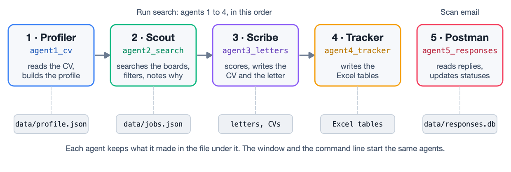
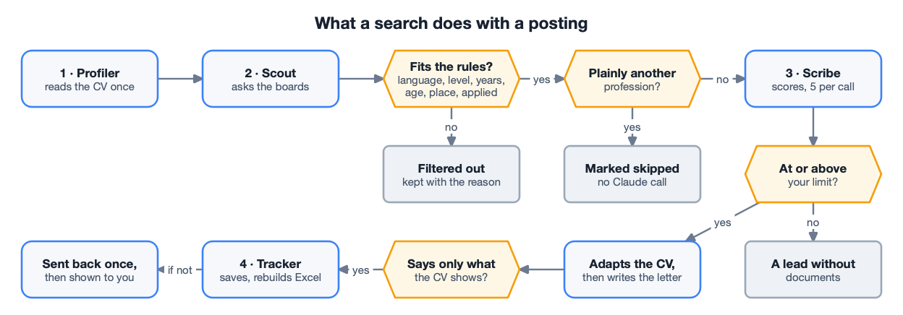
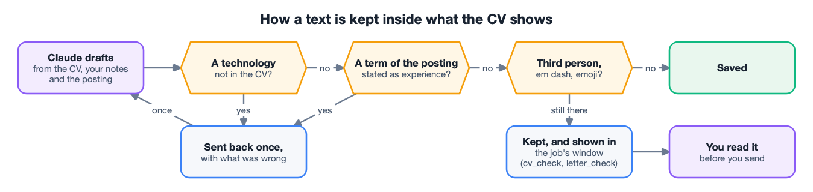
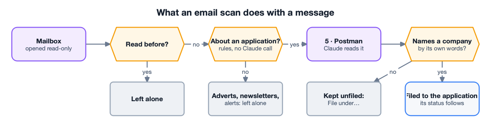
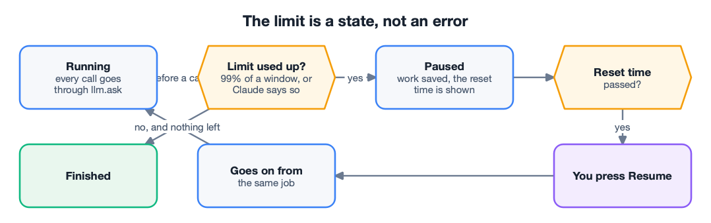
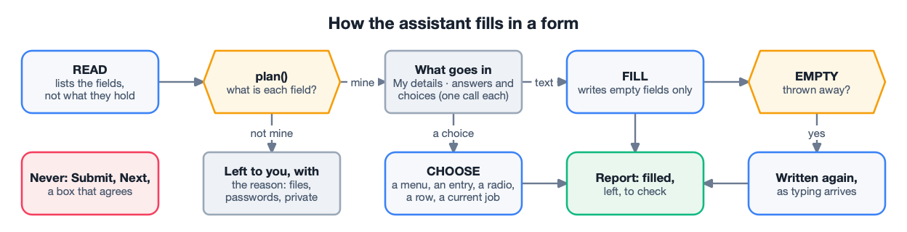
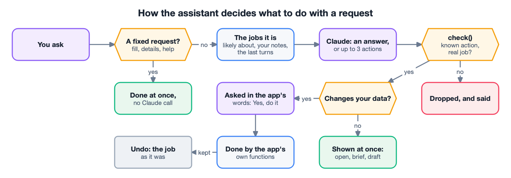
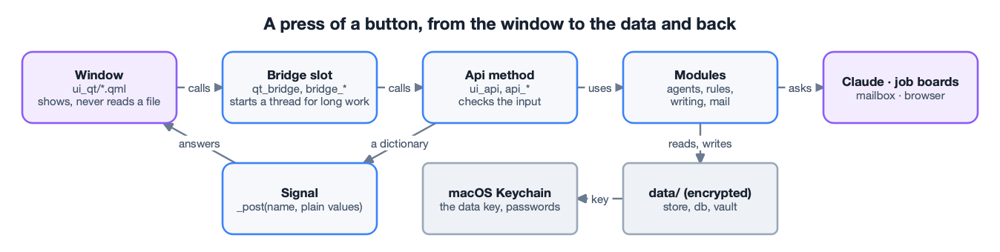
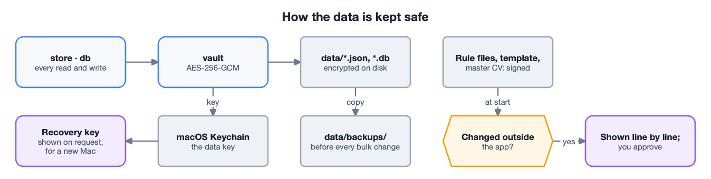
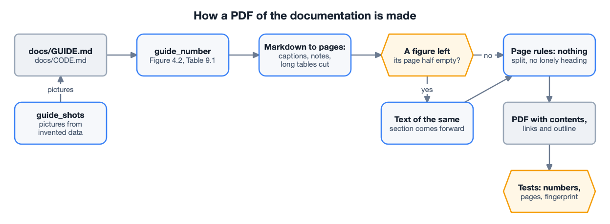

# JobHelper technical documentation

**Applies to:** the JobHelper source code, on macOS with Python 3.10 or newer.

This document is for people who work with the code. It tells you how to install the app and
how to run it from the command line. It also shows how the code is organised, and how to test
and document a change. To use the app, read the user guide, [GUIDE.md](GUIDE.md).

## In this document

1. [Overview](#1-overview)
2. [Know the tech stack](#2-know-the-tech-stack)
3. [Install the app](#3-install-the-app)
4. [Run the app](#4-run-the-app)
5. [Use the command line](#5-use-the-command-line)
6. [Understand the structure of the code](#6-understand-the-structure-of-the-code)
7. [Work with the data files](#7-work-with-the-data-files)
8. [Test a change](#8-test-a-change)
9. [Update the documentation](#9-update-the-documentation)
10. [Troubleshoot problems](#10-troubleshoot-problems)

---

## 1. Overview

JobHelper is a desktop app for macOS. It finds job postings and scores them against a CV. For
the good postings, it writes an adapted CV and a cover letter. It also tracks applications and
replies. It is written in Python, and the window uses Qt Quick (PySide6). All model calls go
through the Claude Code program. So they use the Claude subscription of the person, never the
paid API.

The work is done by five agents (Figure 1.1). A search runs the first four in order; an email
scan runs the fifth.



*Figure 1.1 – The five agents and what each keeps*

Six rules shape the whole code base, and every change must keep them (Table 1.1).

*Table 1.1 – The rules every change must keep*

| Rule | What it means in the code |
|---|---|
| The subscription, never the paid API | `llm.ask` refuses to run while `ANTHROPIC_API_KEY` is set. No code path calls the API directly |
| The mailbox is read-only | Folders are opened read-only and messages are fetched with `PEEK`. Nothing sends, deletes, moves or marks mail |
| Nothing is claimed that the CV does not show | Every written text is checked in plain code against the CV after the model wrote it |
| The person's own letters are never changed | Only letters the app wrote may be replaced or moved |
| Nothing is deleted | Data is backed up before a bulk change; documents are moved to an encrypted backup, old copies to the Trash |
| No personal data in the code | Names and facts of a real person never appear in code, tests or documents |

### Related documents

Table 1.2 lists the other documents of the project.

*Table 1.2 – The documents of the project*

| Document | Use it for |
|---|---|
| [GUIDE.md](GUIDE.md) | Using the app, for someone who never opens a terminal |
| [COMMANDS.md](../COMMANDS.md) | The full reference of every command and option |
| [HANDBOOK.md](../HANDBOOK.md) | The rules the app is built by, decisions already made, what is left to do |
| [CHANGELOG.md](../CHANGELOG.md) | What changed, day by day. The app shows it under **Help** |

## 2. Know the tech stack

### Overview

JobHelper uses a small number of well-known parts. The app must run on the Mac of one person,
keep the data private, and use a Claude subscription instead of a paid API. Each part was chosen
for one of these needs. This chapter names each part and tells why it was chosen. Then a change
does not replace a part without knowing its purpose.

### The language and the window

Table 2.1 lists what the app itself is written in.

*Table 2.1 – The language and the window*

| Technology | Used for | Why it was chosen |
|---|---|---|
| Python 3.10 or newer | All the logic | The libraries for Word files, Excel files, mail and web pages are mature in Python, and the official Claude library is a Python library. One language for everything keeps the project small enough for one person |
| Qt Quick (QML) with PySide6 | The window | It draws a native window on the graphics card, so the robots and the lists move smoothly. It needs no web browser inside the app. An earlier window was a web page, and the app removed it. Two front ends had to stay the same, and the web window was slower and looked foreign on macOS |
| QML for layout, Python for logic | The split between `ui_qt/` and `jobhelper/` | A QML file only shows things and calls the bridge; it never reads a file. The logic can therefore be tested without a window, and the window can be tested without real data |
| Threads with Qt signals | Searches, scans and rewrites | Long work must not freeze the window. A worker thread does it and answers through a signal, which Qt delivers on the window's own thread |

### Claude

Table 2.2 lists how the app reaches the model.

*Table 2.2 – How the app reaches Claude*

| Technology | Used for | Why it was chosen |
|---|---|---|
| `claude-agent-sdk` driving the Claude Code program | Every question to the model | It uses the person's Claude subscription. The paid API bills per use and would make every search cost money; that is why the app refuses to run while `ANTHROPIC_API_KEY` is set |
| One module, `llm`, for all calls | Asking, counting usage, noticing the limit | With a single door, the rules hold everywhere: no call while the limit is used up, every call counted, no key in an error message |
| Plain code before and after the model | Filters before scoring; checks after writing | A check in code is free, instant and always gives the same answer. The model is asked only what code cannot decide, and what it wrote is checked against the CV in code |

### Documents and data

Table 2.3 lists what reads and writes the person's files.

*Table 2.3 – Documents and data*

| Technology | Used for | Why it was chosen |
|---|---|---|
| `python-docx` | Reading a CV; writing the adapted CV and the letter | Employers expect Word files. Editing the person's own `.docx` keeps its fonts and layout, where generating a new file would lose them |
| `pypdf` | Reading a CV that is a PDF; joining the letter and the CV into one PDF | It is pure Python, so nothing else has to be installed |
| LibreOffice (optional) | PDF copies of Word files | It converts a Word file faithfully and is free. It is optional: without it the app still works and offers Word files only |
| `openpyxl` | The Excel tables | People already track applications in Excel; the tables can be opened, sorted and shared without the app |
| JSON files | The job list, the profile, the Options | The data of one person is small. A file can be read whole, backed up by copying, and repaired by hand if it must be |
| SQLite | The replies read from the mailbox | Replies are many, are looked up by message, and must never be read twice. A small database does that; it is part of Python and needs no server |

### Reading the web and the mailbox

Table 2.4 lists what reaches outside the Mac.

*Table 2.4 – Reading the web and the mailbox*

| Technology | Used for | Why it was chosen |
|---|---|---|
| `requests` with `beautifulsoup4` and `lxml` | Reading the job boards and company career sites | The boards have no common interface, so their public pages are read as a browser would read them, at a modest pace. No search needs a key or an account |
| `imaplib`, from Python itself | Reading replies | IMAP works with almost all mail providers. It can open a mailbox read-only. This keeps the promise of the app: it never sends, deletes or marks mail. `email_client.Mailbox` is the only way the app reads a mailbox. It opens each folder read-only, reads with PEEK and always signs out. It has no method that writes |
| An app password instead of a sign-in window | Access to the mailbox | The person can cancel it at the provider at any time, without a change to the real password. The app needs no registration with each provider |

### Privacy and the Mac

Table 2.5 lists what protects the data and ties the app to macOS.

*Table 2.5 – Privacy and the Mac*

| Technology | Used for | Why it was chosen |
|---|---|---|
| AES-256-GCM, from `cryptography` | Encrypting the data files and the backups | Applications and replies are private. This method also notices when a file was changed, so a damaged or tampered file is refused instead of read |
| The macOS Keychain, through the `security` program | Keeping the data key and the mailbox passwords | Secrets are then protected by the Mac's login and are never written to a file of the project |
| Signed rule files | The rules for CVs and letters, the letter template, the master CV | These files decide what is written in the person's name. A change made outside the app must be approved before the next run |
| A LaunchAgent | The weekly run | It is how macOS starts a task on a schedule, also when the window is closed |
| Apple events, through the `osascript` program | The assistant reads and fills in the form that is open in the browser of the person. This works in Chrome, Brave, Edge, Opera and Safari. Opera GX closed this access, and Firefox never had it | The form is filled in where the person is already signed in, with nothing to install. Chrome and macOS each ask for consent first. The app can do only what a script in the page can do: it cannot read saved passwords. It attaches a file the way a page script can (see section 6) |
| Hash-pinned packages in `requirements.lock` | Installing | Each package is checked against a fingerprint, so a changed package cannot be installed unnoticed |

### Quality

Table 2.6 lists what keeps the code correct.

*Table 2.6 – Tools for quality*

| Technology | Used for | Why it was chosen |
|---|---|---|
| `pytest` | More than 2,000 tests | Every change comes with tests. The suite needs no network and never touches real data, so it can be run at any time |
| `pytest-xdist` | Running the tests on every core | The suite takes about one minute instead of six. The tests of one window file share one window and follow on from each other. So each window file stays on one worker in its order (`xdist_group`). The four files run side by side |
| The window loaded without a screen | Tests of the window | The real QML is loaded and driven, so a broken binding or a missing name fails a test instead of reaching the person |
| `pyflakes` | Unused and undefined names | It finds a whole kind of mistake in a second, before a test has to |
| Git and GitHub | The history of changes, and the public copy of the project | Every finished step is a commit that can be gone back to. Each change is a branch and a pull request. The `main` branch takes a change only after the tests pass on GitHub Actions. `scripts/push_check.py` runs before every push and stops one that would publish a personal detail, a secret or the data folder |

### What is deliberately not used

Table 2.7 lists parts that were considered and left out.

*Table 2.7 – What is deliberately not used*

| Not used | Why not |
|---|---|
| The paid Claude API | It bills per use. The subscription the person already has does the same work |
| A web browser inside the app | It was tried and removed: slower, larger, and a second front end to keep the same |
| A browser extension for filling in forms | It would have to be installed by hand and kept in step with the app. Apple events reach the same page without one |
| A database server | One person's data fits in files; a server would be one more thing to install and to keep running |
| A cloud service for the data | Applications, replies and the CV stay on the person's Mac |
| Sending mail | The app reads replies and drafts texts. The person sends them, so nothing leaves in their name without them |

### Next steps

- [Install the app](#3-install-the-app)

## 3. Install the app

### Prerequisites

Before you install, make sure you have:

- macOS.
- Python 3.10 or newer.
- A Claude subscription. The SDK carries its own copy of the Claude Code program. Sign in one time:
  select **Sign in** in the Account card, or run `claude auth login`.
- Optional: LibreOffice, for PDF copies of the documents.

> **Important**
> Do not set `ANTHROPIC_API_KEY`. Leaving it unset is what makes the app use the subscription,
> and the app refuses to run a search while it is set.

### Install the packages

1. Open a terminal in the project folder.
2. Create a virtual environment and turn it on:

   ```bash
   python3 -m venv .venv
   source .venv/bin/activate
   ```

3. Install the exact, hash-checked packages:

   ```bash
   pip install --require-hashes -r requirements.lock
   ```

4. Optional: copy the example settings file into the data home. The mailbox password never goes into it.

   ```bash
   mkdir -p ~/Library/Application\ Support/JobHelper
   cp .env.example ~/Library/Application\ Support/JobHelper/.env
   ```

Table 3.1 lists the main packages and what each is for.

*Table 3.1 – The main packages*

| Package | Used for |
|---|---|
| `claude-agent-sdk` | Driving the Claude Code program, which uses the subscription |
| `PySide6` | The window (Qt Quick and QML) and the PDF of the documentation |
| `python-docx`, `pypdf` | Reading a CV; writing CVs and letters as Word files |
| `openpyxl` | The Excel tables |
| `requests`, `beautifulsoup4`, `lxml` | Reading the job boards |
| `cryptography` | AES-256-GCM encryption of the data files and the backups |
| `pytest`, `pytest-xdist` | The tests, on every core. `pyflakes`, installed separately with `pip install pyflakes`, checks for unused or undefined names |

## 4. Run the app

### Start the window

1. Turn the virtual environment on.
2. Start the app:

   ```bash
   python app_qt.py
   ```

3. Follow the welcome card. Sign in to Claude, choose a CV, and connect a mailbox for replies if
   you want. The user guide describes each step.

### Build JobHelper.app

A packaged app opens like any other Mac app, without Python or a terminal. To build it:

1. Turn the virtual environment on.
2. Install the build tool. The app itself does not need it.

   ```bash
   pip install -r requirements-build.txt
   ```

3. Build the app and check it:

   ```bash
   python scripts/build_app.py
   ```

The script runs PyInstaller with `packaging/JobHelper.spec` and puts the app in `dist/`.
Then `AppCheck` examines the app. It looks for the program, the bundle id, the version, the
window files, the icon, the sound and `CHANGELOG.md`. It starts the Claude program that the
app carries, and it verifies the signature. Then it starts the app with `--check-window`.
To check an app that is already built, use `python scripts/build_app.py --check`.

The window check loads the whole window off-screen for a few seconds and reports each problem
that Qt finds. It also loads the commands of the weekly run, and saves a picture of the window as
`dist/window_check.png`. The check runs only on a throwaway data folder (`JOBHELPER_HOME`) and an
in-memory keychain (`JOBHELPER_VAULT_BACKEND=memory`). Without both, the app refuses it. Its
bridge is quiet: it asks Claude nothing and gives no reminder.

Some important points:

- The name, version and bundle id are in `jobhelper/app_info.py`.
- The spec drops the Qt parts that the window does not use, for example the web engine and 3D
  (`UNUSED_QT`). Thus the app is about 390 MB, not 650 MB. A test makes sure that no Qt part the
  window imports is dropped.
- A module that the app loads by its name must be in `hiddenimports` of the spec. The window
  check fails if one is missing.
- The app is signed only for the Mac that built it (an ad-hoc signature), and Apple has not
  notarized it. On another Mac, the person must select **Open Anyway** one time (user guide,
  section 2).
- `Info.plist` contains `NSAppleEventsUsageDescription`, so macOS can ask before the app controls
  Google Chrome or Terminal.
- Finder and launchd start an app in `/`. The Claude program watches the folder it works in. In
  `/`, macOS then asked for the Desktop, the Downloads, the music, removable disks and the data of
  other apps. So `app_qt.main()` changes to `config.work_dir()`, an empty folder in the data
  folder, before it does anything. `llm.options_for` and `ClaudeCli.auth_status` give the Claude
  program the same folder.
- The questions of the app start none of the person's claude.ai connectors (`mcp_servers={}`,
  `--strict-mcp-config` and `ENABLE_CLAUDEAI_MCP_SERVERS=false` in `llm.options_for`). The questions
  have no tools, and the connectors cost about 1.5 seconds for each question.

### Run a search without the window

A search can also be run from the command line. It does the same work as **Run search** and
writes to the same files. Both make one `agent2_search.SearchSettings` from the Options, and both add
what the search found with `agent2_search.take_in`.

```bash
python run.py
```

Table 4.1 lists the options used most often.

*Table 4.1 – The most used options of run.py*

| Option | What it does |
|---|---|
| `--where CITY` | Searches in another city than the one saved in Options |
| `--source NAME` | Chooses the job boards: `czech`, `linkedin`, `remote`, `adzuna`, `jooble` or `all` |
| `--include-remote` | Adds the remote boards |
| `--threshold N` | Writes documents only from this score |
| `--per-query N` | Asks each board for this many postings per role |
| `--all-languages` | Keeps postings written in other languages than English |
| `--max-age-days N` | Drops postings older than this |
| `--reuse-profile` | Does not read the CV again |
| `--skip-search` | Scores the postings already in the list, without searching |

> **Note**
> Do not run a search from the command line while the window is running one. Both write the
> same job list.

## 5. Use the command line

Everything the window does with applications and replies can also be done with `status.py`.
Table 5.1 lists its commands.

*Table 5.1 – The commands of status.py*

| Command | What it does |
|---|---|
| `python status.py list` | Lists every tracked job with its id and status |
| `python status.py apply ID` | Marks a new job as applied |
| `python status.py update ID STATUS` | Sets the status of a job |
| `python status.py sync` | Reads replies in the mailbox and updates statuses. `--days N` chooses how far back |
| `python status.py responses` | Shows the numbers of replies and rejection reasons |
| `python status.py followups` | Lists applications with no reply for a number of days |
| `python status.py rebuild` | Writes the Excel tables again |
| `python status.py retailor ID` | Writes a letter and an adapted CV for one job |
| `python status.py pdf` | Makes PDF copies of the documents (needs LibreOffice) |
| `python status.py letters` | Takes in letters the person wrote themselves |
| `python status.py prune` | Removes new jobs you have already applied to |
| `python status.py repair-emails` | Reads email text again, without Claude, and fixes replies that were misread because the email was HTML only |
| `python status.py repair-statuses` | Fixes jobs whose status the app does not know |
| `python status.py usage` | Shows the Claude usage of the app, in total and per kind of work |
| `python status.py security ACTION` | Encryption, Keychain and backup tools (Table 5.2) |

### Protect and restore the data

The data files are encrypted with a key kept in the macOS Keychain. Table 5.2 lists the actions
of `python status.py security`.

*Table 5.2 – The actions of status.py security*

| Action | What it does |
|---|---|
| `status` | Says whether encryption is on and whether a watched file changed |
| `recovery-key` | Prints the recovery key. The window shows the same key in the **Account** card |
| `restore-key` | Puts a saved recovery key back into the Keychain |
| `approve` | Accepts a change to a rule file, the letter template or the master CV as trusted |
| `backup`, `backup-all` | Makes an encrypted backup of the data, or of everything |
| `restore`, `test-restore` | Restores a backup, or proves that a backup can be restored |

> **Warning**
> Anyone who has the recovery key can read the data. Never print it into a log, a chat or a
> file that is kept.

## 6. Understand the structure of the code

The code is in three places (Table 6.1).

*Table 6.1 – The folders of the project*

| Folder | What is in it |
|---|---|
| `jobhelper/` | All the logic: the agents, the rules, reading and writing files |
| `ui_qt/` | The window: one QML file per window or part of the main screen |
| `tests/` | The tests, and the script that takes the pictures of the user guide |
| `scripts/` | Tools for the documentation: the PDF builder, the numbering check, the diagram |
| `docs/` | The user guide, this document, their PDFs and the pictures |
| `examples/` | Example rule files and a list of company career sites, to copy and change |

### The agents

Table 6.2 names the module of each agent and what it may ask Claude.

*Table 6.2 – The five agents*

| Agent | Module | What it does | Asks Claude |
|---|---|---|---|
| Profiler | `agent1_cv` | Reads the CV and builds the profile and the search roles | Once per CV |
| Scout | `agent2_search` | Searches the boards, filters, keeps every dropped posting with its reason. `SearchFilters` holds the rules of one search in their order | Never |
| Scribe | `agent3_letters` | Scores postings five per call; writes the adapted CV and the letter. `Scorer` is the one way of scoring, for a search and for scoring again | Yes |
| Tracker | `agent4_tracker` | Writes the Excel tables | Never |
| Postman | `agent5_responses` | Reads replies and files each to its application. `ScanStats` counts what one scan found and says it at the end | For new replies only |

### What a search does with a posting

Figure 6.1 follows one posting through a search. All steps before the scoring are plain code. A
posting that does not fit the rules never costs a call to Claude. The same is true for a posting
from another profession. The app keeps it with the reason, so the person can bring it back.



*Figure 6.1 – What a search does with a posting*

### How a text is kept inside what the CV shows

Claude writes the adapted CV, the letter, the form answers and the interview answers. Then code
checks them (Figure 6.2). A prompt that says "do not invent" is not a guarantee. So the code
reads each draft for technologies that the CV does not show. It also looks for terms of the
posting stated as experience. The code sends its findings back to Claude once. If a finding is
still there, the app keeps it and shows it to the person. It never cuts it out silently. In the interview
preparation, small classes do this work. `Question`, `WorkStory`, `Project`, `Tool` and `Skill` each
clean one part of the reply. `Preparation` lists everything said in the voice of the person and
checks all of it against the CV in one place.



*Figure 6.2 – How a text is kept inside what the CV shows*

### What an email scan does with a message

Figure 6.3 shows the way of one message. The mailbox is opened read-only, and rules decide
without a call which messages are worth a question to Claude.



*Figure 6.3 – What an email scan does with a message*

### How a run behaves at Claude's limit

The limit of the subscription is a state of a run, not an error (Figure 6.4). Every call goes
through `llm.ask`. It refuses to call when a limit is used up. The run then saves its work and
shows the reset time. When the person presses **Resume**, the run continues from the same job.



*Figure 6.4 – The limit is a state, not an error*

### The modules around the agents

Table 6.3 groups the other modules by what they are for.

*Table 6.3 – The modules around the agents*

| Group | Modules | What they do |
|---|---|---|
| Reading postings | `job_sources`, `scrapers_cz`, `scrapers_intl`, `scrapers_remote`, `scrapers_ats`, `scrapers_page`, `web` | Each board, feed or API is one `JobSource` with the same interface: find, reset, available. Each source has one kind; `SourceChoice` alone decides which kinds a setting reads. One scraper module per kind of site; `web` says how the app introduces itself to all of them, and jobs.cz and prace.cz share one `LmcBoard`. A site that turns programs away is left alone |
| Rules without a model call | `filters`, `prefilter`, `language`, `places`, `keywords`, `salary`, `merge`, `followup`, `planner` | Level, years, language, location, profession, pay, duplicates, reminders. `places.RemoteReach` decides which remote jobs fit, for the search and for Options. `filters.Placement`, made once per search, says whether a posting is in the right place and why not. Its `home` is the country of the search |
| Writing | `word_document`, `about_you`, `claims`, `cv_tailor`, `cover_letter`, `letters`, `form_answers`, `interview_prep`, `prep_doc`, `pdf` | The adapted CV, the letter, form answers, the interview documents (one for HR, one technical). `WordDocument` opens a .docx and saves it with only the text changed; every other part stays byte for byte. `claims.ClaimCheck` checks that a text in your voice claims nothing more than the CV. The letter, the form answers and the interview preparation all use it. `about_you.AboutYou` holds the facts of the About you window; `WorkNotes` makes the notes for each job into the one text that the app reads |
| Mail | `email_client`, `mailhosts` | Reading mailboxes read-only; which server a mailbox is read from. A fetch gives `Fetched`: the messages, and a warning for each folder or mailbox it could not read |
| The assistant | `assistant`, `assistant_brain`, `assistant_notes`, `details`, `chrome`, `form_fill`, `form_run`, `form_choices`, `answer_memory` | The fixed requests and the facts about the app. What Claude makes of a free request, checked before anything happens. The details of the person. The link to the browser. Reading a form, deciding what each field is, and filling it in. Choosing from lists and menus. The wording of the person, remembered |
| Claude | `llm`, `usage` | The one place that asks Claude; counting usage and knowing the limits. `usage.UsageLog` keeps the saved sums and the sums of this run; the window asks it for `totals` and `by_tag` |
| Storage and safety | `store`, `db`, `vault`, `integrity`, `housekeeping`, `health`, `trouble` | The job list, the reply database, encryption, signed rule files, backups, the start-up check, the log of errors |
| The window's back end | `ui_api`, `api_core`, `api_system`, `api_options`, `api_jobs`, `api_documents`, `api_replies`, `api_insights`, `api_interview`, `api_letters`, `api_assistant`, `api_talk`, `qt_bridge`, `bridge_runs`, `bridge_jobs` | What the window calls. `Api` is a facade: it hands each call to one of ten services. `Bridge` gives `Api` to QML and runs long work in threads |

### The weekly run

The **Weekly run** card writes a LaunchAgent with `schedule.write_schedule`. The LaunchAgent starts
the program itself with `--weekly` (`schedule.command()`). From the source, that is
`python app_qt.py --weekly`. In the packaged app, it is `JobHelper --weekly`. The LaunchAgent also
gets a PATH with the usual folders of the Claude CLI and Homebrew.

`app_qt.main()` sees `--weekly` before it opens a window and calls `weekly.main()`. `WeeklyRun` runs
two steps: `run.py --reuse-profile`, then `status.py sync --summary`. Each step writes into
`weekly_jobhelper.log` in the data folder. A step that fails is written in the log, and the next
step still runs.

At each start, `schedule.refresh()` compares the LaunchAgent with `schedule.command()`. If an older
version or a different place of the app wrote it, the function writes it again with the same day
and time.

### The Claude program

The SDK asks Claude through its own copy of the Claude Code program (`claude_agent_sdk/_bundled/claude`).
`claude_cli.ClaudeCli` finds the same copy. The app uses it to check the sign-in
(`api_system._claude_auth_status`) and to open Terminal on `auth login` (`Bridge.claudeLogin`), with
the full path of the program. Thus the check, the sign-in and the questions always agree. An app
that Finder opens gets a short PATH. If the copy is missing, `ClaudeCli` looks on the PATH and then
in the usual folders. If it finds no program, the window shows `claude_cli.MISSING`.

### Programs the app needs from outside

Table 6.4 lists the programs from outside that the app uses, and what it does without them.

*Table 6.4 – Programs from outside the app*

| Program | Where the app finds it | Without it |
|---|---|---|
| LibreOffice | The PATH, then its usual folders (`pdf._CANDIDATES`), also for an app that Finder opens | No PDF copies. The **PDF copies** row of the Account card says how to get them |
| The notifications | `Contents/Frameworks/libJobHelperNotify.dylib` in the built app (`macos/Notify.swift`, Apple's notification framework, loaded by `notify.AppNotifier`). macOS asks once and lists JobHelper in System Settings | `osascript` shows the notification (`notify.ScriptNotifier`), for `python app_qt.py` |

### The check before a push

`scripts/push_check.py` examines what a `git push` would publish. Without arguments, it examines
the whole history. As git's pre-push hook, it examines only the commits that no remote branch has
yet. A commit on GitHub is public already, also the commit that GitHub makes when it squashes a pull
request. To install the hook, use `python scripts/push_check.py --install-hook`. The hook stops the
push when it finds one of these problems:

- A personal detail of the owner: the name, an email address, a phone number or a profile address.
  The check reads them from the master CV and the mailbox settings in the data home. It also reads
  `push_check_words.txt` there, with one word on each line. Thus the list is never in the repository.
  The owner can be named in two places only: the README's "Author" section and the copyright line
  of `LICENSE.md`.
- A secret: an API key, a token, a password or a private key. A value with fewer than 10 different
  characters is a made-up test value and does not count.
- An author or committer email that is not a GitHub noreply address.
- An assistant credit line in a commit message.
- The data folder or a `.env` file.

The check also reads the text inside Word files and PDFs. The report gives the kind of problem and
its place, but never the private word itself.

### The macOS widget

The widget is a WidgetKit extension in Swift: `widget/JobHelperWidget.swift`. `scripts/build_app.py`
compiles it with the Swift of the Command Line Tools (`WidgetBuild`). It puts the result into the
app as `Contents/PlugIns/JobHelperWidget.appex` and signs it with `widget/JobHelperWidget.entitlements`.
Then it signs the app again, because the contents of the app changed. Xcode is not necessary.

macOS runs a widget in its sandbox, so the widget cannot open the encrypted data. The entitlements
give it read-only access to one folder: `~/Library/Application Support/JobHelper/widget`.
`widget_feed.WidgetFeed` writes `snapshot.json` there. The file holds the counts, the next five
dates, the last run, the Claude usage left and the weekly run. It holds no letters, CVs, mail or
notes, and its mode is 0600. `SystemService.widget_update` writes it. The window calls it at start,
after each reload and every 5 minutes. `weekly.main()` calls it after the weekly run.

The widget is linked with `-e _NSExtensionMain`, as Xcode links an extension. Started in its own
`main`, it stopped at once on macOS 26. The **Open** button and a click open `jobhelper://open`,
which the app registers in `CFBundleURLTypes`.

The widget reads the file again every 15 minutes, and at midnight it changes "Tomorrow" to
"Today". A test makes sure that the widget knows each key that the app writes. To draw the
pictures of the user guide, compile with `-D PICTURES` and `scripts/widget_pictures.swift`.

### The start-up check and its fixes

`health.run()` makes each check of `health.CHECKS`. A check returns an empty string when all is
well. It returns a sentence when it finds a problem. It returns a pair when the window can fix the
problem: the sentence and an action. The actions are in `health.ACTIONS`: `repair_statuses`,
`restore_jobs` and `restore_replies`. The report gives the action of the first problem and the
label of its button.

The button calls `Bridge.fixProblem`. That slot refuses during a run. Then it calls
`SystemService.fix_problem`:

- `repair_statuses` makes a backup and calls `store.repair_statuses`. The command
  `python status.py repair-statuses` uses the same function.
- `restore_data` finds the newest backup copy that opens with `vault.newest_good_copy`. It moves
  the damaged file into `backups/damaged` with `vault.set_aside`. Then it writes the copy back.

No message of the check tells the person to type a command. A test reads the strings of
`health`, `vault` and `agent2_search` to make sure.

### How the assistant fills in a form

The assistant works on the tab in front in the browser of the person (Figure 6.5). It works in
small steps that are easy to check. `form_fill` holds the scripts and the rules. One fill is one
`form_run.FormFillRun`, with one method for each step. A step that cannot go on raises `Stop`
with the message for the person, and the steps after it do not run:



*Figure 6.5 – How the assistant fills in a form*


1. A script lists the fields of the page: what each is called, its kind, and whether it already
   holds something. It numbers them with an attribute and sends back no value the person typed.
2. `plan()` decides in plain code what each field is. It uses four small classes. `Field` wraps one
   field and knows what it asks for. `RowTracker` knows which job, degree or language a field
   belongs to. `FormPlanner` has one method for each kind of field, and `FormPlan` keeps the result.
   The details of the person come from
   `details`. Open questions go to `form_answers` in one call. The other fields stay empty, with
   the reason.
3. A second script writes the values into fields that are still empty and outlines them.
   Every script gets its values through `with_values`, as JSON data, so a value never becomes code.
   Every answer of a page goes through `page_reply`, because a page may answer anything.
4. Lists, radio buttons and menus that the page draws itself are choices. `form_choices` decides
   them. A third script opens a menu, reads its entries, and presses the chosen entry.
5. A file field can ask for the CV, the letter or other attachments (`file_kind`). It gets the
   document of the job. A request to the browser has a size limit. So the file goes to the page
   as text, in pieces of 150,000 characters (`PUT`). `ATTACH` makes the pieces into a file. It
   gives the file to the field the same way as a file chosen by hand.

`match_job` finds the job of a form. A form is usually not at the address of its posting. So
the function tries these steps in order:

1. the address of the posting (of the page, or of the page that opened it)
2. the name of the company in the address or the title
3. the company and the job title, both in the words of the page
4. the posting last opened from the app, if the page names its company or its title

If none of these is clear, the function gives no job. Without a job, no file leaves the app.

Table 6.5 gives the rules these steps keep. `tests/test_assistant.py` checks each of them.

A test area also tries the whole request. `tests/fixtures/fill_in_browser.py` serves the forms
in `tests/fixtures/forms/` from this machine. It opens one form in a browser engine and runs the
same code as the window. Prepared answers replace Claude, and the data is in a temporary folder.
The area has these forms:

- a plain form
- a form made like component libraries make them. Each box keeps its own value and undoes a
  change that did not arrive like typing. Its lists are menus that are empty until they open.
- a long form with lists, radio buttons and a number
- a form in a frame from another address

To check a form that the assistant fills in wrong, add a page there. Then add a test that names
the fields to fill and the fields to leave.

*Table 6.5 – The rules of filling in a form*

| Rule | How it is kept |
|---|---|
| The form is never sent | No script presses a button that sends. Only one script presses something (`CHOOSE`). It accepts five types of element. These are what opens a menu, an entry of a menu, and a radio button. The fourth is a button that adds a row for a job or a degree. The fifth is a tick box that says a job goes on. It reads the words of the element again before it acts. It refuses anything that sends, continues, uploads or agrees. A test reads the scripts for these calls. The test area checks on each form that nothing was sent |
| What a page throws away is noticed | After writing, `EMPTY` tells which fields are empty. The app writes these again, the way typing arrives. If a field is still empty, the app tells the person and does not count it as filled |
| A choice is made only when something settles it | `form_choices.settle` uses the details of the person and the job. One call to Claude covers the other choices. The app drops an answer that is not one of the options of the field. Every choice is marked for checking |
| Only the assistant's own answers are read back | To learn the person's corrections, `VALUES` is asked for the numbers of the fields the assistant filled as answers, and for nothing else |
| Only empty fields are written | The filling script tests each field again just before it writes |
| Values are data, never code | They travel as JSON inside the script, and the script travels as an argument of `osascript` |
| What the page answers is not trusted | `read_answer` and `fill_answer` accept only the expected shape and cut every text to a fixed length |
| Private fields are left alone | Passwords, payment and personal-status fields are recognised by their kind or their label and never planned |
| A file is attached only when it is clearly the right one | The field must ask for a CV, a letter or other attachments. It must be empty and take the type of file. The app must know the job. A photo, a passport or a transcript is never attached. The page must report a file of the same size. If not, the field is listed as left |
| The right page gets the values | The filling script compares the page's address with the one that was read, and writes nothing when they differ |
| The browser is never started | The request first asks whether the browser is running and stops there when it is not |

### How the assistant decides what to do

Figure 6.6 shows what happens to a request.



*Figure 6.6 – How the assistant decides what to do with a request*

Some requests are fixed, for example "fill in the form", "my details" or "help". All other
requests go to `assistant_brain.decide`. This makes one call to Claude. The call sends the jobs
as lines, the numbers, the last turns of the talk and the list of actions. Claude answers in
words or names one action. Table 6.6 gives the rules that keep this safe. `api_talk` applies
them.

*Table 6.6 – The rules of acting on a request*

| Rule | How it is kept |
|---|---|
| Claude does nothing itself | It returns JSON. `check` keeps only words, up to three actions from a fixed list, and arguments of the right type. It drops an unknown action or a job that is not in the list |
| Only the jobs that a request is probably about are sent | `relevant` picks up to 70 jobs: the job in front, the companies named in the talk, the open jobs and the best leads. Closed applications go only when the request is about them. To send all jobs with each request cost three times more |
| What was agreed to can be taken back | `assistant_confirm` keeps the job as it was, and any lead that marking it applied folded away; `assistant_undo` puts them back. Not offered while a search is running |
| The prompts were tried against the real Claude | A trial on invented data showed a reply's date being read as an interview's date, and a guessed reason for a score. The job lines were reworded ("an invitation arrived", "no date set") and the rules tightened; run such a trial again after changing a prompt |
| Nothing of the person's is changed without their yes | An action that changes data comes back to the window as a question, worded by the app from the checked arguments, not by Claude. `assistant_confirm` carries it out and checks it once more |
| A rewrite is shown before it is saved | The new paragraph or answer is made first and travels with the question; saving is the confirmed action |
| An answer comes from what the app holds | The prompt carries the jobs, their state and the facts about the app. A brief, advice, a review and practice feedback each have their own prompt, with only their own facts |
| The fixed requests cost nothing | They are recognised by their words before any call is made |
| Initiative uses no model | The app calculates the briefing and the reminders from the data. Noticing a form is off until the person turns it on. It looks only at the address and title of the tab in front, and at the number of its empty fields |

### How the window talks to the logic

Figure 6.7 shows the way of one press of a button through the layers and back.



*Figure 6.7 – A press of a button, from the window to the data and back*

The window never touches a file. Every action goes through three layers:

1. A QML file in `ui_qt/` calls a slot of `bridge`, for example `bridge.saveOptions(...)`.
2. The slot, in `qt_bridge.py`, `bridge_runs.py` or `bridge_jobs.py`, calls a method of `Api`.
3. `Api` in `ui_api.py` hands the call to the service that owns it. The service is in one of the
   `api_*.py` files. It checks the input and does the work. It returns a plain dictionary:
   `{"ok": True, ...}` or `{"ok": False, "msg": "why"}`.

Long work (a search, a scan, a rewrite) runs in a thread and answers through a signal.

The window keeps no copy of a limit. `bridge.limits()` gives the length that each typed text may
have. Each number comes from the module that checks it, so the window and the check always agree.

### The back end: a facade over services

`Api` does no work itself. It follows the object-oriented rules of the project: each class has
one job, and parts are joined by composition, not by inheritance. Table 6.7 lists the parts.

*Table 6.7 – The parts of the back end*

| Part | File | What it owns |
|---|---|---|
| `Api` (the facade) | `ui_api.py` | The list of all calls the window can make. Each call goes to one service |
| `Desktop`, `CvSource`, `JobEditor` | `api_core.py` | Opening a file, the CV text, and safe hand edits to the job list (also during a run) |
| `SystemService` | `api_system.py` | The sign-in, Claude usage, the log of small problems, backups, the start-up check |
| `OptionsService` | `api_options.py` | Options and the career-site list, and the figures read from them |
| `JobsService` | `api_jobs.py` | The lists, one job in full, hand edits, and the posting last opened |
| `DocumentsService` | `api_documents.py` | Scores, documents on request, documents from a higher score |
| `RepliesService` | `api_replies.py` | Replies from companies and follow-ups |
| `InsightsService` | `api_insights.py` | Insights, the last week, what a search filtered out |
| `InterviewService` | `api_interview.py` | Dates, form answers, interview preparation |
| `LettersService` | `api_letters.py` | The letter editor and PDFs |
| `AssistantService`, `TalkService` | `api_assistant.py`, `api_talk.py` | The assistant: forms in the browser, and free requests |

Each service gets four things in its constructor: the facade, the `JobEditor`, the `CvSource` and
the `Desktop`. A service that needs another service asks through the facade. No service imports
another service; a test checks this. A test replaces a class (`Desktop.open`, `CvSource.text`)
or a call of the facade, never the inside of a service.

> **Important**
> Every input is checked twice: in the window, where the person sees a red message next to the
> field, and again in the `Api` method, so that nothing unusable is saved whatever sent it.

## 7. Work with the data files

Figure 7.1 shows how the app keeps the data safe. Every read and write goes through `vault`. The
key is in the Keychain. The app makes a backup before a bulk change. A rule file changed outside
the app must be approved.



*Figure 7.1 – How the data is kept safe*

Everything a person makes with the app is in the data home (Table 7.1):
`~/Library/Application Support/JobHelper`. The folder `data` in it holds the files, and `.env` the
settings that are not secret. `home.DataHome` gives these places to `config`. The data home is
not part of the code, so a new version of the program does not touch it.

Older versions kept `data/` and `.env` in the project folder. `app_qt.main()` calls `home.start()`
before it uses the data. If the old folder holds data, `DataHome.settle()` moves it once:

1. It copies the folder into `data.incoming` in the data home.
2. It compares each copy with its original, byte for byte. A difference stops the move.
3. It gives the copy its real name and writes the note `home.json`.
4. It renames the old folder to `data_moved_to_Library`, and `.env` to `.env_moved_to_Library`.
   Nothing is deleted.
5. The app starts again (`home.restart_command`), so every module uses the new place.

If a step fails, the old folder stays in use and the start-up check shows the reason. The
variable `JOBHELPER_HOME` names another data home; the tests set it to a temporary folder.
In Table 7.1, `data/` is the folder `data` of the data home.

*Table 7.1 – The files and folders in data*

| Path | What it holds | Encrypted |
|---|---|---|
| `data/jobs.json` | Every posting and application | Yes |
| `data/profile.json` | The profile read from the CV | Yes |
| `data/ui_settings.json` | The Options | Yes |
| `data/responses.db` | Every reply that was read | Yes |
| `data/usage.json` | The Claude usage and the last known limits | No |
| `data/backups/` | Backups, made before any bulk change | Yes |
| `data/cv/`, `data/my_letters/` | The master CV and the person's own letters | No, so that Word can open them |
| `data/tailored_cvs/`, `data/cover_letters/` | The documents the app wrote | No, so that Word can open them |
| `data/app_trouble.log` | One line for each error the app carried on after | No |

Follow these rules when code changes data:

1. Read and write the job list only through `store`, and the replies only through `db`. Read
   and write any encrypted file only through `vault`.
   A small store is one class over one `vault.JsonFile`. Examples: the assistant notes, the
   remembered answers, the notes per company. The file gives the saved value, or nothing when the
   file is not there or is damaged. If the key cannot open the file, it stops with an error. Thus
   a save never writes an empty store over the data.
2. Call `vault.make_backup(label)` before a change that touches many jobs.
3. Move a document to the encrypted backup instead of deleting it; put old copies in the Trash.
4. Do not change the data while the window is running.

## 8. Test a change

### Run the tests

1. Run the whole suite. It uses every core of the computer, takes about one minute and needs no
   network:

   ```bash
   python -m pytest -q
   ```

2. Check for unused and undefined names:

   ```bash
   python -m pyflakes jobhelper tests scripts
   ```

Both must pass before a change is committed.

### What the tests may never touch

The tests work in temporary folders with stand-ins. Table 8.1 lists what they never reach and
what stands in for it.

*Table 8.1 – What the tests never touch*

| Never touched | What stands in |
|---|---|
| The real `data/` folder and `.env` | Temporary folders, set by the `isolate_data` fixture |
| The macOS Keychain | An in-memory keychain |
| Claude | A function that returns a prepared answer |
| Job boards and mail servers | Functions that return prepared postings and messages |
| Notifications, Finder, the Trash, the browser | Functions that only record that they were called |
| The person's browser | A guard that fails the test. The scripts that read and fill in a form run in a browser engine on a local page, `tests/fixtures/forms/` |

### Test the window

The tests in `tests/test_window_*.py` load the window without a screen and drive it. Each of these
files gets its own window, so the four files run at the same time. Use the
helpers of their `ui` fixture. `ui.js(code)` runs JavaScript in the window. `ui.find(name)`
finds an item by its `objectName`. `ui.wait(ms)` lets the window run.

> **Tip**
> After a change that can be seen, take a picture of the window and look at it. A test that
> reads a text does not notice that the text is not drawn.

## 9. Update the documentation

Each change that a person can see needs three things. Add a line to `CHANGELOG.md`, and update
the user guide. If a window in a picture changed, take its pictures again.

### Take the pictures of the user guide again

The pictures show the real window filled with invented people and companies. A script takes
them:

```bash
python -m pytest tests/guide_shots.py -q -o addopts=""
```

### Keep the numbers of figures and tables in order

Figures and tables are numbered inside their chapter, as in a thesis. For example, the second
figure of chapter 4 has the number 4.2. Each picture has a caption under it, and each table has
a caption above it. The caption is a line in italics: the word Figure or Table, the number, an
en dash and the title. The text refers to each figure and table by its number.

1. Write the caption of a new figure or table with any number that is not used yet, for
   example 900.
2. Renumber the captions and every reference in one go:

   ```bash
   python scripts/guide_number.py
   ```

### Build the PDFs

Figure 9.1 shows how a PDF is made from its text.



*Figure 9.1 – How a PDF of the documentation is made*

```bash
python scripts/guide_pdf.py
```

The script makes `docs/GUIDE.pdf` and `docs/CODE.pdf`. It lays out each one like a thesis.
First comes a title page. Then come the contents, with dotted lines to the page numbers. Then
comes the text, with the page number at the top right. You can select the entries of the
contents, the references to figures and tables, and the links to other chapters. Each one takes
you to its place. A caption is centred under its picture and above its table. There are no lists
of figures and tables. The script keeps the page rules in Table 9.1. A test fails while a PDF
is older than its text.

*Table 9.1 – The page rules of the PDFs*

| Rule | How the script keeps it |
|---|---|
| A figure is never split across two pages | A picture and its caption are one block; a block that would cross a page starts on the next one |
| A table stays on one page | The same, with the caption above it |
| No page is left half empty because a figure or a table had to start on the next page | The text that follows it in the same section moves forward to fill the space. A figure, a table or a note moves forward only if all of it fits. Text never goes past a heading. A table longer than a page starts where its page has room. A picture that almost fits is made a little smaller |
| What names a place leads to it | A PDF library adds a link for each entry of the contents and each mention of a figure or a table. It also adds a link for each reference to another chapter. It also writes the chapters into the outline of the PDF |
| The points of a list stand out | A heavy square before each point, a bold number before each step |
| A table longer than a page continues between two rows | It is cut into parts that fit, each under the line "Continuation of Table" with its number, and with the heading row repeated |
| A heading is never left alone at the bottom of a page | A heading whose text would start on the next page moves there too |

### Write in the house style

Table 9.2 gives the rules for the text of both documents.

*Table 9.2 – The rules for writing the documentation*

| Element | Rule |
|---|---|
| Headings | Start with a verb and name the task: "Connect your mailbox" |
| Steps | Numbered, one action each, in the order they are done |
| Reference material | In a table, with a caption and a reference from the text |
| Names of buttons and labels | Bold, spelled exactly as in the app |
| Commands and file names | Monospace. The user guide contains no commands |
| Links | The link text says where it leads, never just "here" |
| Notes | Four kinds: Note, Tip, Important, Warning, as a quoted block that starts with the bold word |

## 10. Troubleshoot problems

Table 10.1 lists the problems met most often while working on the code.

*Table 10.1 – Problems while working on the code*

| What you see | Cause | What to do |
|---|---|---|
| "Unset ANTHROPIC_API_KEY to use your subscription" | The paid key is set in the shell | Run `unset ANTHROPIC_API_KEY`, then start again |
| The window says Claude is not signed in | The Claude Code program has no session | Run `claude auth login` |
| A test of a PDF fails after a change to a document | The PDF is older than its text | Run `python scripts/guide_pdf.py` |
| A test of the numbering fails | A figure or table was added or moved | Run `python scripts/guide_number.py` |
| A QML property named `onSomething` does nothing | QML reads such a name as a signal handler | Give the property another name |
| An item made by a `Repeater` is not found in a test | It is not a child in the object tree | Use `ui.seen(part)` or `ui.drawn(name)` |
| The window stutters while a thread works | Python runs one thread at a time | Give the thread short rests, as `keywords.read_ahead` does |
| Data looks wrong after an experiment | A change was made to the real data | Restore the newest backup: `python status.py security restore` |
