# JobHelper user guide

**Applies to:** JobHelper for macOS.

This guide explains every part of the app. For each part, it tells you what the part is for
and how to use it step by step. It also tells you what each control does and what to do when
something looks wrong.

## In this guide

**Get started**

1. [Overview](#1-overview)
2. [Set up the app](#2-set-up-the-app)
3. [Find your way around the main window](#3-find-your-way-around-the-main-window)

**Find jobs and apply**

4. [Run a search](#4-run-a-search)
5. [Review new jobs](#5-review-new-jobs)
6. [Work with one job](#6-work-with-one-job)
7. [Check and edit your documents](#7-check-and-edit-your-documents)
8. [Fix a score you cannot trust](#8-fix-a-score-you-cannot-trust)
9. [Fill in an application form](#9-fill-in-an-application-form)
10. [Talk to the assistant](#10-talk-to-the-assistant)

**Track your applications**

11. [Track an application](#11-track-an-application)
12. [Read replies from companies](#12-read-replies-from-companies)
13. [Prepare for an interview](#13-prepare-for-an-interview)

**Understand your results**

14. [See what a search left out](#14-see-what-a-search-left-out)
15. [Learn from your results](#15-learn-from-your-results)

**Configure and maintain**

16. [Set your options](#16-set-your-options)
17. [Schedule a weekly run](#17-schedule-a-weekly-run)
18. [Watch your Claude usage and limits](#18-watch-your-claude-usage-and-limits)
19. [Protect your data](#19-protect-your-data)
20. [Troubleshoot problems](#20-troubleshoot-problems)
21. [Look things up](#21-look-things-up)

---

## 1. Overview

### What the app does for you

A job search has five tasks that you do again and again. You read postings and decide which
ones fit. You change your CV and write a letter for each job. You keep a list of where you
applied. Then you read the answers. JobHelper does the repeated work in all five tasks. You
make the decisions.

The work is split between five agents. The window shows each one as a robot on an assembly
line (Table 1.1).

*Table 1.1 – The five robots and what each does*

| Robot | What it does | Asks Claude |
|---|---|---|
| **Profiler** | Reads your CV and works out what to search for | Once per CV |
| **Scout** | Searches the job boards and filters out what cannot fit | Never |
| **Scribe** | Scores each posting against your CV, then writes an adapted CV and a letter for the good ones | Yes |
| **Tracker** | Keeps the Excel tables up to date | Never |
| **Postman** | Reads the replies in your mailbox and updates your applications | For new replies only |

A sixth robot, the **assistant**, is not part of the line. It stands at its end and fills in
application forms for you when you ask it (section 9).

### What the app never does

- It never applies for you and never sends an email.
- It never deletes, moves or marks anything in your mailbox. The mailbox is opened read-only.
- It never writes anything in a CV, a letter or an answer that is not in your own CV or in
  notes you gave it.
- It never rewrites a letter that you wrote yourself.

You read, you decide, you send.

### What it costs

The app works through your Claude subscription. There is no bill per search. What a search
uses counts against your normal Claude limits, and the window shows how much is left
(section 18).

> **Important**
> The app refuses to run while a paid Claude key is set on the Mac, so that you are never
> billed per use by accident.

### A normal week

Table 1.2 shows a normal week with the app.

*Table 1.2 – A normal week with the app*

| When | What you do | Section |
|---|---|---|
| Once | Set up the app and choose what you look for | 2, 16 |
| Two or three times a week | Run a search, review the new jobs, apply to the good ones | 4 to 7 |
| When you apply | Ask the assistant to fill in the company's form | 9 |
| After each application | Press **Mark applied** | 5 |
| Every day or two | Scan your email for replies | 12 |
| Before an interview | Build the interview preparation | 13 |
| Every few weeks | Look at Analytics and Insights and adjust Options | 12, 15, 16 |

### Read this guide

All sections have the same structure. First, an overview tells you what the feature is for.
Then you see what you need before you start, and the steps to follow. A table tells you what
each control does. The last part covers the usual problems (Table 1.3).

*Table 1.3 – How things are written in this guide*

| Element | How it is written | Example |
|---|---|---|
| A button, a list or a label in the window | **Bold**, spelled as in the app | Select **Run search**; open **Options** |
| A path through the window | **Bold**, joined with > | **Options** > **Email scan** > **Scan now** |
| Something you type | *Italics* | Enter *Prague* in **City** |
| The name of a file or a folder | `Monospace` | Your CV as a `.docx` file |
| A key on the keyboard | Capitalised, joined with + | Press Esc; press Cmd+C to copy |
| A figure or a table | By its number | Figure 3.1, Table 2.1 |

Four kinds of box mark what deserves attention (Table 1.4).

*Table 1.4 – The four kinds of box*

| Box | Meaning |
|---|---|
| **Note** | Extra information that helps you understand |
| **Tip** | A faster or better way to do something |
| **Important** | Something you should know before you continue |
| **Warning** | Something that can cost you work or data if you ignore it |

The figures show the real window of the app, filled with **invented** people and companies.

> **Note**
> A window that holds text you did not save never closes without a question. The ✕ and the Esc
> key ask once. Press them again to discard the changes. While Claude is still working in a
> window, it waits until the work is done. A button that you cannot use at the moment is pale.
> The Tab key also reaches the ✕ of each window. Press Space to close the window.

This guide is for people who use the app. The technical documentation, [CODE.md](CODE.md),
is for people who work with the code. It covers the installation, the command line, the
structure of the code and the tests.

### Next steps

- [Set up the app](#2-set-up-the-app)

---

## 2. Set up the app

Do this once. When the app starts, it checks five things and shows them on the welcome card (Figure 2.1).

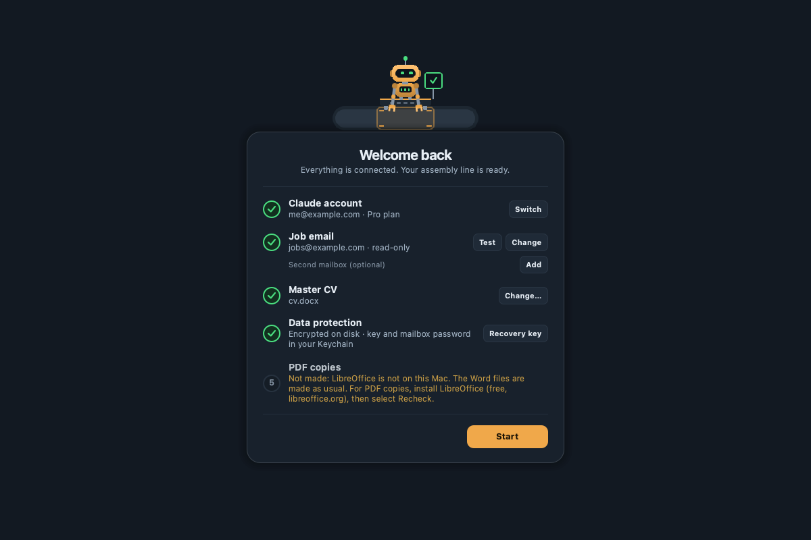

*Figure 2.1 – The welcome card*

### Install the app

1. Drag **JobHelper** into the **Applications** folder.
2. Double-click **JobHelper** in **Applications**.

### Open the app for the first time

JobHelper is not from the App Store, so macOS does not know it. The first time you open it,
macOS stops it and shows a message. Do these steps one time:

1. On the message, select **Done**.
2. Open **System Settings**, then select **Privacy & Security**.
3. Scroll down to the line that names JobHelper, then select **Open Anyway**.
4. Type your Mac password, if macOS asks for it.
5. Select **Open Anyway** again. The window of JobHelper opens.

After this, JobHelper opens like any other app.

The first time the assistant fills in a form, macOS asks if JobHelper may control Google
Chrome. Select **Allow**. Without this, the assistant cannot read or fill in a form.

JobHelper does not need your Desktop, your Downloads, your music, removable disks or the data
of other apps. If macOS asks for one of them, select **Don't Allow**. When you choose a file
yourself (your CV, for example), macOS gives the app that one file.

### Prerequisites

You need:

- JobHelper installed on your Mac and its window open.
- A Claude subscription, and the Claude Code program signed in on this Mac.
- Your CV as a `.docx`, `.pdf` or `.txt` file.
- Optional: the mailbox you apply from, and a password for a program to read it (for Gmail
  and most other providers, an *app password*).

### What the welcome card checks

Table 2.1 lists the five checks.

*Table 2.1 – What the welcome card checks*

| Row | What it is | Why it is needed | Required |
|---|---|---|---|
| **Claude account** | The Claude sign-in on this Mac | Scoring and writing are done by Claude | Yes |
| **Job email** | The mailbox you apply from, opened read-only | So that replies update your applications by themselves | No |
| **Master CV** | Your one true CV | Every adapted CV is made from it and may only say what it says | Yes |
| **Data protection** | Encryption of your job data, with the key in the macOS Keychain | Your applications and replies are private | Yes |
| **PDF copies** | LibreOffice, a free program that makes a PDF copy of each Word file | Some forms accept only PDF files | No |

A search can start only when the required rows are green. Without the email row everything
works except reading replies. Without LibreOffice, the app makes the Word files but no PDF
copies. To get PDF copies, install LibreOffice from libreoffice.org, then select **Recheck**.

### Sign in to Claude

1. On the welcome card, find the **Claude account** row.
2. Select **Sign in with Claude**. A browser window opens.
3. Sign in with the account that has your subscription.
4. Return to the app. The row turns green within a few seconds.

### Choose your master CV

1. On the **Master CV** row, select the **Change…** button.
2. Pick your CV file.
3. The row shows the file name and turns green.

> **Tip**
> A `.docx` whose sections are headed PROFILE and KEY SKILLS gives the best result: the app
> can then adapt both sections for each job. With other files it rewrites the profile
> paragraph only.

### Connect your mailbox

1. Get a password for a program from your mail provider (the table below). For Gmail: turn on
   **2-Step Verification** in your Google account, then create an **App Password** and name it
   "JobHelper".
2. On the **Job email** row of the welcome card, select **Connect** (or **Change**).
3. Enter the address. The line under the fields then shows the server that the app reads from.
   It also shows the type of password that the provider wants.
4. Enter the password. If the app does not know the provider, a third field appears. Enter the
   provider's **IMAP server** in it, for example `imap.example.com`. The provider's help pages
   give this name.
5. Select **Save**. The button says **Checking…** while the app signs in to the mailbox once
   with what you entered. A refused password is not saved, and the card says so in red (Table 2.2).

*Table 2.2 – Mail providers and the password each one wants*

| Your address is at | Read from | Password to enter |
|---|---|---|
| Gmail | `imap.gmail.com` | A Google App Password (16 letters) |
| Yahoo, AOL | The provider's server | An app password from the account's security settings |
| iCloud | `imap.mail.me.com` | An app-specific password from your Apple account |
| Fastmail, Zoho | The provider's server | An app password |
| Seznam, GMX, WEB.DE | The provider's server | Your mailbox password, with IMAP turned on in the mailbox settings |
| A company or another provider | The **IMAP server** you type | What that provider gives for reading mail by IMAP |
| T-Online, Posteo, mailbox.org, Orange, Libero, Onet | The provider's server | What the line under the fields says for that provider |
| A Russian mail service | Not used | The app does not work with Russian services. Connect a mailbox at another provider |
| Outlook.com, Hotmail, Proton Mail, Tuta | Not possible | These cannot be read with a password. Forward your job mail to another mailbox and connect that one, or paste replies into their applications (section 11) |

> **Note**
> An app password is a separate password that only lets a program read mail. You can cancel it
> in your account at any time without changing your real password. Where a provider offers
> one, never enter your real password in the app.

### Add a second mailbox (optional)

Use this when replies arrive at two addresses, for example an old address and a new one.

1. On the welcome card, under the **Job email** row, find **Second mailbox (optional)**.
2. Select **Add**.
3. Enter the second address and its own password, then select **Save**. It may be at another
   provider than the first one.

Each email scan then reads both mailboxes. To find older replies in the new mailbox, run one
longer scan (section 12, *Look further back once*). A problem with the second mailbox never
stops the scan of the first one. The app tells you about the problem at the end of the scan.

### Save your recovery key

Your job data is encrypted with a key that the app keeps in the macOS Keychain. The recovery
key is that key as one line of text. You need it to open your data on another Mac, or on this
Mac after the Keychain is reset.

1. Select the **Account** chip to open the card.
2. On the **Data protection** row, select **Recovery key**.
3. Select **Copy**, and paste the key into a password manager or another safe place outside
   this Mac.
4. Select **Hide key**. The key is also put away by itself after a minute, and when the card
   closes.

> **Warning**
> Anyone who has the recovery key can read your data. Do not send it by email or keep it in a
> plain note. Without it, your data cannot be opened on a new Mac.

### Open your data on a new Mac

When the key is missing from the Keychain, the **Data protection** row is red and asks for it.

1. Paste your recovery key into the field under the row.
2. Select **Open my data**.

The app checks that the key belongs to this data before it uses it.

### Test a connected mailbox

An app password can be cancelled at the provider without the app knowing. To check that the
mailboxes can still be read:

1. Open the **Account** card.
2. On the **Job email** row, select **Test**.

A green line says that the app signed in; a red line says what the mail server answered. Both
mailboxes are tried when you have two.

### Open the card again later

Select the **Account** chip in the left column of the main window. The three dots under the
chip (**Claude**, **Email**, **CV**) are the same checks at a glance.

### If something is wrong

Table 2.3 lists problems while setting up, and what to do.

*Table 2.3 – Problems while setting up, and what to do*

| What you see | Cause | What to do |
|---|---|---|
| **Claude account** stays red after you sign in | The sign-in was done in another browser profile, or was cancelled | Select **Sign in with Claude** again |
| "A paid API key is set" | A paid Claude key is set on this Mac | Ask whoever set up the app to remove it, then start the app again. The app never bills you per use |
| "The mail server refused this address and password" | The normal password was used where an app password is needed, the app password was cancelled, or it belongs to another address | Create an app password for this address and enter that one |
| "The app does not know this provider" | The address is at a company or a small provider | Enter its IMAP server in the third field |
| "Microsoft no longer lets a program read…" | Outlook.com and Hotmail cannot be read with a password | Forward your job mail to another mailbox and connect that one |
| "Saved. The mail server could not be reached" | No internet connection at that moment | Nothing. The first email scan shows whether it works |
| "Couldn't connect safely: the mail server's certificate is not trusted" | The server name is wrong, or your company's server uses its own certificate. A network (for example public Wi-Fi) can also show a false server. The app did not send your password | Check the server name. Then try again on a network that you trust |
| **Master CV** is red | No CV was chosen, or the file was moved | Select the **Change…** button and pick the file |

### Next steps

- [Find your way around the main window](#3-find-your-way-around-the-main-window)
- [Set your options](#16-set-your-options), to say what you are looking for

---

## 3. Find your way around the main window

Figure 3.1 shows the main window.

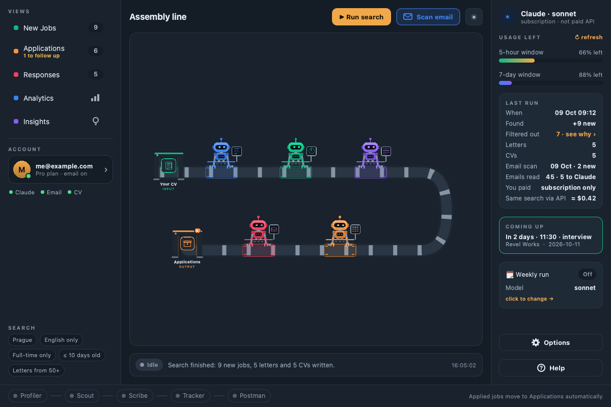

*Figure 3.1 – The main window*

The window has three columns and a strip at the bottom (Table 3.1).

*Table 3.1 – The areas of the main window*

| Area | Where | What it holds |
|---|---|---|
| Lists and account | Left | Your lists, the Account chip, the settings of the next search |
| Assembly line | Middle | The five robots, the assistant (section 9), the two run buttons, the status line |
| Where you stand | Right | Claude usage, the last run, the next date, the weekly run, Options, About you, Help |
| Pipeline strip | Bottom | The five agents by name, lit while they work |

### The left column

Figure 3.2 shows the lists and the account chip.

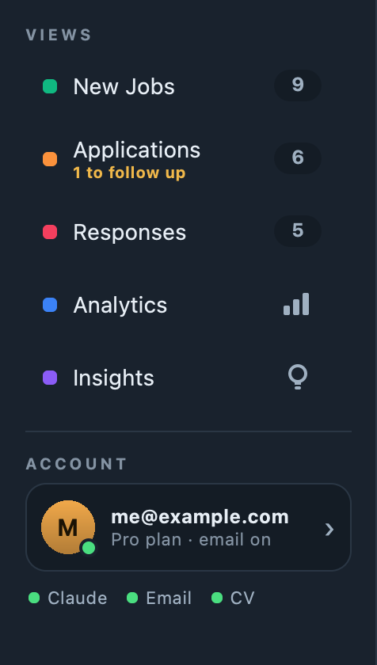

*Figure 3.2 – The lists and the account chip*

Table 3.2 describes the lists in the left column.

*Table 3.2 – The lists in the left column*

| Item | What it opens | The mark on the right |
|---|---|---|
| **New Jobs** | Postings found for you that you have not applied to | How many there are |
| **Applications** | Where you applied and where each one stands | How many there are |
| **Responses** | Every reply email the app has read | How many there are |
| **Analytics** | Outcomes and rejection reasons, added up | A bar chart |
| **Insights** | What your own results teach you | A light bulb |

A line under **Applications** appears when something needs you, for example "1 to follow up"
or "2 possible duplicates".

Under the lists:

- **Account**: the chip shows who is signed in. Select it to open the card from section 2.
- **Search**: chips that show what the next search is set to (city, language, full-time, age
  of postings, the score from which letters are written). Select a chip to change it in
  Options.

### The middle

Table 3.3 lists the controls in the middle.

*Table 3.3 – The controls in the middle*

| Control | What it does |
|---|---|
| **Run search** | Starts a search (section 4). While a run is going, it becomes **Stop** |
| **Scan email** | Reads new replies (section 12) |
| The sun or moon button | Switches between the dark and the light theme |
| A robot | Lights up while its agent works and shows a tick when it is done. Point at it for its name, its job and its latest result |
| The status line | Always says what is happening, or what just happened, with the time |

### The red line at the top

Figure 3.3 shows the red line of the start-up check.

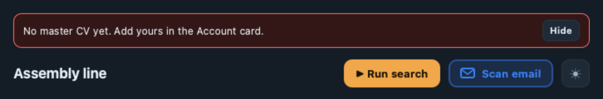

*Figure 3.3 – The start-up check found something*

Each time the app starts, it checks itself. It checks the data key, the job list, the
replies, the settings, the rule files, your master CV and the folders. If it finds a problem,
a red line at the top tells you what is wrong and how to fix it. **Hide** removes the line
until the next start. **Show all** appears when the app found more than one problem.

For some problems, the line has a button that fixes the problem:

- **Repair** appears when a job has a status that the app does not know. That job is in no
  list. Select **Repair**. The app makes a backup first. Then it gives each job a status that
  it knows and adds a note to the job.
- **Restore from backup** appears when the job list or the replies database is damaged. Select
  **Restore from backup**. The app puts back the newest backup copy that opens. It moves the
  damaged file into the backups, in the folder "damaged". Changes after the time of that copy
  are not in it.

When the fix is done, the line becomes green and tells you what changed. If the fix is not
possible, a red sentence under the line tells you why. You cannot use these buttons while a
search or a scan runs.

### The right column

Figure 3.4 shows the Usage left card and the Last run card.

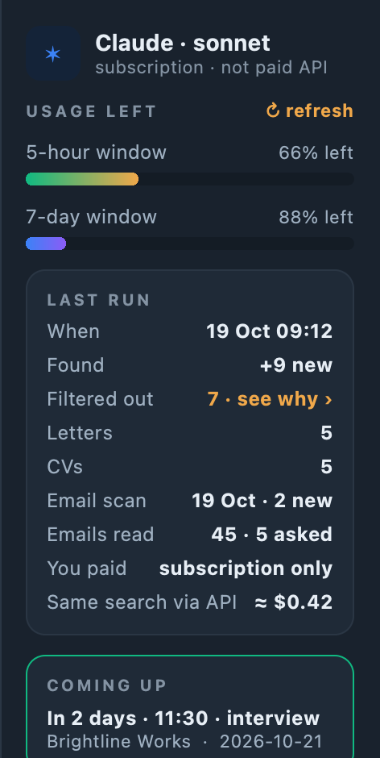

*Figure 3.4 – Usage and the last run*

Table 3.4 lists the cards in the right column.

*Table 3.4 – The cards in the right column*

| Card | What it tells you |
|---|---|
| **Claude** | The model in use, and that the subscription is used, not the paid API |
| **Usage left** | How much of your Claude limit remains (section 18). **refresh** asks Claude for the current numbers |
| **Last run** | What the last search and the last email scan did (the table below) |
| **Coming up** | The next dated event, such as an interview |
| **Weekly run** | Whether a weekly run is scheduled. Select it to change the schedule (section 17) |
| **Options** | Opens the settings (section 16) |
| **About you** | Opens your salary, right to work, start date and the notes about your work (section 16) |
| **Help** | A short version of this guide, and the list of changes |

The rows of the **Last run** card (Table 3.5):

*Table 3.5 – The rows of the Last run card*

| Row | Meaning |
|---|---|
| **When** | Day and time of the last search |
| **Found** | How many new postings it added |
| **Filtered out** | How many postings it dropped. Select the number to see each one with its reason (section 14) |
| **Letters**, **CVs** | How many of each were written |
| **Email scan** | Day of the last email scan and how many new replies it filed |
| **Emails read** | How many messages that scan went through, and how many of them were worth a question to Claude ("1224 · 43 asked"). It explains a "0 new": most mail was read before, or is not about an application |
| **You paid** | *subscription only*: nothing was billed for the run |
| **Same search via API** or **Same scan via API** | What the last run alone would have cost with pay-per-use billing. It is a measure of how much work was done, not a bill |

### The JobHelper widget

The JobHelper widget shows your job search on the desktop of your Mac, also when the window is
closed. It has four sizes (Figure 3.5, Figure 3.6, Figure 3.7 and Figure 3.8).

To add the widget:

1. Open JobHelper one time, so that it can write what the widget shows.
2. Right-click an empty area of the desktop, then select **Edit Widgets**.
3. In the search field, type **JobHelper**.
4. Select a size, then drag the widget to the desktop or to the Notification Center.
5. Select **Done**.

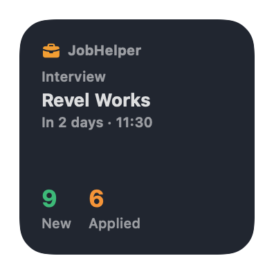

*Figure 3.5 – The small widget*

*Figure 3.6 – The medium widget*

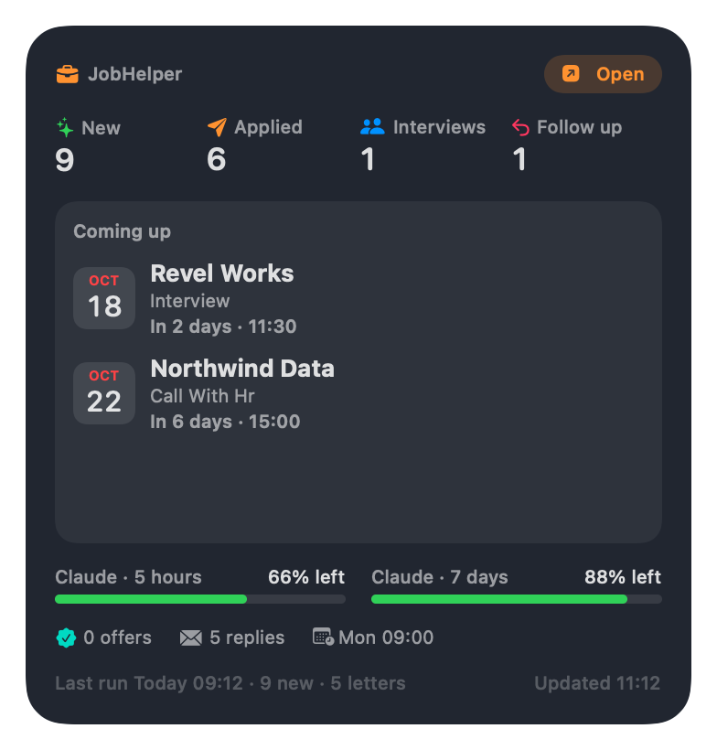

*Figure 3.7 – The large widget*

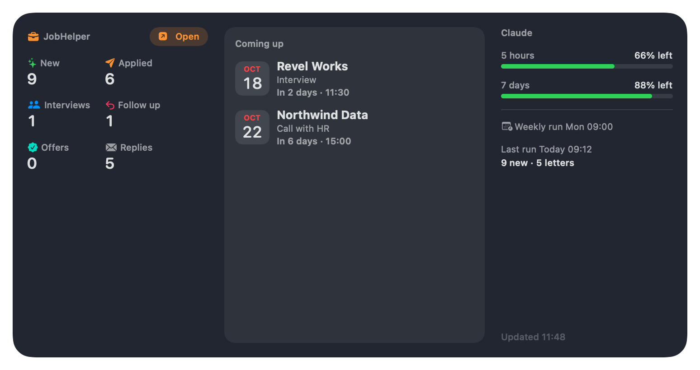

*Figure 3.8 – The extra large widget*

Table 3.6 lists what each size shows.

*Table 3.6 – What the widget shows*

| Size | What it shows |
|---|---|
| Small | The next date, and the number of new jobs and applications |
| Medium | The next date, the new jobs, applications, interviews and follow-ups, and the Claude usage of the 5-hour window |
| Large | All of the numbers, the next three dates, the last run, both Claude usage windows, offers, replies and the weekly run |
| Extra large | All of the numbers, the next five dates, both Claude usage windows, the weekly run and the last run, side by side |

The widget gets new numbers every 15 minutes. The app writes them when it starts, after each
change, every 5 minutes while it is open, and after the weekly run. When the numbers are older
than a day, the widget tells you to open the app. A Claude usage figure that is more than one
hour old shows as "–", because the widget has no space for its time.

To open the app, select **Open** on the medium or the large widget. You can also click anywhere
on a widget of any size.

The widget cannot open your encrypted data. The app writes a short summary for it, in the
folder JobHelper of your Library. The summary contains numbers, the companies and roles of the
next dates, and their days and times. It contains no letters, CVs, emails or notes. Only you
can read the file.

### Next steps

- [Run a search](#4-run-a-search)

---

## 4. Run a search

A search finds new postings and removes the ones that cannot fit. It scores the other postings
against your CV. For each good posting, it writes an adapted CV and a cover letter.

### Prerequisites

- The **Claude account** and **Master CV** rows of the Account card are green.
- A city and at least one search role are set in Options (section 16).

### Start a search

1. In the main window, select **Run search**.
2. Watch the assembly line. You can keep using the lists while it runs.
3. When the status line says the search is finished, open **New Jobs**.

Figure 4.1 shows a search in progress.

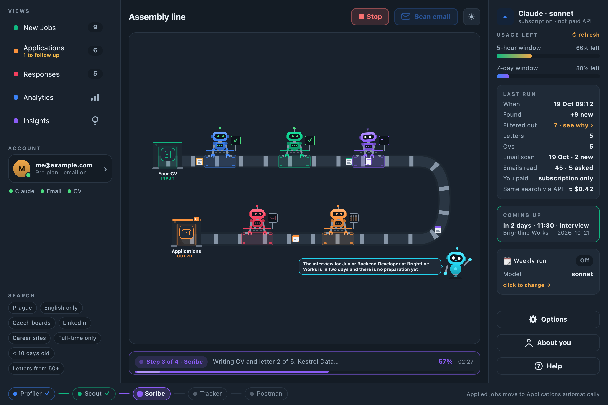

*Figure 4.1 – A search in progress*

### What happens, in order

Table 4.1 lists what a search does, step by step.

*Table 4.1 – What a search does, step by step*

| Step | Robot | What it does |
|---|---|---|
| 1 | **Profiler** | Reads your CV. Only when the CV changed since last time |
| 2 | **Scout** | Asks the job boards for each of your search roles in your city |
| 3 | **Scout** | Drops what cannot fit, and keeps every dropped posting with its reason |
| 4 | **Scout** | Reads once more the postings that came back empty, and asks older postings whether they still accept applications |
| 5 | **Scribe** | Scores what is left, five postings per Claude call |
| 6 | **Scribe** | Writes an adapted CV and a letter for each posting at or above your limit |
| 7 | **Tracker** | Rebuilds the Excel tables |

What step 3 drops:

- Postings written in another language, and roles that require one at a working level
  (with **English only** on). The reason names the language.
- Titles above your level.
- Part-time work, when you want full-time.
- Postings older than your limit.
- Roles you already applied to.
- Titles that contain a word you chose to skip.

> **Note**
> Scoring costs a Claude call. A posting whose title is plainly another profession is marked
> **skipped** without a call. You can send any skipped posting to scoring yourself with
> **Score it anyway** in its window.

### Stop a search

Select **Stop**. The search ends after the step in progress. Everything finished before that
is kept, and the next search continues with what was not done.

### If Claude's limit runs out

The run pauses instead of failing. See [Watch your Claude usage and limits](#18-watch-your-claude-usage-and-limits).

### If something is wrong

Table 4.2 lists problems with a search, and what to do.

*Table 4.2 – Problems with a search, and what to do*

| What you see | Cause | What to do |
|---|---|---|
| "No city yet" | Options has no city | Open Options and choose a city |
| The search finds nothing new | Your roles are too narrow, or everything was filtered | Open **Filtered out** on the Last run card (section 14) |
| Too many poor postings | The filters are too loose | Add words to **Skip titles with**, or set **Kinds of role you want** |
| A source is missing from the results | That site turned programs away this time | Nothing to do. The app leaves such a site alone and tries again at the next search |

### Next steps

- [Review new jobs](#5-review-new-jobs)

---

## 5. Review new jobs

**New Jobs** is the list of postings found for you that you have not applied to, best score
first (Figure 5.1).

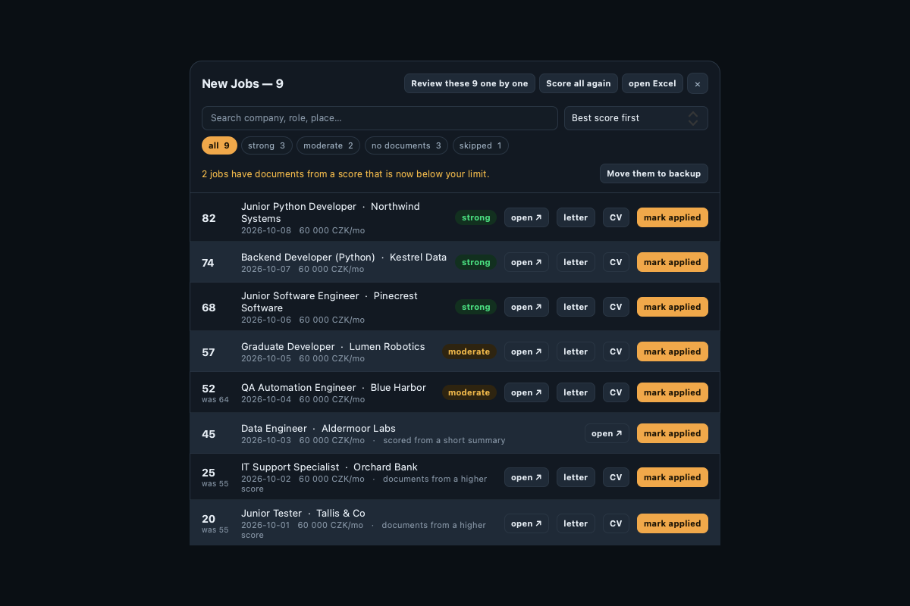

*Figure 5.1 – The New Jobs list*

### Read a row

Table 5.1 explains how to read a row.

*Table 5.1 – How to read a row of New Jobs*

| You see | It means |
|---|---|
| The number on the left | The score, 0 to 100: how well the posting fits your CV and the roles you want |
| **was 64** under the number | What the job scored before it was scored again |
| **strong** | 60 or more. A CV and a letter were written |
| **moderate** | 50 to 59. A CV and a letter were written |
| No badge | Below your limit. Listed so that you can judge for yourself; no documents were written |
| **skipped** | Not scored at all, to save a Claude call (section 4) |
| The grey line | When it was posted, the salary you ask for (section 16), and any warning about the score |
| **closed** | The posting no longer accepts applications |
| **scored from the title only**, **scored from a short summary** | The score rests on little text (section 8) |
| **documents from a higher score** | The job fell below your limit after its documents were written (section 8) |

### Apply to a job

1. Select the row to open the job (section 6).
2. Read **Why this score**, then check the CV and the letter (section 7).
3. Select **Open posting** and apply on the company's site with the two files.
4. Return to the app and select **Mark applied**.

> **Important**
> Select **Mark applied** only after you really sent the application. The job moves to
> **Applications**, and replies are matched to it from then on.

### Controls of the list

Table 5.2 lists the controls of the New Jobs list.

*Table 5.2 – The controls of the New Jobs list*

| Control | What it does |
|---|---|
| The search box | Shows only the rows that contain what you type |
| The chips under it | Filter the list |
| The buttons on a row | Open the posting, the letter and the CV |
| **mark applied** | Moves the job to Applications |
| **Score all again** | Scores every job with your current Options. It asks first, because it uses your Claude limit |
| **open Excel** | Opens the same list as an Excel table |

### Review several jobs one by one

Many jobs can wait for a decision, for example all the jobs marked **stretch**. You do not
have to open each job from the list and then go back to the list.

1. In **New Jobs**, show only the jobs that you want to go through. Select a chip, or type
   in the search box.
2. Select **Review these … one by one**. The first job opens, with a bar that says where you
   are (Figure 5.2).
3. Read **Why this score**, then decide: **Not interested** removes the job, **Mark applied**
   moves it to Applications. The next job opens by itself.
4. To leave a job as it is, select **Next ›**. **‹ Previous** goes back.

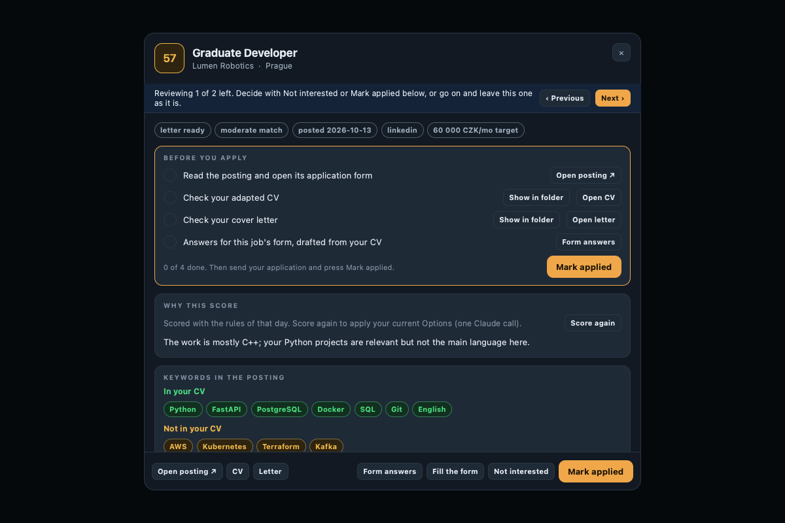

*Figure 5.2 – Reviewing jobs one by one*

The round ends after the last job, or when you close the window. Jobs you did not decide on
stay in the list as they were.

### Next steps

- [Work with one job](#6-work-with-one-job)

---

## 6. Work with one job

Select a row in **New Jobs** to open the job's window. Everything about one posting is here (Figure 6.1).

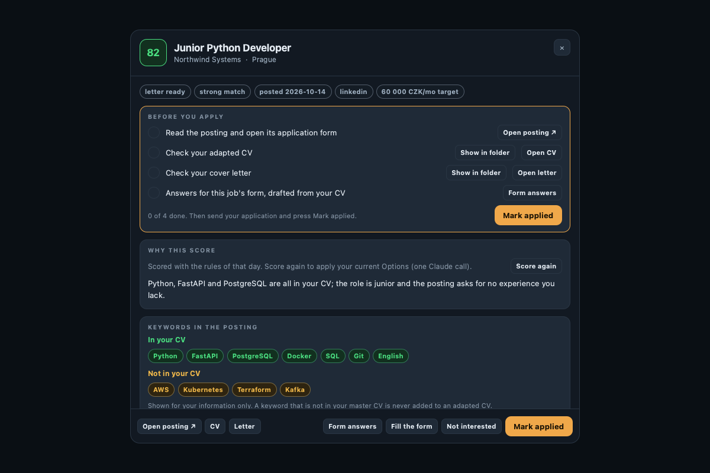

*Figure 6.1 – The job window*

### The checklist: Before you apply

The checklist has one line per step. Tick the steps as you go. The ticks are remembered for
this job (Table 6.1).

*Table 6.1 – The checklist of a job and its buttons*

| Line of the checklist | Its button | What the button does |
|---|---|---|
| Read the posting and open its application form | **Open posting** | Opens the posting in your browser |
| Check your adapted CV | **Open CV** or **Open CV PDF** | Opens the adapted CV |
| Check your cover letter | **Open letter** or **Open letter PDF** | Opens the letter |
| If the form takes one file | **Make one PDF** | Makes one PDF with the letter first and the CV after it |
| Answers for this job's form | **Form answers** | Drafts answers for the application form (section 7) |

**Show in folder** on a line selects that file in Finder, so that you can drag it into an
application form.

The row of buttons at the bottom of the window opens the same documents again and adds two
more (Table 6.2):

*Table 6.2 – The two extra buttons for documents*

| Button | What it does |
|---|---|
| **Compare CV** | Shows what was changed in the adapted CV (section 7) |
| **Edit letter** | Opens the letter editor (section 7) |

### Why this score

Figure 6.2 shows the score and the keywords.

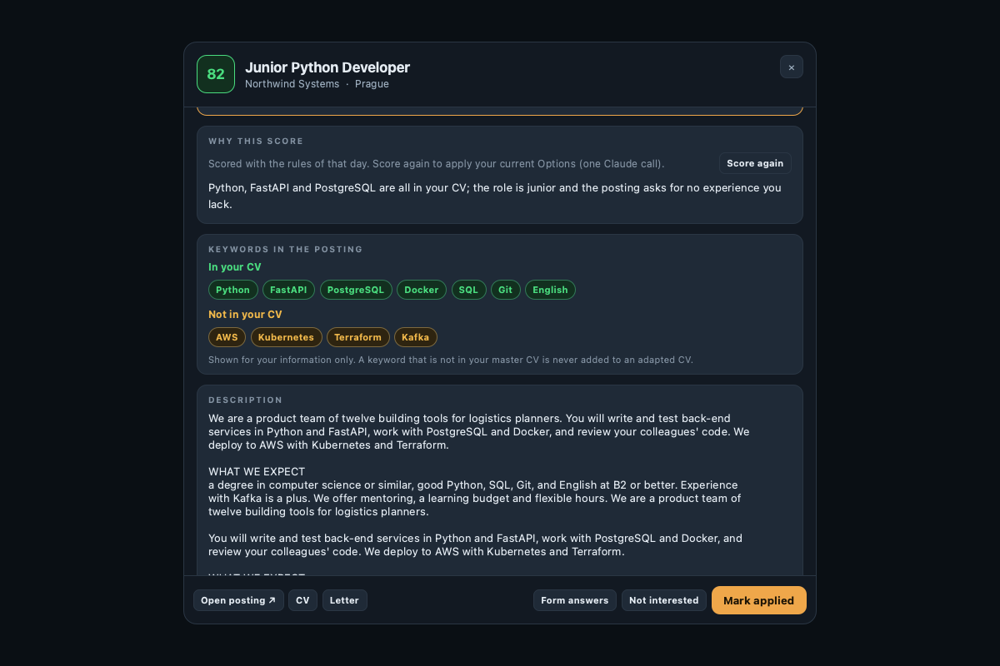

*Figure 6.2 – The score and the keywords*

**Why this score** is the reason in words. Read it before you apply to anything below
**strong**: it tells you what the posting asks for that your CV does not show.

**Keywords in the posting** compares the skills and tools the posting names with your CV (Table 6.3).

*Table 6.3 – The two groups of keywords*

| Group | Meaning |
|---|---|
| **In your CV** | The posting asks for it and your CV shows it |
| **Not in your CV** | The posting asks for it and your CV does not show it. Something to learn, or something you know and forgot to write down |

> **Note**
> The app never adds a **Not in your CV** word to an adapted CV. If you really have that
> skill, add it to your master CV, or describe it under **More about your work** in **About you**.

### The buttons at the bottom

Table 6.4 lists the buttons at the bottom of the job window.

*Table 6.4 – The buttons at the bottom of the job window*

| Button | What it does |
|---|---|
| **Form answers** | Drafts answers for this job's application form (section 7) |
| **Fill the form** | Opens the assistant for this job, to fill in the form that is open in your browser (section 9) |
| **Score it anyway** | Sends a skipped job to scoring |
| **Not interested** | Removes the job from the list. Its documents go to an encrypted backup |
| **Mark applied** | Moves the job to Applications |

> **Note**
> If you typed something in this window and did not save it, the ✕, the Esc key, **Mark
> applied** and **Not interested** all ask once before the text is discarded.

### Next steps

- [Check and edit your documents](#7-check-and-edit-your-documents)

---

## 7. Check and edit your documents

For each posting at or above your limit the app writes two documents. Check both before you
send them. You are the one who signs them.

### The adapted CV

The app makes a copy of your CV for each job. In the copy, it rewords the profile paragraph
and the skills list. It also puts first what this posting asks for. All other parts stay as
you wrote them.

**To see what changed:**

1. Open the job.
2. Select **Compare CV**.
3. Read the two columns: your master CV on the left, the adapted one on the right. New words
   are in bold (Figure 7.1).

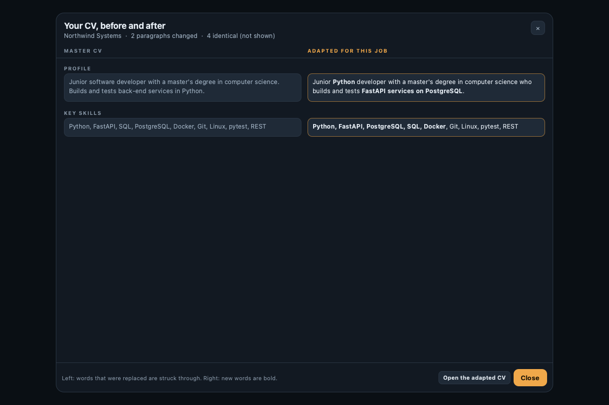

*Figure 7.1 – Master CV next to the adapted one*

> **Tip**
> Use this view to check that nothing was stretched. Every claim on the right must be one you
> can back in an interview.

Sometimes the job window shows an amber line with a few terms. The line says **Check your
adapted CV before you send it** or **Check your cover letter before you send it**. These terms
come from the posting. The adapted CV states them as your experience, but your own CV does not
mention them. In a letter, the line marks only a sentence that says you did it, not a sentence
about the role. The app already asked Claude once to remove these terms. A term that is left
can still be a fair word for work that you did. So you decide. Keep the term only if it is
true. If it is not true, edit the Word file. You can also add what you really did under **More
about your work** in **About you**.

The line **Check the figures in your cover letter** names a number, for example a percentage.
Your CV and your own notes do not give that number. Keep the figure only if it is true. If it is not true, select
**Edit letter** and change the sentence.

### The cover letter

The letter is written to the company, about this role, from the facts in your CV.

**To edit a letter:**

1. Open the job and select **Edit letter**.
2. Change the words of any paragraph yourself.
3. To have one paragraph written again, type what to change in **For a rewrite**, for example
   "shorter". Then select **Rewrite this paragraph**.
4. Select **Save**. The Word file and the PDF are updated.

Figure 7.2 shows the letter editor.

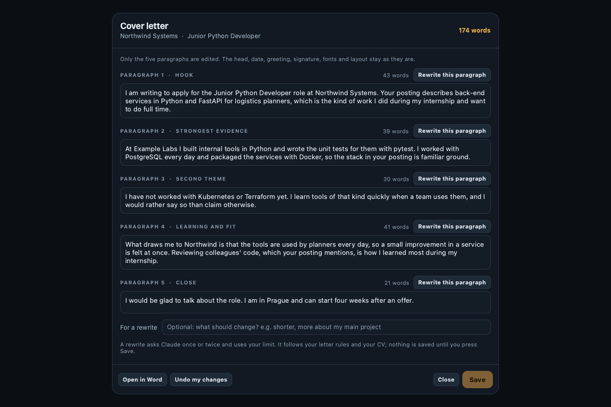

*Figure 7.2 – The letter editor*

Table 7.1 lists the controls of the letter editor.

*Table 7.1 – The controls of the letter editor*

| Control | What it does |
|---|---|
| The word count, top right | Turns amber when the letter is shorter or longer than a letter should be |
| **Rewrite this paragraph** | Asks Claude for a new version of that paragraph. The new version keeps about the same length, and the letter stays on one page. Nothing is saved until you select **Save** |
| **For a rewrite** | An optional hint for the rewrite |
| **Open in Word** | Opens the file in Word instead |
| **Undo my changes** | Puts back the text as it was when you opened the editor |
| **Save** | Writes the paragraphs into the letter. The head, date, greeting, signature, fonts and layout stay as they are |
| **Close**, the **✕** or the Esc key | Closes the editor. With unsaved changes they ask once |

> **Note**
> Closing the editor with unsaved changes asks once. The previous version of a saved letter is
> kept in an encrypted backup.

### Have documents written for one job

A search writes documents only for jobs at or above your limit. For any other new job you can
have them written when you decide to apply after all, or after the job was scored again.

1. Open the job.
2. Under **Why this score**, select **Write CV and letter**. The app asks Claude; this takes
   about a minute.
3. When the line says **Written**, check both documents as usual.

The app never replaces a letter that you wrote yourself. It writes only what is missing. If
the text of the posting is missing, the app first asks you to read the posting again
(section 8). A letter from the title alone would be too general.

### Your own letters

A letter that **you** wrote is never touched.

1. Open **About you** and find **Your own letters**. Select **Open folder**.
2. Put your letter in that folder, named after the company.
3. At the next search the app uses your letter for that company instead of writing one.

If the folder has a Word file and a PDF for the same company, the app uses the Word file.

### Form answers

Application forms ask their own questions, and every form asks different ones.

1. Open the job and select **Form answers**.
2. Paste that form's questions, one per line.
3. Select **Draft**.
4. Read each answer. Fill in anything marked with square brackets.
5. Copy the answers into the form.

Figure 7.3 shows answers for one job's form.

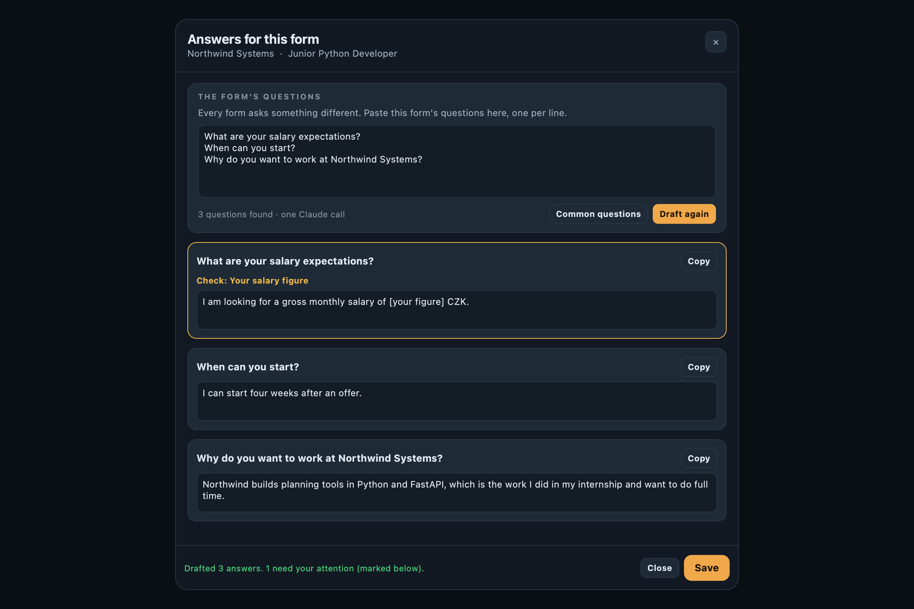

*Figure 7.3 – Answers for one job's form*

The answers come from your CV, the posting, and the facts in **About you**. Some
answers need a fact that the app does not know, such as a salary figure, a date or a
reference. The app then puts the missing part in square brackets and adds a **Check** note.
A **Check** note also names a figure, such as "40%", that your CV and your details do not give.
The answers stay with the job (Table 7.2).

*Table 7.2 – The limits of one draft of form answers*

| Limit | Value |
|---|---|
| Questions in one draft | Up to 15 |
| Length of one question | Up to 300 characters |

### Next steps

- [Track an application](#11-track-an-application), after you applied

---

## 8. Fix a score you cannot trust

Two situations make a score misleading. The app marks both in the list and in the job's window.

### The posting could not be read in full

Some job boards return only a title or a short summary. The row then says **scored from the
title only** or **scored from a short summary** (Table 8.1).

*Table 8.1 – What the app does when a posting could not be read*

| Mark | What the app did |
|---|---|
| **scored from the title only** | Capped the score at 40 and wrote no documents, because a letter written from a title could only be generic |
| **scored from a short summary** | Scored from what there was, and tells you so |

**To get a real score:**

1. Open the job.
2. Select **Read it again**. The app asks the job board once more.
3. If that does not help, select **Open posting**. Copy all the text of the posting in your
   browser. Paste it under **Paste the posting's text**, then select **Save text**.

Either way, the job is then scored again by itself.

### The score dropped after documents were written

If you tighten your Options and score again, a job that had a letter and a CV can fall below
your limit. Its row says **documents from a higher score** (Figure 8.1).

*Figure 8.1 – A job that fell below the limit*

**For one job:** open it and select **Move documents to backup**. The letter and the CV go to
an encrypted backup. The job stays in the list. **Put them back** returns them.

**For all such jobs at once:**

1. Open **New Jobs**. A bar above the list says how many jobs have documents from a score
   that is now below your limit.
2. In that bar, select **Move them to backup**.
3. Read the jobs it names, then select **Yes, move documents of …** to confirm.

Figure 8.2 shows moving documents for several jobs at once.

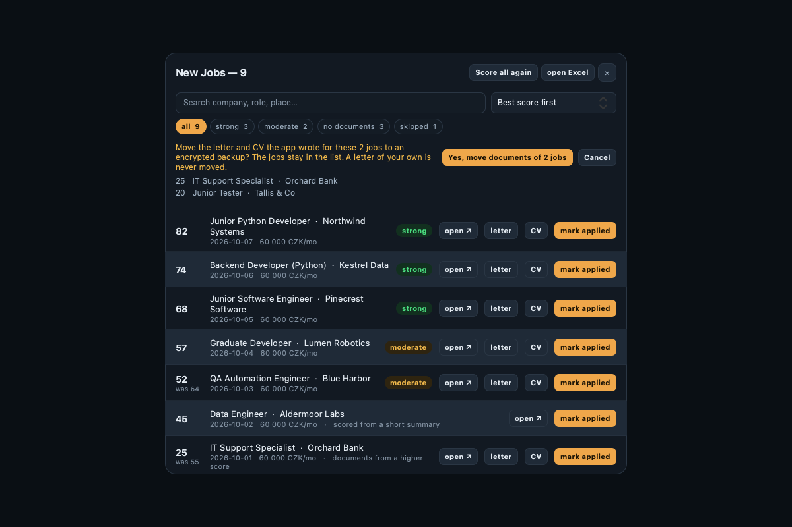

*Figure 8.2 – Moving documents for several jobs at once*

For one week after the move, **Put them back** in the same bar undoes the whole move. For one
job, **Put them back** stays in the job's window. It stays there also if the job became an
application in the meantime, because a reply showed that you applied. Then these documents are
the documents that you sent.

> **Note**
> Nothing the app wrote for you is thrown away without a way back. You may have had a reason
> to apply anyway. Letters you wrote yourself are never moved.

---

## 9. Fill in an application form

Most companies ask you to fill in a form on their own site. The form asks again for your name,
your contacts and a few links, and it asks some questions of its own. The **assistant** does the
typing. It is the light-blue robot at the end of the assembly line (Figure 9.1). It blinks, it
waves when the app opens, and it opens its window when you select it.

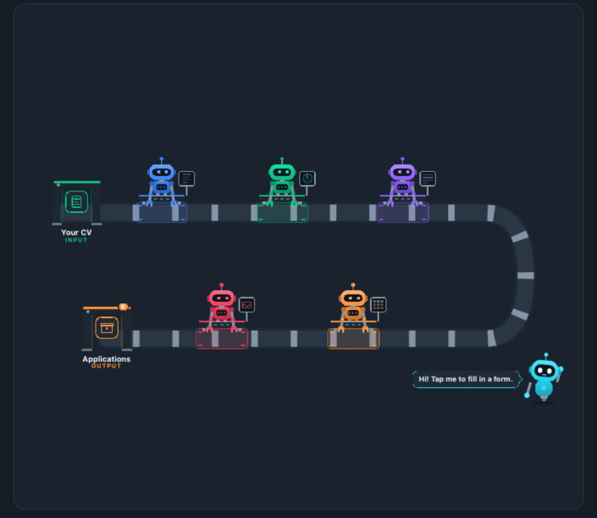

*Figure 9.1 – The assistant at the end of the assembly line*

The assistant fills in the form that is open in Google Chrome. You can also choose Brave, Edge,
Opera or Safari (section 10). It cannot work in Opera GX or Firefox. It writes only into empty
fields. On a page, it presses only these things:

- a menu, and an entry of a menu
- a yes/no button
- a button that adds a row for another job or degree
- the box that says you work at a job now, and the box that says you are fluent in a language

It never presses a button that sends or continues. It never ticks a box that agrees to
something, and it never sends the form. You read what it wrote, and you send the form
yourself.

When the pointer is over the assembly line, the assistant follows it with its eyes. It nods
when a request worked and shakes its head when it did not.

### Prerequisites

- Google Chrome or another browser the assistant works in (section 10), with the application form open in a tab.
- Your details saved in the assistant's window (the first task below).
- For answers to the form's own questions: the job is in **New Jobs** or **Applications**, and
  your master CV is set.

### Tell the assistant your details

Do this once. The details are kept encrypted on your Mac, and a form gets exactly what is
written here (Figure 9.2).

1. Select the assistant on the assembly line.
2. Select **My details**. The first time, the window opens on this page by itself.
3. Fill in the fields at the top. Table 9.1 describes them. Fields marked **from your CV** were
   read from the head of your CV and are not saved yet: check them.
4. List your jobs and your degrees, give your salary, and add the files forms ask for. The
   tasks below describe each.
5. Select **Save**.

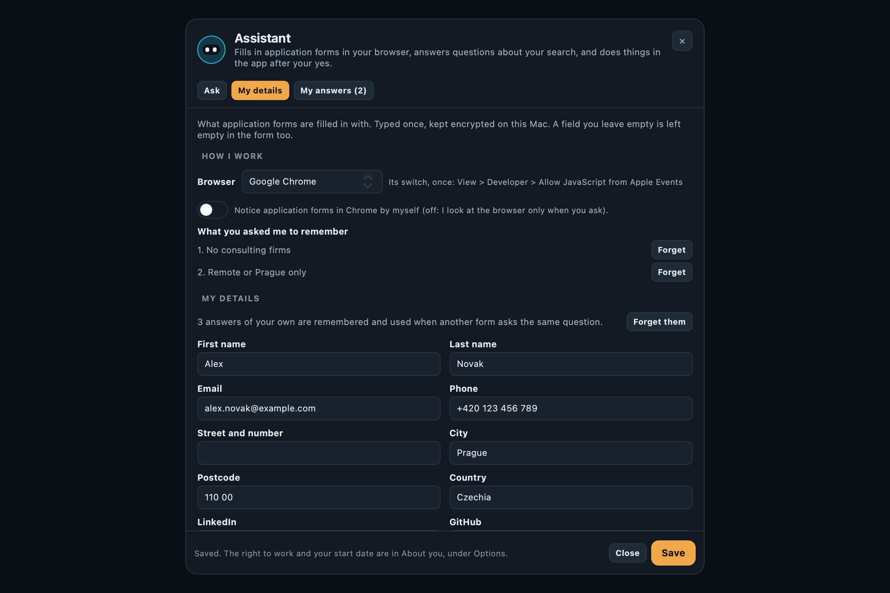

*Figure 9.2 – The My details page*

*Table 9.1 – The fields of My details*

| Field | What to enter | Checked for |
|---|---|---|
| **First name**, **Last name** | Your name as you want it on applications | Letters only |
| **Email** | The address you apply from | A name, an @ and a domain |
| **Phone** | Your number with the country code, like *+420 123 456 789* | 6 to 15 digits; + only at the start |
| **Street and number**, **City**, **Postcode**, **Country** | Your address. Leave out what you do not want to give | Letters for the city and the country |
| **LinkedIn**, **GitHub** | The address of your profile. *https://* is added for you | An address at that site, with no spaces |
| **Website or portfolio** | Any other page about your work | A web address with no spaces |
| **Notice period** | How soon you can leave, like *1 month*. The assistant also picks it from a list that offers it | Length only |

A field you leave empty is left empty in the form too. When something is wrong, the field
turns red and the line under it says what to change; nothing is saved until it is right.

> **Note**
> Your right to work and your start date are not on this page. They are in **About you**
> (section 16), because letters and answers use them as well. The assistant
> takes your start date from there when a form asks for it.

### List your jobs and your degrees

Many forms have a section for work experience and one for education, with a row for each job
and each degree. The assistant fills those rows from two lists (Figure 9.3).

1. On the **My details** page, under **Work experience**, select **Add a job** for each job
   that you had. Or select **Read from my CV**. Then Claude copies, in one call, the jobs and
   degrees from your CV. For each job, it copies the place and the lines under the job, word for
   word. A line that your CV does not show is not copied. The app saves nothing until you
   select **Save**.
2. Fill in each job. Table 9.2 describes the fields. Turn on **I work here now** for every job
   that goes on; several jobs may be current at once.
3. Under **Education**, select **Add a degree** for each degree, the highest first.
4. Select **Save**.

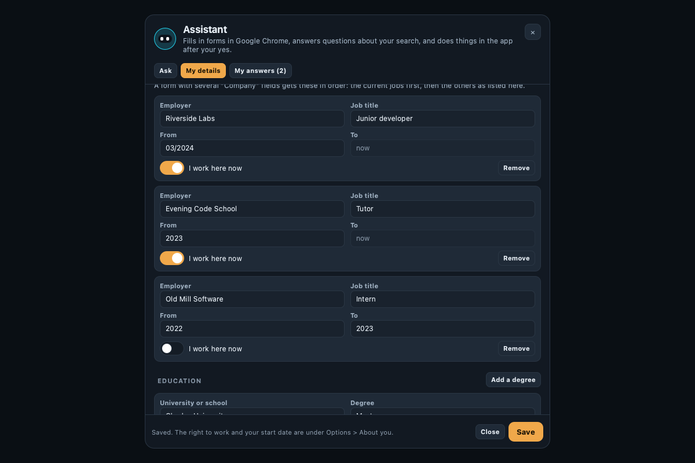

*Figure 9.3 – Jobs and degrees on the My details page*

*Table 9.2 – The fields of a job and of a degree*

| Field | What to enter | Checked for |
|---|---|---|
| **Employer**, **Job title** | As you want them written in forms | Both are needed for a job |
| **University or school** | The name of the school | Needed for a degree |
| **Degree**, **Field of study** | For example *Master* and *Computer science* | Length only |
| **From**, **To** | A year, or a month and a year: *2023* or *03/2023* | The form of the date; **To** not before **From** |
| **I work here now** | On for a job that goes on. **To** is then left empty | A current job has no end date |
| **Where it was** | The place of that job, for example *Brno, Czechia* | Length only |
| **What you did there** | What your CV says under that job, one point per line. Forms ask for it inside each job, as "Role description" or "Responsibilities" | Up to 2,000 characters |

A form that asks for one employer gets your current job. A form with several rows gets your
current jobs first, then the others in the order of the list; each row gets one job, whole.
When a form has more rows than you have jobs, the extra rows are left to you.

> **Note**
> When a form shows fewer rows than you have jobs or degrees and has a button such as **Add
> another job**, the assistant presses it once for each missing row. It presses no other
> button. It writes the dates of a job where the form takes a month and a year, and ticks
> the box **I currently work here** for a job you marked as current.

### List your languages

Some forms ask for each language you speak and how well, in a block of its own for each one.

1. On the **My details** page, under **Languages**, select **Add a language** for each one.
   **Read from my CV** fills an empty list from your CV.
2. Enter the language and its level: **Native**, **Fluent**, **Advanced**, **Intermediate** or
   **Basic**. Any other word is refused.
3. Select **Save**.

The level is what forms are told, so set it as you would say it yourself. The assistant looks
for that level in the form's own words: *Fluent* is also "Full professional" or "C1". When a
form has no entry for *Native*, it chooses *Fluent*. A scale of bare numbers says nothing about
their meaning, so such a list is left to you.

### Give your salary and add your files

Figure 9.4 shows the last two parts of the page.

1. Under **Salary expectation**, enter the figure as a whole number. Choose the currency, and
   choose **per month** or **per year**. A form that asks then gets, for example, *60 000 CZK
   gross per month*. If you leave the figure empty, the assistant uses the figure in
   **Options**. If there is none, it leaves the question to you.
2. Under **Files for forms**, select **Add a file…** for each certificate, diploma or reference
   that a form can ask for. Give each file a short name.
3. Select **Save**.

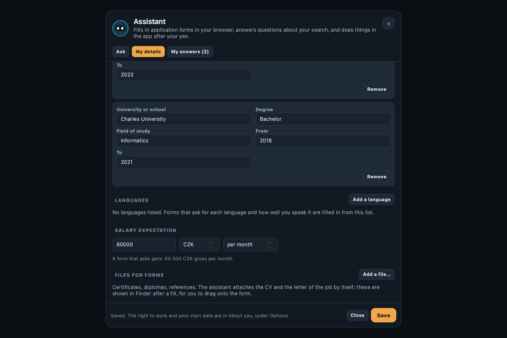

*Figure 9.4 – The salary and the files on the My details page*

The assistant attaches the CV and the letter of the job by itself. It does not attach your
other files. After a fill, **Show my CV and letter in Finder** selects them in Finder. Then you
drag them onto the form.

### Answer the questions every form asks

Some questions come back in almost every form: when you can start, what your strengths are,
why you are looking. Answer them once on the **My answers** page (Figure 9.5), and every form
that asks gets your wording, without a Claude call.

1. In the assistant's window, select **My answers**.
2. Select one of the suggested questions, or **Add a question** and type the question as
   forms ask it.
3. Write the answer, or select **Draft with Claude**: Claude drafts it from your CV in one
   call. Read the draft and make it yours.
4. Select **Save** on the answer.

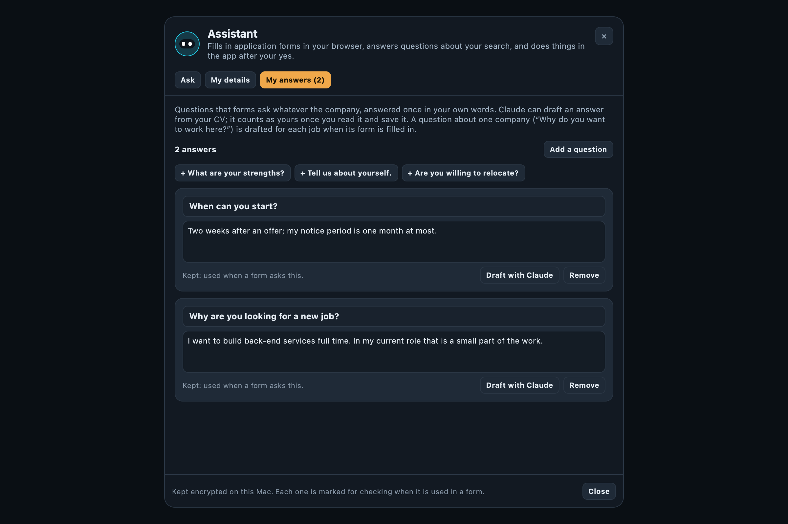

*Figure 9.5 – The My answers page*

The app marks an answer for checking each time it uses it. Some questions are about one
company, for example "Why do you want to work here?". These cannot have one answer for all
companies. The assistant writes them for each job when it fills in the form of that job (the
next tasks).

If you close the assistant before you save an answer, it asks once. If **My details** also has
unsaved changes, it asks once for each page.

### Let your browser be filled in

A browser does not let another app write into a page until you allow it. Do this once. The
steps are for Google Chrome; for another browser, the **My details** page says where its
switch is (section 10).

1. In Chrome's menu bar, select **View** > **Developer** > **Allow JavaScript from Apple
   Events**. A tick appears next to it.
2. The first time that you ask the assistant to fill in a form, macOS asks a question. It asks
   if the app can control Google Chrome. Select **OK**.

> **Important**
> This switch lets apps on your Mac write into the page that is open in the browser. Turn it off
> again in the same menu whenever you like; the assistant then tells you that it is off.

### Fill in a form

1. In your browser, open the application form and leave its tab in front.
2. In the app, select the assistant.
3. Optional: under **Answers are for**, choose the job. To find it quickly, type part of its
   company or title in the box next to the list. The list becomes shorter. When only one job is
   left, the app chooses it. With **Find the job from the page**, the assistant finds the job and
   tells you which job it took. A form is usually not at the address of its posting, because
   **Apply** opens another page. So the assistant also looks at the page that opened the form. It
   reads the company and job title on the page. It also checks the posting that you last opened
   from the app. If none of these is clear, it takes no job.
4. Select **Fill in the form**, or type the request, for example *fill in the
   form*, and press Return.
5. Read the answer (Figure 9.6). **Filled in** lists what was written and chosen. Under it,
   **Left for you** lists what was not, each with the reason (Figure 9.7).
6. Go to the browser and read the form. Filled fields have a green outline. An answer that needs
   your attention, and everything that was chosen for you, has an amber one.
7. Complete what was left for you, then send the form yourself.
8. Back in the app, use the buttons under the answer (Figure 9.7). Table 9.3 describes them.

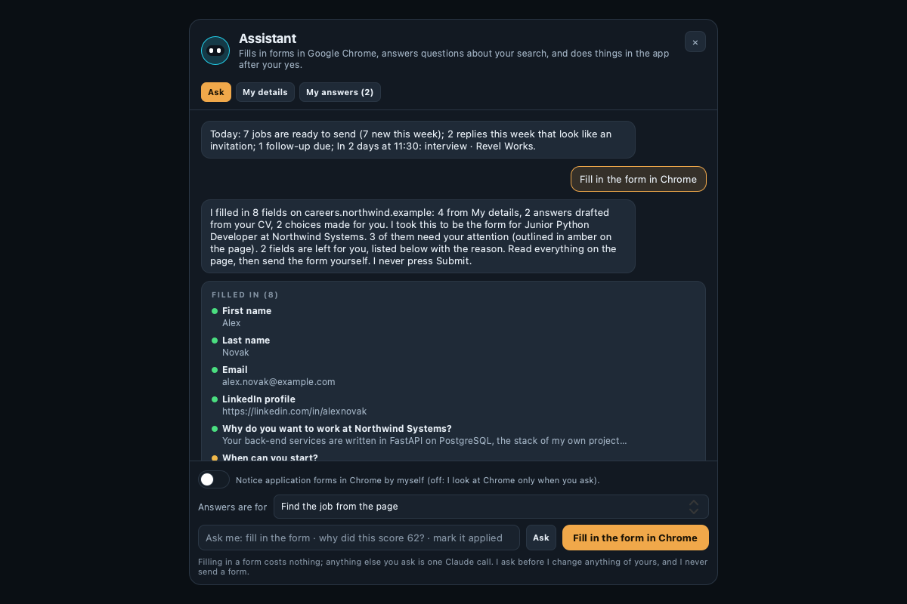

*Figure 9.6 – What the assistant filled in*

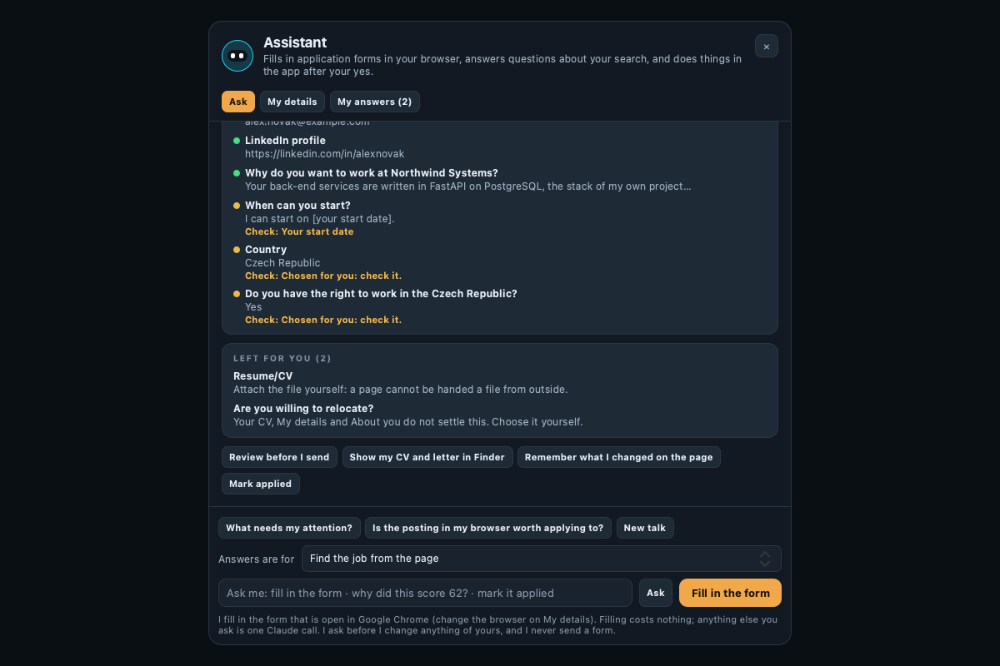

*Figure 9.7 – What the assistant left for you, and the buttons under the answer*

*Table 9.3 – What the assistant offers after it filled in a form*

| Button | Shown when | What it does |
|---|---|---|
| **Show my CV and letter in Finder** | A file field was left to you, and the job has documents from the app or you added files of your own | Opens Finder with the PDF of the adapted CV, the letter and your own files selected, ready to drag onto the form |
| **Remember what I changed on the page** | The assistant wrote at least one answer | Reads back the answers it wrote, keeps your changes with the job, and remembers your wording |
| **Mark applied** | The job is still in **New Jobs** | Moves the job to **Applications** as waiting, as the button in the job's window does |
| **Fill in this page too** | The form in your browser moved on to other fields | Fills in the new page |
| **Open the form in its own tab and fill it in** | The form sits in a frame from another site | Opens that form in a new tab of the browser, waits for it to load and fills it in there. A page that loads slowly is left open: ask again when you see it |
| **Review before I send** | After every fill | Reads the form back and lists what looks wrong |

To open the assistant for one job directly, select **Fill the form** in that job's
window.

### Fill in a form with several pages

Many forms continue on a second and third page. After a fill, the assistant looks at the form
every few seconds for five minutes. When you go on to the next page and it has empty fields,
the assistant says so and offers **Fill in this page too**. It never moves to the next page
itself: you press the form's own button.

### Use your own wording again

When you rewrite an answer, the assistant keeps your words. The next time a form asks the same
question, it uses them, at any company, without a Claude call.

1. After a fill, change the answers on the page as you like.
2. In the app, select **Remember what I changed on the page**.

The assistant also keeps an answer that you rewrite and save under **Form answers** (section 7).
The app marks a kept answer for checking each time it uses it. An answer that names its company
is not used for another company. The **My answers** page lists all kept answers. There you can
change or remove them. **Forget them** on the **My details** page removes all of them, after it
asks you once.

> **Note**
> To learn your changes, the assistant reads back only the answers it wrote itself. It does
> not read your other fields, and a draft you did not change is not remembered.

### Review a form before you send it

After a fill, select **Review before I send**, or ask *review the form*. The assistant reads the
form back and lists the problems (Figure 9.8):

- a required field that is still empty
- a part that is still in square brackets
- an email address that is not yours
- an answer that disagrees with your CV or names another company (this check uses one Claude
  call)

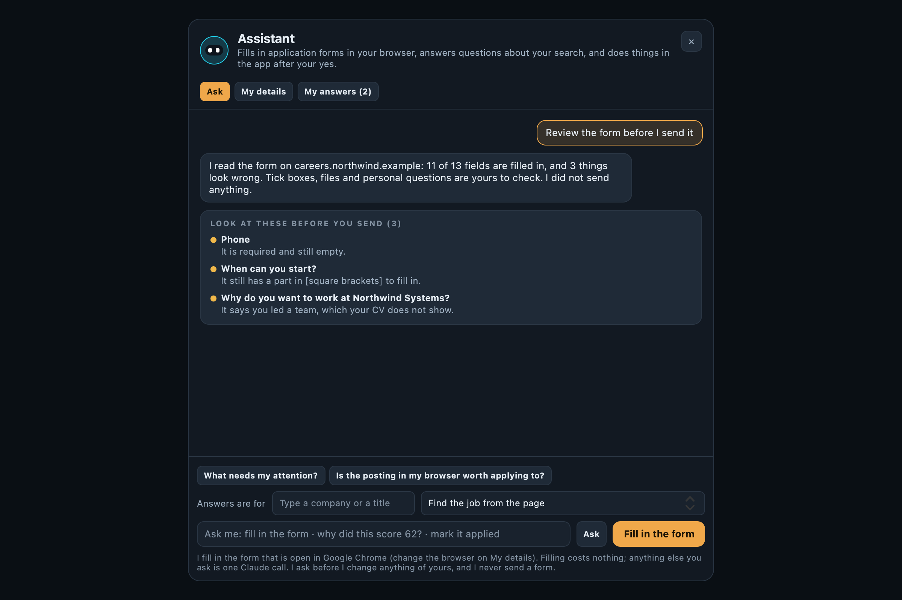

*Figure 9.8 – What a review found*

> **Note**
> For a review the assistant reads what the visible fields hold, which it does not do when it
> fills in a form. It never reads a password or a file a field holds, and the values of personal
> questions and payment fields are not sent to Claude.

> **Tip**
> Answers the assistant drafts are kept with the job, under **Form answers** (section 7). Ask
> again on the same form and they are used again without another Claude call.

### What the assistant fills in and what it leaves

Table 9.4 shows what happens to each kind of field.

*Table 9.4 – What the assistant does with each kind of field*

| Kind of field | What the assistant does |
|---|---|
| Name, email, phone, address, links | Writes them from **My details**. A phone field too short for the spaces gets the number without them |
| A phone number with a list of country codes beside it | Chooses the code of your number in the list and writes the number without the code. When two countries have the same code, such as +1, it chooses the country in **My details**. When the list already shows another country, it leaves the list as it is, writes the whole number and marks both for checking |
| File fields the page keeps behind its own **Select file** buttons | Cannot be reached. The assistant says so once; press the page's button and choose each file yourself |
| Employer, job title, school, degree, field of study | Writes them from your lists of jobs and degrees, row by row |
| A salary question | Writes the figure with its currency from **My details** |
| A list, a yes/no choice, or a menu the page draws itself | Chooses the entry when a fact settles it. A fact can come from **My details**: country, city, notice period, the country code of your phone. It can come from where you found the posting ("How did you hear about us?"). It can also come from your CV and **About you**: right to work, degree level. Marked for checking. If no fact settles it, it is left to you |
| A number, such as years of experience with a tool | Counts it from your CV. Marked for checking |
| A question you answered in your own words before | Uses your wording again, marked for checking |
| An open question, such as "Why do you want to work here?" | Drafts the answer from your CV and the posting, in one Claude call for the whole form. Nothing outside your CV is claimed |
| A cover letter box | Pastes the letter the app wrote for this job |
| A field that already holds something | Leaves it as it is |
| A file field for your CV or resume | Attaches the CV adapted to this job, as a PDF when the field takes one. When the job has no adapted CV, it attaches your own CV and says so. Marked for checking |
| A file field for the cover letter | Attaches the letter of this job |
| A file field for other attachments | Attaches the letter of this job, when the form has no other place for it. Certificates and diplomas stay yours to add |
| Any other file field (a photo, a passport, a transcript). Also a file larger than 4 MB, or a type of file that the field does not take | Leaves it to you, with the reason |
| A file field, when the assistant does not know which job the form is for | Leaves it to you. Choose the job, then ask again: a CV written for another company is worse than none |
| A password | Leaves it to you |
| Date of birth, gender, origin, health, payment details | Leaves them to you |
| A field about another person (**Referee phone**, **Next of kin name**), an employer's address, or **Current salary** | Your own name, contacts, address and the salary you ask for never go there. A field about another person and an employer's address are left to you. For **Current salary**, the assistant may offer words from your CV, marked for checking |
| **Current employer** when no job in **My details** is marked **I work here now** | Leaves it to you and says why. An old job is never given as the current one. **Current or most recent employer** gets the first job in your list in **My details** |
| The dates of a job or a degree | Writes them where the form takes a month and a year, as one field or as two lists. Where it wants a full date, the first of the month is used and marked for checking. With only a year in **My details**, a month is left to you |
| The box **I currently work here** | Ticked for a job you marked **I work here now**. Marked for checking |
| **Location** and **Role description** inside a job's block | Writes where that job was and what you did there, from the job in **My details**. Never your own city, and never a text drafted about you in general. Empty in **My details**: left to you, with the reason |
| A date split into a month box and a year box | Writes each part into its box |
| A block for each language | Chooses the language, then its level in each list (comprehension, reading, speaking and so on), from your list of languages. Ticks **I am fluent in this language** for *Native* and *Fluent*. Levels are marked for checking |
| A field that throws away what was written | Written a second time, the way typing arrives. If the page throws that away too, the field is left to you and the assistant says so |
| A short field the app does not recognise | Asks Claude, with the lists and numbers, to copy the words from your CV or your details. Words that are not there are not written |
| When you can start ("Earliest start date", "Available from", "When can you start?") | Writes what you entered in **About you** > **You can start**. For a date picker it works out the day: *1 November 2026* as written, *immediately* as today, *one month* as a month from today. A worked-out day is marked for checking. Words it cannot turn into a day, and a day that has passed, leave the picker to you |
| Other dates | Leaves them to you |
| Every other tick box, such as agreeing to a privacy notice | Leaves it to you |
| **Add another job**, **Add education** | Pressed once for each job or degree that has no row yet |
| **Submit**, **Next** and every other button | Never pressed |

To fill in a form and leave something out, say so: *fill it in but skip the salary*.

### If something is wrong

Table 9.5 lists what the assistant may answer, and what to do.

*Table 9.5 – Problems while filling in a form, and what to do*

| What the assistant says | Cause | What to do |
|---|---|---|
| Google Chrome is not open | Chrome is closed, or has no window | Open the form in Chrome and ask again |
| Chrome does not let other apps fill in pages yet | The switch in Chrome is off | **View** > **Developer** > **Allow JavaScript from Apple Events** |
| macOS did not let JobHelper talk to Chrome | The question from macOS was answered with **Don't Allow** | **System Settings** > **Privacy & Security** > **Automation**: turn on **Google Chrome** for the app |
| The browser does not let another app fill in its pages | The browser has that part switched off (Opera GX), or never had it (Firefox) | On **My details**, choose **Google Chrome** or **Safari**, and open the form there |
| I found no form fields on this page | The tab in front is the posting, not the form | Open the form itself, usually with the site's **Apply** button |
| The form sits inside a frame from another site | The company shows a form that lives on a recruiting site | Select **Open the form in its own tab and fill it in** under the answer |
| The menu did not open for me | The site draws its menu in a way the assistant does not know | Choose that one yourself |
| I could not ask Claude | Claude's limit is used up, or there is no connection | The details are still filled in. Ask again after the reset time shown in the Usage card (section 18) |
| The tab changed while I was working | You moved to another page in the meantime | Go back to the form and ask again. The answer lists what was filled before, and what was not reached |
| The tab changed while I was attaching your files | You moved to another page while a file was on its way. The answer still lists what was filled before | Go back to the form. Look at what it holds, then ask again. Reload the form first if a file is missing |
| An open question: choose the job this form is for | The page did not show which job it belongs to | Choose the job under **Answers are for** and ask again |
| I do not know your details yet | **My details** is empty | Fill in **My details**, save, ask again |
| A field stayed empty although it is listed as filled | The site rebuilt the field after it was written | Type that one yourself |

### Next steps

- [Track an application](#11-track-an-application), after you sent the form

---

## 10. Talk to the assistant

The assistant does more than fill in forms. You can ask it about your search in your own words.
It can do things in the app after you say yes. It also tells you what needs your attention. This
chapter covers all of this. Section 9 covers the forms.

### Prerequisites

- For questions and requests: Claude is signed in. Each one is a call to Claude, unless this
  chapter says otherwise.
- For anything in the browser: the switch from section 9 is on.

### Talk to the assistant

You can ask the assistant in your own words. It remembers the last turns of the talk, so a
second question can build on the first (Figure 10.1). When the window of a job is open, "this
job" means that job. If no job window is open, choose the job under **Answers are for**, or name
its company.

1. Select the assistant and type what you need, then press Return.
2. Read the answer. While you wait, the line under the talk says what the assistant is doing.
   Jobs the answer is about are listed under it; select one to open it.
3. When the assistant asks before it does something, select **Yes, do it** or **No**.

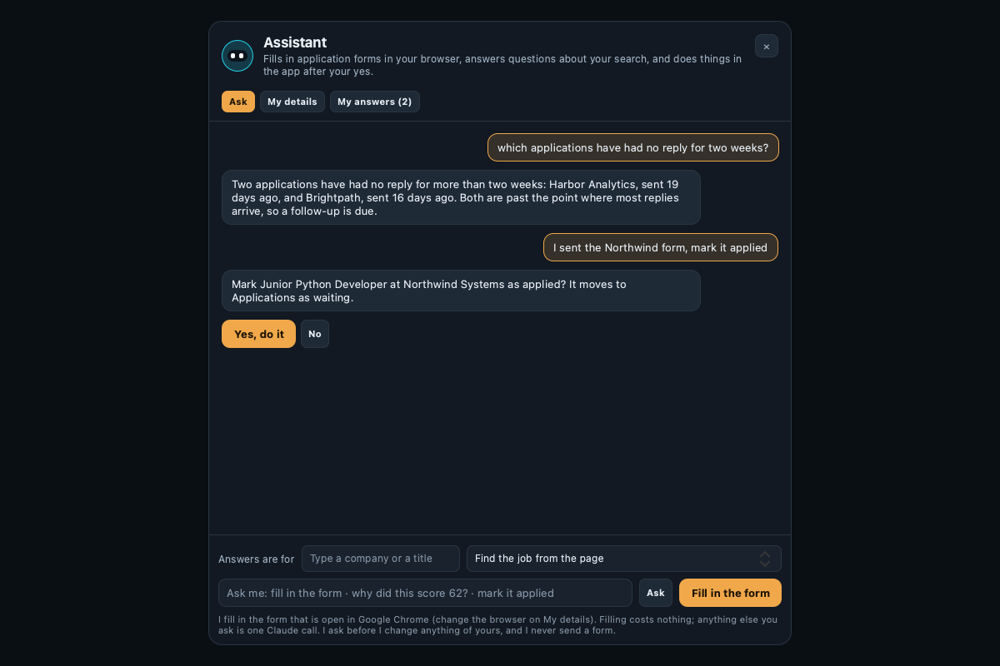

*Figure 10.1 – A talk with the assistant*

Table 10.1 shows what you can ask for.

*Table 10.1 – What you can ask the assistant*

| You ask | Example | What happens |
|---|---|---|
| A question about your search | *Which applications have had no reply for two weeks?* | It answers from your jobs, their statuses, dates and replies, and lists the jobs |
| A question about one job | *Why did this score 62?* | It answers from the job's score, its reason and its keywords |
| To open something | *Open the letter for Northwind* | The job, its posting, its CV or its letter opens at once |
| To change a job | *Mark it applied*; *set the interview for Tuesday at 11:30*; *Quillon said no* | It asks first, in the app's own words. Nothing changes until you select **Yes, do it** |
| To rewrite a text | *Make the second paragraph of this letter shorter*; *make my answer about salary more formal* | It shows the new version first. It is saved only after your yes, and is checked against your CV like every text |
| A brief about a company | *Tell me about Northwind before the interview* | A few lines from the posting, your notes and their messages |
| Advice | *What do my results say?* | What works and what does not, from the numbers of your own applications |
| To fill in a form, with exceptions | *Fill it in but skip the salary* | It fills in the form and leaves out what you named |
| Several things at once | *Mark it applied and remind me to follow up in ten days* | One question lists every step; see the next task |
| To remember something | *Remember that I do not want consulting firms* | Kept for later talks; see below |
| A posting in your browser | *Is this posting worth applying to?* | It is scored against your CV and can be added to **New Jobs**; see below |
| A reply to a company | *Answer Quillon that Tuesday suits me* | A draft to copy; see below |
| To practise | *Let us practise the interview for Quillon* | See the task below |

> **Important**
> Filling in a form, opening your details and asking for help cost nothing. Every other
> request is one call to Claude, and a rewrite, a brief, advice, a reply, a posting and each
> practice answer are one more. Only the jobs a request is likely about are sent with
> it, not your whole list. The calls count against your Claude limit like a search does (section 18).

The assistant never changes anything only because Claude says so. The app checks each proposal
from Claude. It drops an action that does not exist, or a job that is not in your list. Then the
assistant tells you that it could not do it.

### Do several things at once, and take them back

One request can hold up to three tasks. For example: *I sent the Northwind form: mark it applied
and remind me to follow up in ten days*. A task that only shows something is done at once. For
the tasks that change your data, the assistant asks one question that lists each step. **Yes, do
it** does them in order.

After a yes, **Undo** appears under the answer. It puts the job back exactly as it was: its
status, its dates, and a lead that marking it applied had folded away. **Undo** takes back the
last yes only, and is not offered while a search or a scan is running.

### Tell the assistant what to remember

Say *remember that I do not want consulting firms*, and the assistant keeps the note. It uses
your notes in all later answers, also after you close the app. It also remembers the last turns
of a talk. The **My details** page lists the notes under **What you asked me to remember**.
Select **Forget** to remove one. **New talk** on the **Ask** page puts away the earlier talk.

> **Note**
> A note shapes what the assistant says. It does not change what a search finds or how a
> posting is scored: for that, use **Options** (section 16).

### Judge a posting that is open in your browser

1. Open a job posting in your browser and leave its tab in front.
2. In the assistant's window, select **Is the posting in my browser worth applying to?**
3. The assistant reads the page and scores the posting against your CV. It uses the same scorer
   as a search. Then it tells you the score and the reason.
4. To keep it, select **Yes, do it**: the posting is added to **New Jobs**. The next search
   writes its documents when the score is at or above your limit.

This takes one call to Claude, for the score. Most job pages give the title and the employer in a
form that search engines read. The assistant takes them from there. Only if a page does not
give them, one more call reads them from the page. The app knows a posting that is already in
your list by its address, so that needs no call.

### Draft a reply to a company

Ask, for example, *answer Quillon that Tuesday suits me*. The assistant drafts a short reply
to the company's last message that is filed under that application, and shows it with a
**Copy** button. What it cannot know, such as a time, stands in square brackets for you to
fill in.

> **Important**
> The assistant never sends mail. You paste the draft into your own mail program, read it,
> and send it yourself.

### Practise an interview

1. Build the interview preparation for the application first (section 13).
2. Ask the assistant to practise for that job, for example *practise the interview for
   Quillon*.
3. The assistant asks the questions of the preparation one at a time. Type each answer as you
   would say it and press Return.
4. Read what it says about your answer: what is good and what is missing. It also gives one real
   fact from your CV that you can add. Then it asks the next question.
5. To end, type *stop* or select **Stop practising**.

Each answer is one Claude call. Nothing you type in practice is saved.

The questions that went badly last time are asked first, then the ones you never practised.
Only how each answer went is kept with the application (good, fair or weak), never what you
typed. When the practice ends, the assistant says how many went well.

### Let the assistant speak first

The assistant also tells you things without being asked. None of this uses Claude.

- **When the app opens**, its bubble tells you what needs your attention. This can be a form that
  you filled in but did not mark as applied. It can be an interview in the next two days with no
  preparation, or an invitation with no date. It can also be the number of jobs ready to send.
- **In its window**, **For you today** lists the same reminders. Select **Open** to go to the
  job, or **Do not remind me** to stop that reminder.
- **Noticing a form.** On the **My details** page, under **How I work**, turn on the switch
  **Notice application forms by myself**. While the app is open, the assistant then looks at
  the address of the tab in front in your browser every 20 seconds. When it is the form of a
  job you track, its bubble says so; select the assistant and it is ready to fill that form.

> **Important**
> The switch is off until you turn it on. When it is on, the assistant looks at the address
> and title of the tab in front and counts its empty fields. It reads nothing else, opens
> nothing, and says nothing about pages that belong to no job of yours.

### Choose your browser

The assistant works in Google Chrome unless you choose another browser. On the **My details**
page, under **How I work**, choose **Google Chrome**, **Brave Browser**, **Microsoft Edge**,
**Opera** or **Safari**. The list shows Opera GX and Firefox as not possible. They do not let
another app fill in their pages, so open the form in another browser. The line next to the list
tells you where the switch of that browser is. Turn it on once, as in section 9. The switch to
notice forms is in the same place.

### Speak instead of typing

The box of the assistant takes dictation, like all text fields on your Mac. Select the box and
press the dictation key (the microphone key, or the Fn key two times). Then speak. Your words
appear as text. Press Return to send them. Dictation is a feature of macOS. Turn it on under
**System Settings** > **Keyboard** > **Dictation**.

### Next steps

- [Track an application](#11-track-an-application)

---

## 11. Track an application

**Applications** lists where you applied, grouped by where each one stands: offers and
interviews first, then waiting, then rejected (Figure 11.1).

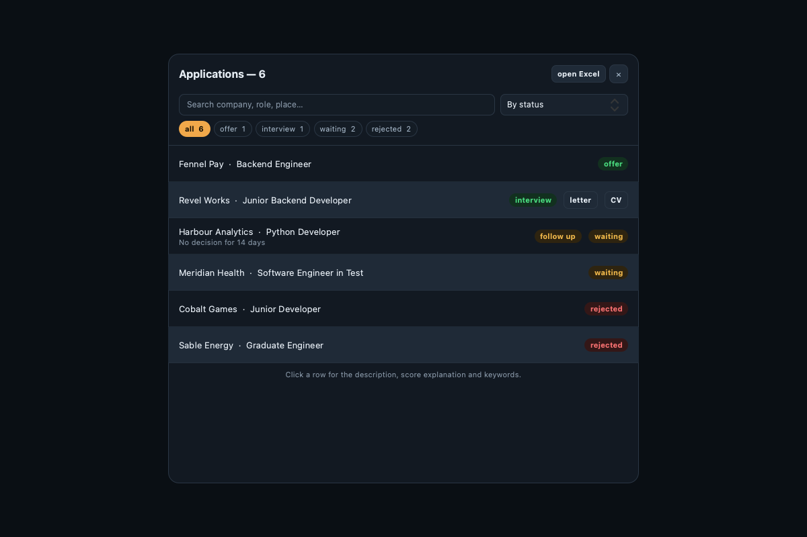

*Figure 11.1 – The Applications list*

### The application's window

Select a row to open the application (Figure 11.2).

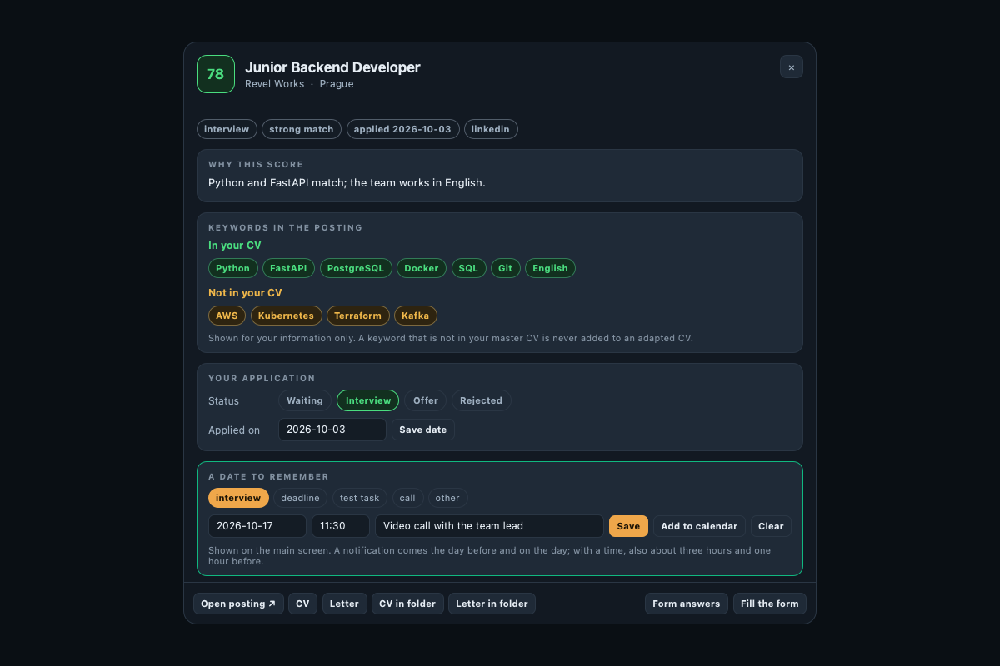

*Figure 11.2 – An application in full*

Table 11.1 lists the fields of an application.

*Table 11.1 – The fields of an application*

| Field | What it is | When to change it |
|---|---|---|
| **Status** | Where the application stands | Normally set by the replies in your mailbox. Change it by hand when the news came another way |
| **Applied on** | The day you applied | Correct it if you applied before you pressed the button |
| A date to remember | An interview, a deadline, a test task, a call | Set it when you agree a date |

### Set a date and get reminded

1. In the application's window, choose the kind of date, the day and, if you know it, the time.
2. Select **Save**.
3. Optional: select **Add to calendar** to put it in Calendar, so that your phone reminds you
   too.

If the app cannot use the day, the time or the note, only that box is red. The line under the
boxes tells you what to correct.

The date then shows on the **Coming up** card of the main window. You get a notification the
day before and on the day. With a time, you also get one about three hours and one hour before (Figure 11.3).

You often do not have to set it. An invitation in your mailbox that names a day sets the date by itself
when you scan your email. When the company moves the interview, the newer invitation moves the date
as well. A date that you set or changed yourself is never changed by an email.

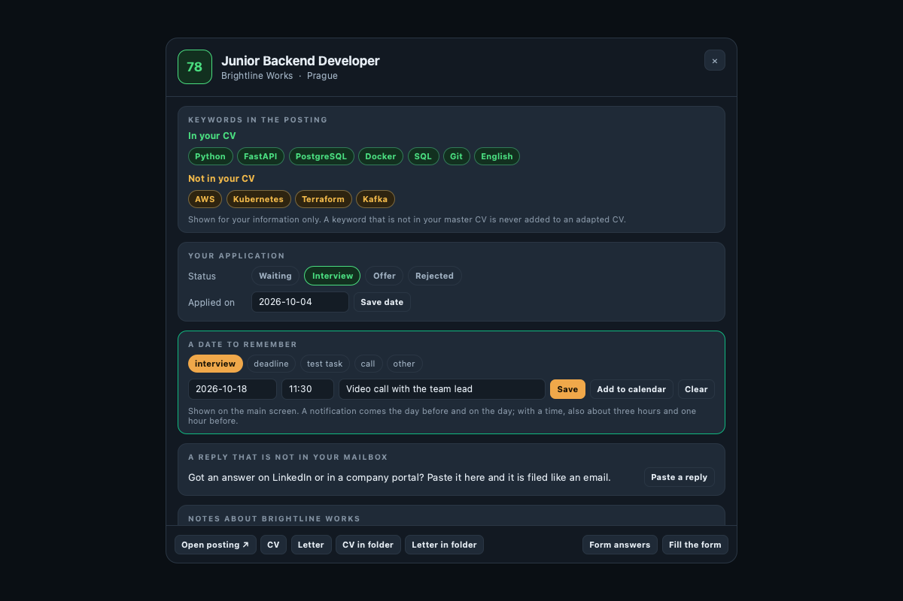

*Figure 11.3 – Dates, pasted replies and notes*

### File a reply that did not come by email

An answer that came on LinkedIn or in a company portal can be filed by hand.

1. In the application's window, find **Paste the message text here**.
2. Paste the message and select **Save**.

The app reads it like an email and updates the status.

### Keep notes about the company

**Who you spoke to**, **Salary mentioned**, **What they asked** and **Anything else worth
remembering** are kept for the company, not for the job. They appear again when you apply
there later. Select **Save notes** after you write them.

### Follow up

After ten quiet days (you can change the number in Options) the app suggests a follow-up and
drafts one.

1. Open the application. The follow-up draft is shown.
2. Select **Copy** and send it from your own mail program.
3. Select **Mark as followed up**, so that the reminder stops.

> **Note**
> The app does not send the follow-up. It only writes the draft.

### Possible duplicates

When two entries look like the same application, the line under **Applications** says so. Open
one of them and choose **Merge into one** or **They are different**.

### Next steps

- [Read replies from companies](#12-read-replies-from-companies)

---

## 12. Read replies from companies

An email scan reads new mail in your mailbox, works out which messages are answers to your
applications, and files each one to its application.

### Prerequisites

- The **Job email** row of the Account card is green (section 2).

### Scan your email

1. In the main window, select **Scan email**.
2. Wait for the status line to say how many new replies were filed.
3. Open **Responses** to read them, or **Applications** to see the new statuses.

> **Important**
> The scan only reads. Nothing is sent, deleted, moved or marked as read. Mail from the Sent
> and Drafts folders is never read.

### How the app chooses which messages to read closely

Most mail in a mailbox is not about your applications. Asking Claude about every message
would waste your limit, so the app first decides, without Claude, which messages are worth a
question (Table 12.1).

*Table 12.1 – Which messages are sent to Claude*

| A message is | Sent to Claude |
|---|---|
| From a recruiting system (for example Greenhouse, Workable, Teamio, SuccessFactors) | Yes |
| From a company you track, named in the sender or the subject, and it talks about an application | Yes |
| From a person at a company you track, even with no such words ("Are you free on Tuesday?") | Yes |
| From anyone, when it talks about an application and is not list mail | Yes |
| A job alert, a digest, a sign-up or password message | No |
| Automatic mail from a company you track with nothing about an application (a statement, an advert) | No |
| An advert or newsletter that only shares a common word with a company's name ("International", "Praha"), or mentions a brand somewhere in its text | No |

Claude then reads each chosen message and decides whether it is an invitation, a rejection, an
offer, or an automatic confirmation. A message that turns out to be none of these is not filed.

### How far back a scan looks

A scan reads the mail of the last days set in Options under **Scan emails from the last**.
Messages that were already read by an earlier scan are skipped, so a longer period costs
nothing after the first time.

### Look further back once

Use this after you add a mailbox, or when an old reply is missing.

1. Open **Options** and find **Email scan**.
2. Under **Look further back once**, choose the number of days (90 to begin with).
3. Select **Scan now**. A green line confirms that the scan started; you can close Options.

The scan reads that period once. The setting **Scan emails from the last** stays as it is.

### Responses

Figure 12.1 shows the Responses list.

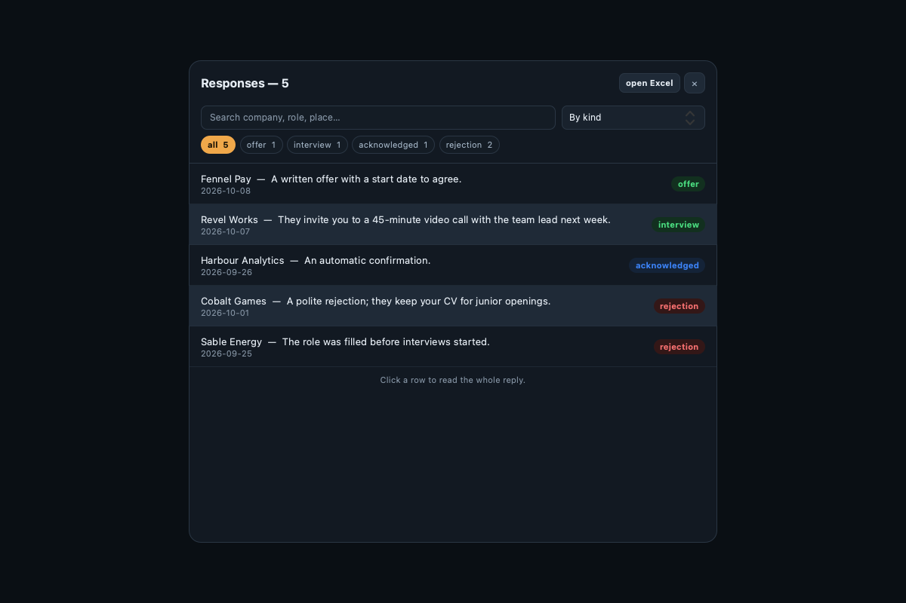

*Figure 12.1 – Every reply*

**Responses** lists every reply with what it was. Select one to read it in full (Figure 12.2).

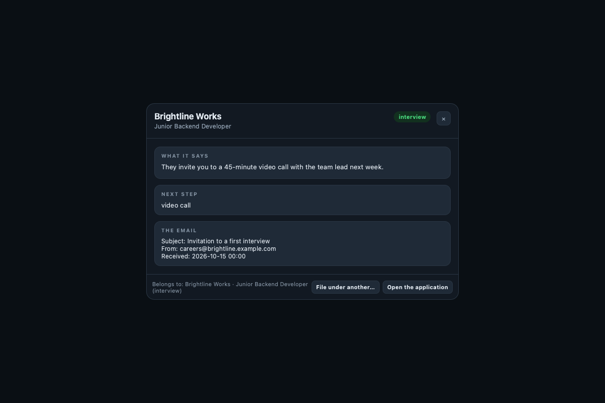

*Figure 12.2 – One reply in full*

Table 12.2 lists the fields of a reply.

*Table 12.2 – The fields of a reply*

| Field | Meaning |
|---|---|
| The badge | What the reply was: interview, rejection, offer, acknowledged |
| **Summary** | What the message says, in one or two sentences |
| **Next step** | What they ask of you, if anything |
| **Reason** | For a rejection: the reason they gave, and its kind |
| The application | Which of your applications it was filed to. Select it to open that application |
| **File under…** | Files the reply under another application, or under none |

### File a reply under the right application

Sometimes the app files a reply under the wrong application, or under none. This can happen
when you have two applications at one company. It can also happen when a recruiter writes from
the address of an agency.

1. In **Responses**, select the reply.
2. Select **File under…** (or **File under another…**). The list of your applications opens
   (Figure 12.3).
3. Type a company or a role to narrow the list, then select the right application.

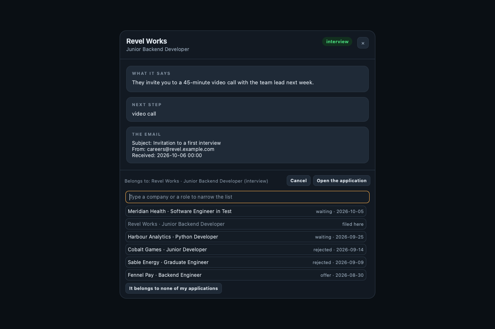

*Figure 12.3 – Choosing the application a reply belongs to*

The application the reply moves to follows it in the usual way: an invitation makes it an
interview, a rejection closes it. The application the reply leaves keeps its status, because
only you know whether this reply had set it; the green line reminds you to look. To unlink a
reply that is about none of your applications, select **It belongs to none of my
applications**.

### Analytics

Figure 12.4 shows outcomes and rejection reasons.

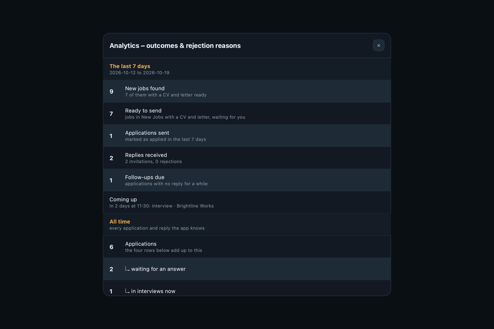

*Figure 12.4 – Outcomes and rejection reasons*

**Analytics** adds the replies up (Table 12.3).

*Table 12.3 – The parts of Analytics*

| Part | What it shows |
|---|---|
| The last seven days | What came in this week |
| Where applications stand | How many are waiting, in interviews, or closed |
| Rejection reasons | What reasons the rejections gave, most common first |

> **Tip**
> The rejection reasons are the useful part. If most of them say the same thing, that is what
> to change: your level, a missing skill, or the kind of role you apply to.

### If something is wrong

Table 12.4 lists problems with replies, and what to do.

*Table 12.4 – Problems with replies, and what to do*

| What you see | Cause | What to do |
|---|---|---|
| "0 new" after a scan | No new replies in the period, or they were read by an earlier scan | Nothing. **Emails read** on the Last run card shows what the scan went through. To look further back, use **Look further back once** |
| A rejection is missing | It did not arrive in a scanned mailbox, or it is in another folder | Turn on **Also archived mail and spam**, or paste the reply into the application (section 11) |
| A reply was filed to the wrong application, or to none | Two applications at the same company, or a sender the app could not place | Open the reply and select **File under…** |
| A warning about the second mailbox | Its password was cancelled or mistyped | Open the Account card and select **Change** for the second mailbox |

---

## 13. Prepare for an interview

For one interview the app builds a sheet from your CV and the posting.

### Build the preparation

1. Open the application.
2. On the **Interview preparation** card, select **Prepare**. The app asks Claude; this takes
   about a minute.
3. When the card says the questions and answers are ready, select **Open**.

**Documents** on the same card opens the preparation as two Word files. One file is for a talk
with HR or a recruiter. The other file is for a talk with a specialist or the hiring manager.
**Make again** makes a new preparation, for example after you change your CV (Figure 13.1).

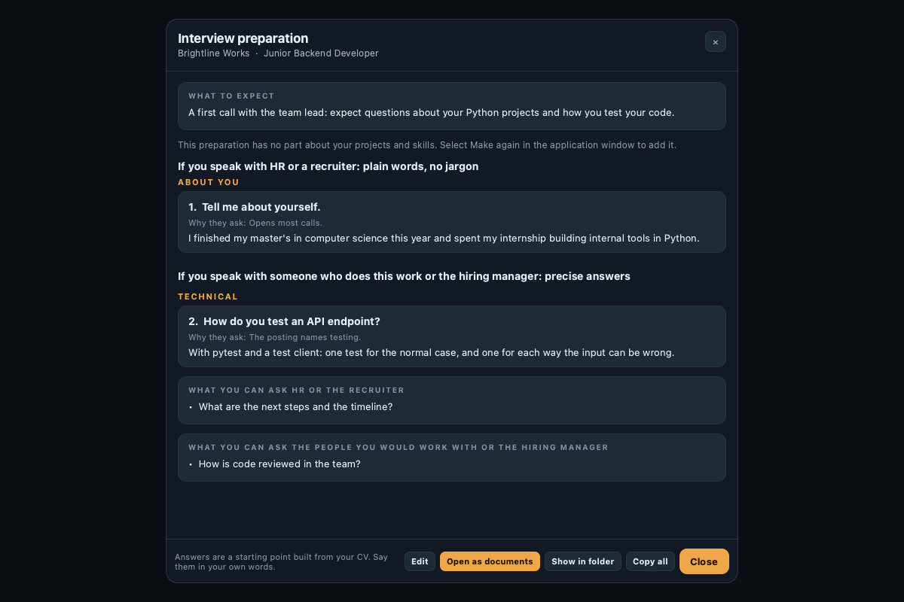

*Figure 13.1 – The interview preparation*

### What the sheet contains

Table 13.1 lists the parts of the interview sheet.

*Table 13.1 – The parts of the interview sheet*

| Part | What it is |
|---|---|
| What to expect | A short summary of this interview |
| The opening pitch | Two or three sentences to introduce yourself |
| Questions an HR person or a recruiter is likely to ask | Answered in plain words, without the jargon of your field |
| Questions someone who does this work, or the hiring manager, is likely to ask | Answered precisely, with the real tools, methods and numbers |
| **Why they ask** | Under each question: what the interviewer wants to learn |
| Questions you can ask them | For the HR person, and for the people you would work with |

### The two documents

The two documents have the same order. First the company, then you, then your projects and
skills. Then come the questions that they can ask you, and the questions that you can ask them.
Table 13.2 shows the differences.

*Table 13.2 – The HR document and the technical document*

| Part | For HR | For a specialist |
|---|---|---|
| 1. About the company | What the company does, and a sentence to say about it | The same facts, and the role in detail |
| 2. About you | Your opening pitch and your jobs in plain words | Your pitch, and each job told for this role, with notes to check |
| 3. Your projects and skills | Each project in one or two plain sentences | Each project in full, with its tools |
| 4. Questions they may ask you | HR questions, answered in plain words | Questions about the work, answered with exact tools and numbers, then terms to explain and topics to revise |
| 5. Questions you can ask | The next steps, the team, working hours, the first weeks, the contract | The work itself, the tools, what you would do first |

The question about the next steps is always in the HR document. The text follows the rules of
ASD-STE100 Simplified Technical English: short sentences, the active voice and common words.
A preparation made before 15 October 2026 has no projects and skills part: select **Make again**
to add it.

> **Important**
> The answers are a starting point built from your CV. An answer that touches something your
> CV does not show is marked **Check this answer**. Rewrite it, so that you never repeat a
> claim you cannot back.

### Use the sheet

Table 13.3 lists the buttons of the interview sheet.

*Table 13.3 – The buttons of the interview sheet*

| Button | What it does |
|---|---|
| **Edit** | Lets you rewrite any part in your own words |
| **Copy all** | Copies the whole sheet as text |
| **Open as documents** | Makes the two Word files, for HR and for a specialist, and opens them |
| **Show in folder** | Shows the two Word files in Finder |

After the interview, the application's window offers a short **thank-you** note to copy.

---

## 14. See what a search left out

A search that only shows you what it kept would be asking you to trust it blindly. Every
posting a search drops is kept with the reason.

### Open the list

1. On the **Last run** card, select the number next to **Filtered out**.

Figure 14.1 shows postings the last search filtered out.

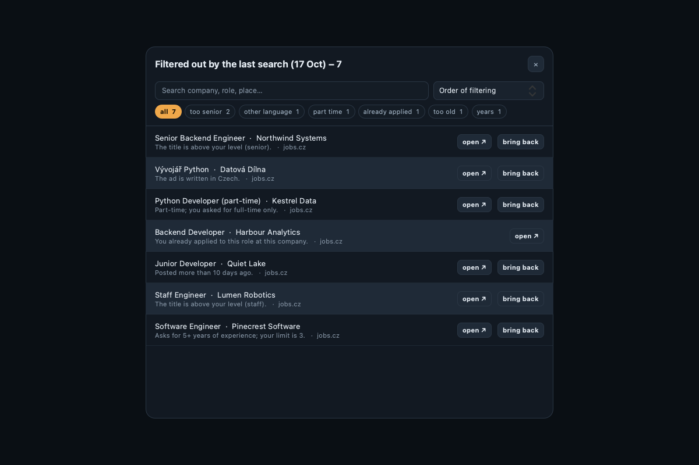

*Figure 14.1 – Postings the last search filtered out*

### Read the list

Each row is one dropped posting with the reason in words. The chips at the top group the rows
by reason (Table 14.1).

*Table 14.1 – Reasons a posting is filtered out, and where to change each rule*

| Reason | Meaning | Where to change the rule |
|---|---|---|
| **level** | The title is above your level | **Skip levels above yours** |
| **other language** | The ad is written in another language (the reason names it), or the role requires one at a working level | **English only** |
| **other country** | The job is on site in another country. Or it is a remote job for another country or part of the world | **Country**, **Remote jobs** |
| **part-time** | You asked for full-time only | **Full-time only** |
| **too old** | Posted longer ago than your limit | **Max job age** |
| **too many years** | Asks for more years of experience than you accept | **Skip jobs asking for** |
| **skip word** | The title has a word you skip | **Skip titles with** |
| **duplicate** | The same role is on another board too, and the search keeps that copy | Nothing to change |
| **closed** | The posting no longer accepts applications | Nothing to change |
| **already applied** | You applied to this role at this company | Nothing to change |

### Bring a posting back

1. Find the row.
2. Select **bring back**.

The posting goes to **New Jobs**, and the next search scores it.

---

## 15. Learn from your results

**Insights** is worked out on your Mac from your own applications. It asks Claude nothing (Figure 15.1).

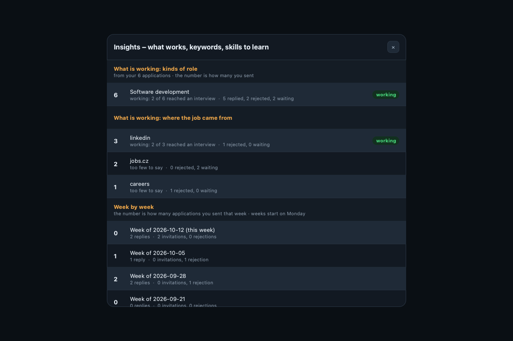

*Figure 15.1 – Insights*

Table 15.1 lists the parts of Insights.

*Table 15.1 – The parts of Insights*

| Part | The question it answers |
|---|---|
| **What is working** | Which kinds of role and which job boards led to interviews? |
| **Week by week** | How many applications did I send, and what came back? |
| **Skills to learn** | What do the postings ask for most that my CV does not show? |
| **What the postings pay** | What salaries do the postings state, in your currency, and how do they compare with what you ask? |
| **How long companies take to answer** | When should I stop waiting? |
| **Why jobs scored low** | What reasons come up most often? |

> **Note**
> With only a few applications the app says "too few to say" rather than guessing. The numbers
> become useful after about ten applications.

### What to do with it

Table 15.2 suggests what to do with what you see.

*Table 15.2 – What to do with what Insights shows*

| You see | Consider |
|---|---|
| One kind of role gets the interviews | Put that role first in **Search roles**, and add it to **Kinds of role you want** |
| One skill is asked for again and again | Learn it, or add it to your CV if you already have it |
| Most low scores give the same reason | Change the filter that should have dropped those postings |
| Companies answer within two weeks or not at all | Follow up after ten days and move on after three weeks |

---

## 16. Set your options

Options is where you tell the app what you are looking for. Open it with **Options** in the
right column, or with a chip under **Search** in the left column (Figure 16.1).

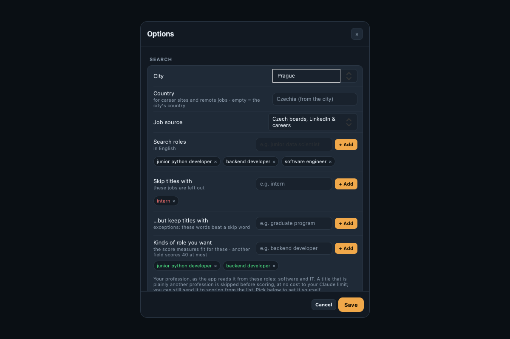

*Figure 16.1 – Options: the search*

> **Note**
> A choice too long for its box is shown on two lines, never cut.

> **Note**
> Every field checks what you type. A value the app cannot use is marked in red with the
> reason, and **Save** waits until it is corrected. Closing Options with unsaved changes asks
> once.

### Search

Table 16.1 lists the Search settings.

*Table 16.1 – The Search settings*

| Setting | What it does | Values | Why you would change it |
|---|---|---|---|
| **City** | Where to search | A city name | The app will not search without one |
| **Country** | Which postings count as "here", from the career site of a company. They can be in the city, anywhere in this country, or in the region of the country ("Europe", "EMEA"). **Remote jobs** uses this country too | A country's name in English. Empty = the country of the city, shown in grey | Type it when the field says that it does not know the city. Also type it when you want jobs from a neighbouring country |
| **Remote jobs** | Which remote jobs a search keeps, from all job sources. A job open to all countries is always kept. A job for one country is kept only for your country and the countries you add. **In** your country keeps a job for a part of the world that your country is in. **Anywhere in the world** keeps a job for any part of the world | In your country or anywhere in the world, with added countries | Add a country when you have the right to work there. Select anywhere when all time zones suit you |
| **Job sources** | Which job boards are read. Select one or more: a search reads all that you select. The app reads the Czech boards only for a city in Czechia. For a city in another country, the log of the run says that they were not used | Czech boards, LinkedIn, Career sites, Remote boards, in any combination | More sources find more and take longer |
| **Search roles** | The words typed into the job boards, in English | One or more roles | Too few results: add a role. Too many poor ones: remove one |
| **Skip titles with** | Words that drop a posting by its title | Words | To get rid of a kind of posting that keeps appearing |
| **…but keep titles with** | Exceptions to the line above | Words | To keep a title that a skip word would drop |
| **Kinds of role you want** | Tells the scorer your direction | Roles | Without it, a role in another field that merely accepts your degree could score high |
| **Kinds of role you do not want** | Skipped when the title names one, scored low otherwise | Roles | To keep a neighbouring field out |
| **Skip levels above yours** | Level words that drop a posting | Words such as senior, lead | A senior candidate empties this list |
| **Skip jobs asking for** | Drops postings that ask for this many years or more | 0 to 60; 0 = never | To keep out postings you are not yet eligible for |
| **Full-time only** | Hides part-time roles | On or off | Turn off if part-time suits you |
| **English only** | Hides postings written in another language, and roles that require another language at a working level | On or off | Turn off if you also work in the local language. A posting that requires a language your CV does not show is then scored low instead |
| **Max job age** | Drops postings older than this | Days; 0 = any date | Old postings are often already filled |
| **Results per query** | How many postings each role asks each board for | 1 to 100 | Raise it for a wider search, lower it for a faster one |

### Remote jobs

A remote job is often open to people in some countries only, for example "Remote, Germany" or
"USA Only". You must usually live in that country or have the right to work there. Thus the search
skips such a job, unless the country is your country. To keep the remote jobs of more countries,
add those countries (Figure 16.2). The added countries apply to both choices.

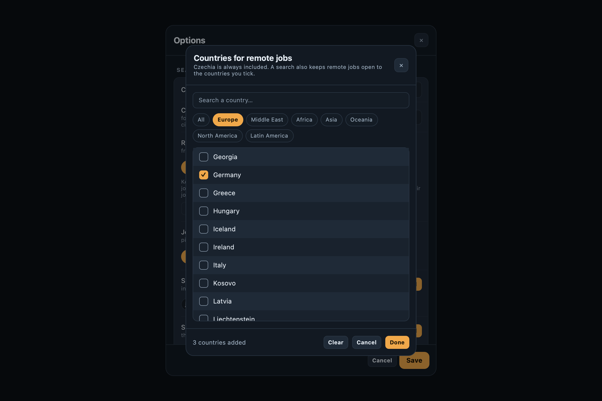

*Figure 16.2 – The countries for remote jobs*

To add countries:

1. In Options, find **Remote jobs**.
2. Click **+ Add countries**. The window opens.
3. To find a country, type the start of its name or select a part of the world. Other names
   work too: *usa* finds the United States, and *england* finds the United Kingdom.
4. Select each country that you want. Your own country is always included.
5. Click **Done**, and then click **Save** in Options.

To remove a country, click the **✕** on its name. You can add up to 40 countries.

> **Note**
> A posting that names a part of the world, for example "Remote – EMEA", is kept when your country
> or an added country is in it. With **Anywhere in the world**, it is always kept. A job on site in
> an added country is not kept.

### Your profession

Figure 16.3 shows the roles you want and your profession in Options.

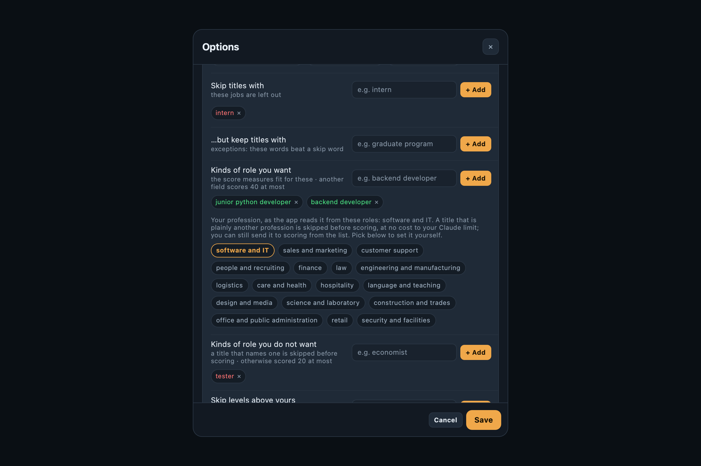

*Figure 16.3 – Options: the roles you want and your profession*

Under **Kinds of role you want**, chips show what the app takes as your profession. The app
reads it from the roles you want (the outlined chip). It decides which titles are skipped as
"another profession" before scoring.

- If the app read it wrong, select the right chips yourself.
- **Let the app decide** goes back to reading it from your roles.

Seventeen professions are known.

### Company career sites

Some companies publish their openings on their own career site. To read one directly:

1. Find the company's career page and note the short name in its address (for example,
   `boards.greenhouse.io/example` gives `example`).
2. Under **Company career sites**, enter the company's name and that short name, and choose
   the system.
3. Select **Add**.

### Matching and follow-up

Table 16.2 lists the Matching and Follow-up settings.

*Table 16.2 – The Matching and Follow-up settings*

| Setting | What it does | Values |
|---|---|---|
| **Write letters above** | The score from which a CV and a letter are written | 0 to 100 |
| **Hide leads below** | Hides jobs below this score from New Jobs | 0 to 100; 0 = show all |
| **Remind me after** | Days without a reply before a follow-up is suggested | 0 to 365; 0 = never |

> **Tip**
> Raise **Write letters above** to apply to fewer, better matches. It also uses less of your
> Claude limit, because fewer documents are written.

### About you

**About you** is a window of its own. It holds the only facts about you that the app states
besides your CV. To open it, select **About you** under **Options** on the right side of the main
window. Figure 16.4 shows the top of the window.

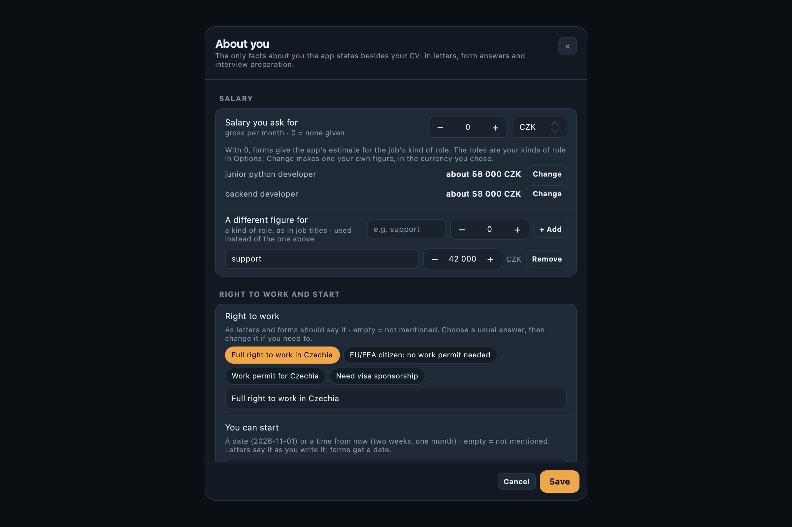

*Figure 16.4 – The About you window*

Table 16.3 lists what you can enter.

*Table 16.3 – The parts of About you*

| Part | What it does |
|---|---|
| **Salary you ask for** | Your expected pay, gross per month, with its currency. Form answers give it as your expectation. The job window and the lists show it. Insights compares what postings pay with it. 0 = none given. Then the window shows the app's own estimate for your types of role. The app has an estimate only for software roles in Czechia. In other cases, you fill in the figure yourself |
| **A different figure for** | A salary for one type of role. The app uses it instead of the general figure when the words are in the job's title (*support* for "IT Support Specialist"). Enter the type of role and the figure, then select **+ Add**. To change a figure, change it in the list. To delete it, select **Remove** |
| **Right to work** | How letters and answers should say it. Select one of the usual answers to fill in the field, and then change the words if necessary. Empty = not mentioned |
| **You can start** | When you can start, for example *immediately*, *one month* or *2026-11-01*. Letters say it as you write it. Under the field, the window shows the date that forms get. A red line tells you when the app cannot find a date in your words. Empty = not mentioned |
| **More about your work** | What you really did in each job beyond what the CV says. There is one box for each job in **My details**, and a box for other work. The app may use the text like the CV. All boxes together, with the names of the jobs, can have 4,000 characters |
| **Your own letters** | The folder for letters you wrote yourself (section 7) |

Figure 16.5 shows the boxes for your work.

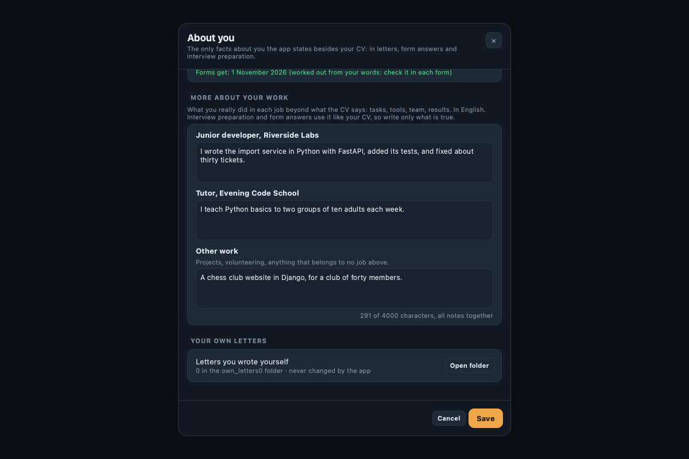

*Figure 16.5 – More about your work, one box for each job*

A note stays when you rename or delete its job in **My details**. The window marks it as no
longer in My details. Select **Remove** to delete the note.

> **Important**
> Write only true facts here. The app treats them as true and uses them in letters, form
> answers and interview answers.

### Notifications and storage

Figure 16.6 shows the Notifications and storage settings.

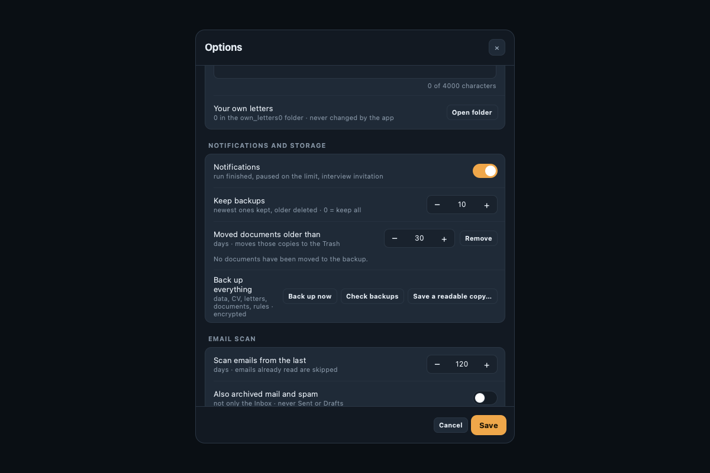

*Figure 16.6 – Options: notifications and storage*

Table 16.4 lists the Notifications and storage settings.

*Table 16.4 – The Notifications and storage settings*

| Setting | What it does | Values |
|---|---|---|
| **Size of text and controls** | Draws everything in the window larger, for a large or very sharp screen. It is used the next time you open the app | 100%, 110%, 125% or 150% |
| **Notifications** | A macOS notification when a run finishes, pauses on the limit, or an interview invitation arrives. **Test** sends one now and says what macOS did. When macOS has JobHelper's notifications turned off, a red line says so, with **Open System Settings** | On or off |
| **Keep backups** | How many automatic backups are kept; older ones are removed | 0 to 1000; 0 = keep all |
| **Back up everything** | **Back up now** makes one encrypted backup of everything. **Check backups** proves that a backup can be restored. **Save a readable copy…** puts the newest full backup, not encrypted, into an empty folder you choose | Three buttons |
| **Moved documents older than** | Moves old copies in the backup to the Trash, after asking | 7 to 3650 days |

### Email scan

Figure 16.7 shows the Email scan and Model settings.

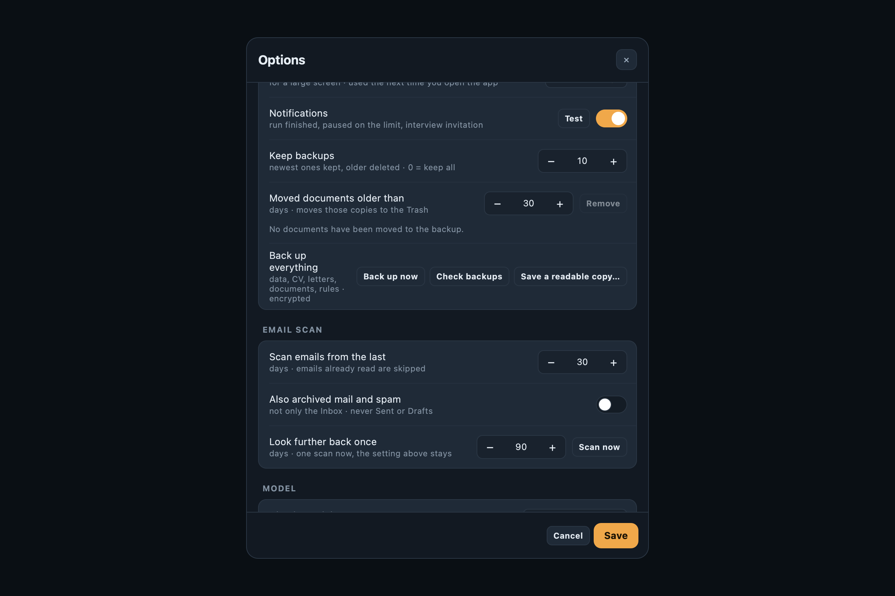

*Figure 16.7 – Options: email and the model*

Table 16.5 lists the Email scan settings.

*Table 16.5 – The Email scan settings*

| Setting | What it does | Values |
|---|---|---|
| **Scan emails from the last** | How far back an email scan looks. Messages already read are skipped | 1 to 3650 days |
| **Also archived mail and spam** | Reads those folders too, not only the Inbox. Never Sent or Drafts | On or off |
| **Look further back once** | Starts one scan over a longer period now. The setting above stays | 1 to 365 days, then **Scan now** |

### Model

Table 16.6 describes the Model setting.

*Table 16.6 – The Model setting*

| Setting | What it does | Values |
|---|---|---|
| **Claude model** | Which Claude model scores and writes | sonnet, opus, haiku |

A larger model writes better and uses your limit faster. **sonnet** is a good default.

---

## 17. Schedule a weekly run

macOS can run a search and an email scan for you once a week, even with the window closed.

### Turn it on

1. In the right column, select the **Weekly run** card.
2. Turn **Enabled** on.
3. Choose the day and the time.
4. Select **Save**.

Figure 17.1 shows the weekly run.

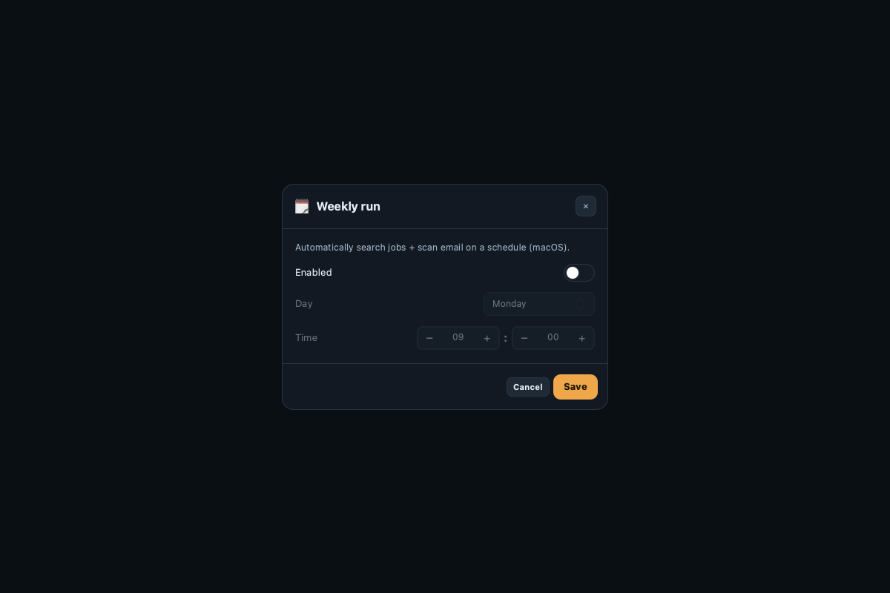

*Figure 17.1 – The weekly run*

You get a notification when the run is done. The **Last run** card shows its result the next
time you open the window (Table 17.1).

*Table 17.1 – What happens at the scheduled time*

| Situation at the scheduled time | What happens |
|---|---|
| The Mac is on | The run starts |
| The Mac is asleep | The run starts when it wakes |
| The Mac is switched off | That week's run is skipped |
| Claude's limit is used up | The run stops early and keeps what was finished |

### Turn it off

Open the card again, turn **Enabled** off, and select **Save**.

If you put a new version of the app on your Mac, or move the app to a different folder, open
the app one time. It then sets the weekly run to start the app in its new place, on the same
day and at the same time.

---

## 18. Watch your Claude usage and limits

Your Claude subscription has two limits, and the app counts against both like any other use of
Claude (Table 18.1).

*Table 18.1 – The two limits of a Claude subscription*

| Limit | What it is |
|---|---|
| **5-hour window** | How much you can use in a period of five hours. Claude calls it the session limit |
| **7-day window** | How much you can use in a week |

### Read the Usage left card

Each window has a bar and a figure for what is left. The numbers come from Claude's last
answer. **refresh** asks Claude for the current ones (Figure 18.1).

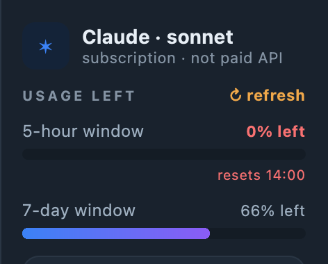

*Figure 18.1 – A limit that is used up*

Table 18.2 explains what the card shows.

*Table 18.2 – How to read the Usage left card*

| You see | Meaning |
|---|---|
| A figure such as **66% left** | That much of the window remains |
| **resets 14:00** under a bar | Shown when less than 20% is left: the time the window is empty again. A date is added when it is another day |
| **as of 18 Oct 09:22** under a bar | The figure is more than one hour old. Claude gives new figures only when it answers, so they stop while Claude refuses calls. A date is added when it is another day. Select **refresh** |
| **0% left** in red | Claude refused a call because this limit is used up. Nothing can be asked until the time shown |
| **—** | Claude has not reported this window yet. Select **refresh** |

When a reset time passes while the window is open, the card corrects itself: the limit is
shown as free again without you pressing anything.

> **Note**
> Other use of Claude on the same account, in the Claude app or in Claude Code, counts against
> the same limits. That is why the figure can drop while the app does nothing.

### When a run hits the limit

The run pauses instead of failing, and everything done so far is saved (Figure 18.2).

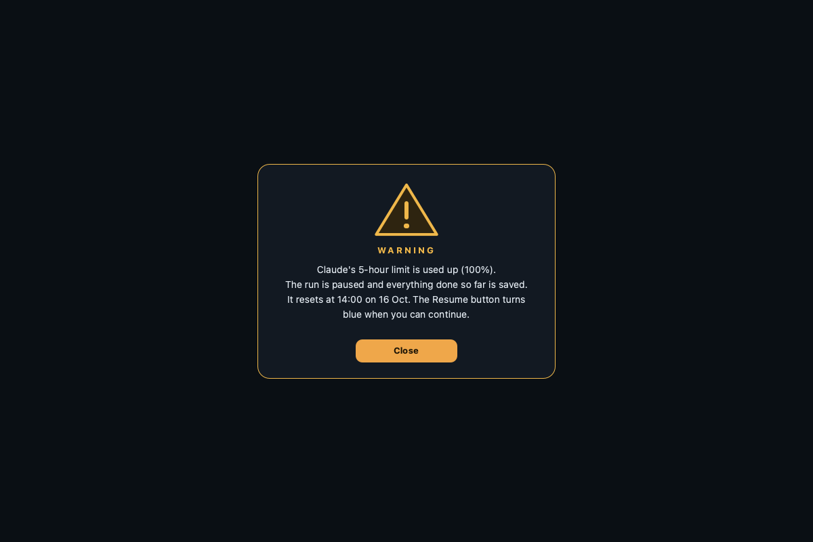

*Figure 18.2 – The run paused on the limit*

1. Read the window: it names the limit and the time it resets.
2. Select **Close**. You can keep using the lists.
3. When the limit is back, the **Resume** button turns blue. Select it.

The run continues from where it stopped. Nothing that was finished is done again.

### What a run costs

The **Last run** card shows two rows about cost (Table 18.3).

*Table 18.3 – The two cost rows of the Last run card*

| Row | Meaning |
|---|---|
| **You paid** | *subscription only*. Nothing was billed for the run |
| **Same search via API**, **Same scan via API** | What that one run would have cost with pay-per-use billing |

### See everything the app has used

1. In the right column, select **Help**.
2. Select the tab **Usage and problems** (Figure 18.3).

The first card shows how many questions the app asked Claude, in total and by type of work. It
also shows the cost of the same work through the paid API. You paid none of it.

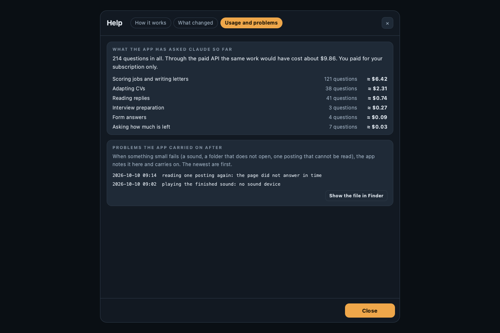

*Figure 18.3 – Usage and problems in Help*

### Use less of your limit

Table 18.4 lists ways to use less of your limit.

*Table 18.4 – Ways to use less of your limit*

| Do this | Why it helps |
|---|---|
| Keep fewer **Search roles** | Fewer postings to score |
| Select fewer **Job sources** | Fewer postings to score |
| Raise **Write letters above** | Fewer documents to write. Writing costs more than scoring |
| Set **Kinds of role you want** | More postings are skipped before scoring |
| Choose the **sonnet** model | It uses the limit more slowly than opus |

---

## 19. Protect your data

### Where your data is

Everything stays on your Mac. Only three things leave it (Table 19.1). These are the questions
to Claude (your CV text and a posting), the requests to the job boards, and the reading of your
mailbox.

*Table 19.1 – Where your data is and what protects it*

| What | Where | Protected by |
|---|---|---|
| The job list, your profile, your settings, the replies | `data/`, as encrypted files | AES-256 encryption |
| All backups | `data/backups/` | AES-256 encryption |
| The mailbox passwords and the data key | The macOS Keychain | Your Mac's login |
| CVs, letters, Excel tables | `data/`, as ordinary files, so that Word and Excel can open them | The encryption of your disk |
| The rule files for the CV and the letter | `data/` | A signature; a change made outside the app must be approved |

### Backups

The app makes a backup by itself before it changes data in bulk. The newest ones are kept,
as many as **Keep backups** in Options says.

To make a backup of everything yourself, for example before you move to a new Mac:

1. Open **Options** > **Notifications and storage**.
2. Select **Back up now**. The green line names the folder of the backup.
3. Optional: select **Check backups**. The app restores a backup into a temporary folder. Then it
   compares the copy with your data. This proves that the backup works.

To take your data out of the app in a form that any program can open:

1. Select **Save a readable copy…**.
2. Choose an empty folder outside the app's own folder.

> **Warning**
> A readable copy is not encrypted. Keep that folder safe, and delete it when you no longer
> need it.

### Changes to the rule files

The files that tell the app how to write your CV and your letters, the letter template and
your master CV are signed. If one of them is changed outside the app, the next run waits.

1. Open the **Account** card. The **Data protection** row names the changed files.
2. Select **See what changed**. Removed lines show in red with a minus sign. Added lines show in
   green with a plus sign.
3. Select **Approve** if the change is yours. Otherwise put the file back as it was.

> **Note**
> The app keeps the text of each file as it was when you approved it. For a file approved
> before this was added, the card says that no earlier copy was kept; open the file and read
> it before you approve.

> **Warning**
> Approve a change only when you made it yourself. The rule files decide what the app is
> allowed to write in your name.

### Nothing is thrown away

Table 19.2 lists where data goes instead of being deleted.

*Table 19.2 – Where data goes instead of being deleted*

| Action | Where the data goes |
|---|---|
| **Not interested** | The job leaves the list; its documents go to an encrypted backup |
| **Move documents to backup** | An encrypted backup; **Put them back** returns them |
| A letter is saved again | The previous version goes to an encrypted backup |
| Old copies are tidied | The Trash, never straight to deletion |

---

## 20. Troubleshoot problems

Figure 20.1 shows the Help window.

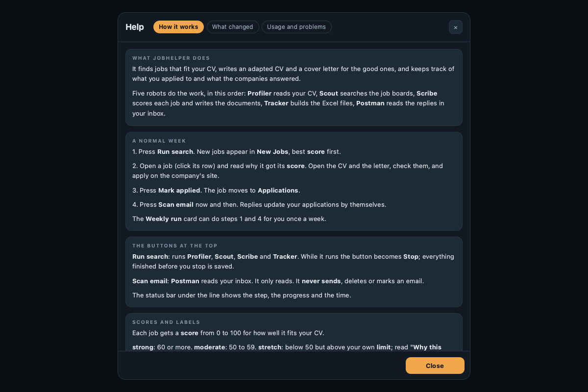

*Figure 20.1 – Help inside the app*

**Help** in the app has three tabs:

- **How it works** gives the main points of this guide in short form.
- **What changed** lists the changes of each version.
- **Usage and problems** shows what the app used, and the small problems that it noted.

### Starting and signing in

Table 20.1 lists problems with starting and signing in.

*Table 20.1 – Problems with starting and signing in*

| What you see | Cause | What to do |
|---|---|---|
| A red line at the top of the main window | The start-up check found something | The line says what and how to fix it |
| "Jobs have a status the app does not know" | A job has a status from an older version or from a change by hand | Select **Repair** on the red line |
| "Your job list is damaged" | The file of the job list cannot be read | Select **Restore from backup** on the red line |
| A button does nothing | A required row of the Account card is red | Open the **Account** chip and make the rows green |
| "A paid API key is set" | A paid Claude key is set on this Mac | Ask whoever set up the app to remove it, then start the app again |

### Searching and scoring

Table 20.2 lists problems with searching and scoring.

*Table 20.2 – Problems with searching and scoring*

| What you see | Cause | What to do |
|---|---|---|
| No results | The city or the roles are too narrow, or the filters dropped everything | Check Options; open **Filtered out** to see what was dropped and why |
| Too many poor jobs | The filters are too loose | Add words to **Skip titles with**, set **Kinds of role you want**, or raise **Write letters above** |
| Good jobs are skipped | The app read your profession wrong | Check the profession chips in Options; use **Score it anyway** on a single job |
| A score looks wrong | The posting was read only in part, or your Options changed | Read **Why this score**; see section 8 |
| The search paused | Claude's limit ran out | The window says when it resets; select **Resume** then (section 18) |
| The usage card says **0% left** | Claude refused a call for a used-up limit | Wait for the time shown, then select **refresh** |
| "Claude did not answer within 5 minutes" | Claude or the connection stopped answering. The search ended, and what was done is kept. If the CV of a job was written before the stop, the app keeps it | Try again later. If a job still has no documents after two stops, open it and select **Write CV and letter** (or **Write what is missing**) |

### Replies

Table 20.3 lists problems with replies.

*Table 20.3 – Problems with replies*

| What you see | Cause | What to do |
|---|---|---|
| A rejection is missing | It did not arrive in a scanned mailbox or folder | Set the status by hand, or paste the reply (section 11) |
| A scan finds "0 new" | Nothing new in the period | Use **Look further back once** in Options |
| A scan takes long the first time | It reads a long period once | Later scans skip what was already read |
| "Claude did not answer within 5 minutes" | Claude or the connection stopped answering. The scan ended. The replies that the app read before the stop are kept | Try again later. The next scan reads the other emails |

### Everything else

Table 20.4 lists other problems.

*Table 20.4 – Other problems*

| What you see | Cause | What to do |
|---|---|---|
| Something failed quietly | The app carried on after an error | Open **Help** > **Usage and problems**: the second card lists such errors, newest first, and **Show the file in Finder** shows the whole log |
| The data cannot be opened on a new Mac | The data key is in the old Mac's Keychain | Paste your recovery key in the **Account** card (section 2) |
| No notifications come | macOS has JobHelper's notifications turned off. macOS asks only once, the first time | Open **Options** > **Notifications and storage**. Select **Open System Settings**, select **JobHelper** and turn on **Allow notifications**. Then select **Test** |

---

## 21. Look things up

### Words the app uses

Table 21.1 explains the words the app uses.

*Table 21.1 – Words the app uses*

| Word | Meaning |
|---|---|
| **Lead** | A posting found for you that you have not applied to |
| **Score** | 0 to 100: how well a posting fits your CV and the roles you want |
| **Your limit** | The score in **Write letters above**: from there a CV and a letter are written |
| **strong**, **moderate** | 60 or more; 50 to 59 |
| **skipped** | Not scored, to save a Claude call |
| **Master CV** | Your own CV, which every adapted CV is made from |
| **Adapted CV** | A copy of the master CV with the profile and the skills reworded for one posting |
| **Filtered out** | Dropped by a search before scoring, with a reason |
| **The limit** | Claude's 5-hour or 7-day limit of your subscription |

### Where things are written

The app keeps your data in the folder JobHelper. That folder is in the folder Application
Support of your Library: `~/Library/Application Support/JobHelper`. Your data stays there
when you put a new version of the app on your Mac.

Older versions kept the data in the folder of the program. When you start this version for
the first time, the app copies your data into the Library and compares each copy with its
original. Then it starts again. It keeps the old folder as `data_moved_to_Library`, so you
have a full copy. If the move is not possible, the app uses the old folder, and the red line
at the top tells you why.

Table 21.2 lists the folders the app writes to. They are in the folder `data` of JobHelper.

*Table 21.2 – The folders the app writes to*

| Folder | What is in it |
|---|---|
| `data/cv/` | Your master CV |
| `data/tailored_cvs/` | The adapted CVs, as Word files and PDFs |
| `data/cover_letters/` | The letters the app wrote |
| `data/my_letters/` | The letters you wrote |
| `data/excel_new_jobs/`, `data/excel_applications/`, `data/excel_reports/` | The Excel tables |
| `data/backups/` | Encrypted backups |

### The light theme

Figure 21.1 shows the light theme.

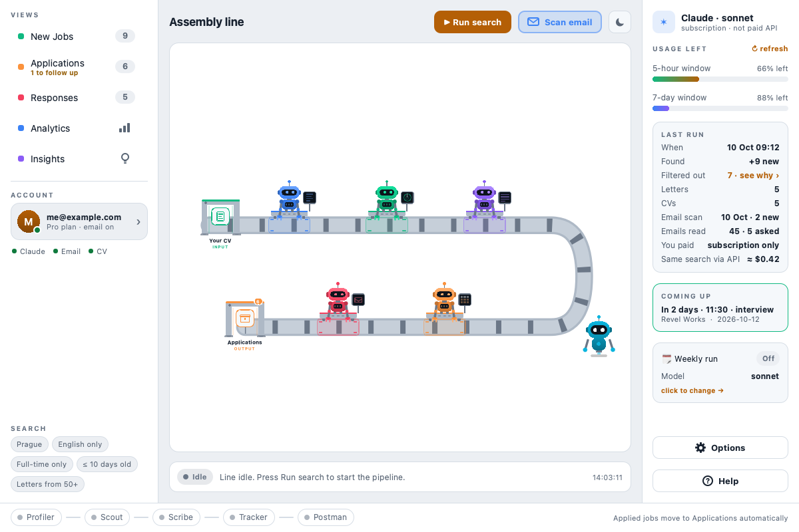

*Figure 21.1 – The light theme*

The sun or moon button at the top of the main window switches between the dark and the light
theme. Every window follows it.
