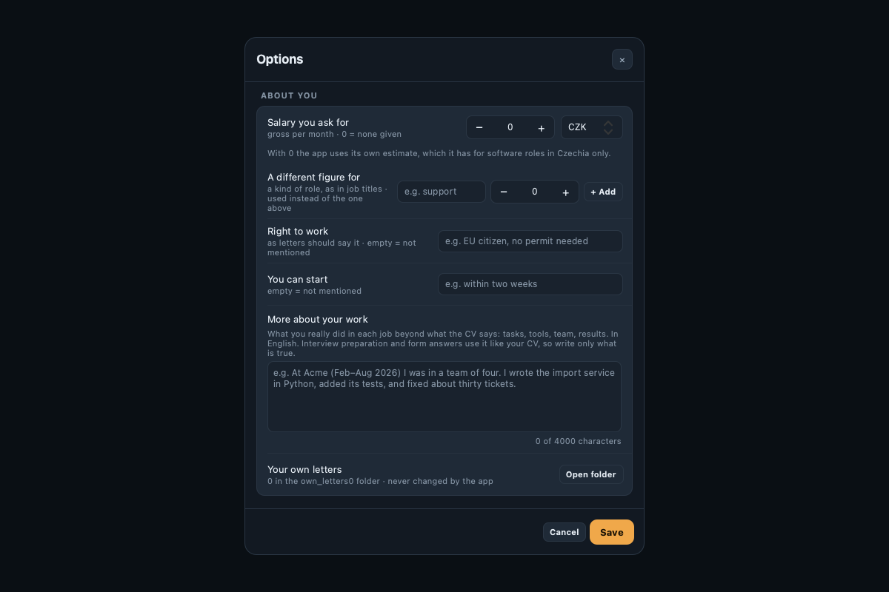

# JobHelper user guide

**Applies to:** JobHelper for macOS.

This guide explains every part of the app: what it is for, how to use it step by step, what
each control does, and what to do when something does not look right.

## In this guide

**Get started**

1. [Overview](#1-overview)
2. [Set up the app](#2-set-up-the-app)
3. [Find your way around the main window](#3-find-your-way-around-the-main-window)

**Find jobs and apply**

4. [Run a search](#4-run-a-search)
5. [Review new jobs](#5-review-new-jobs)
6. [Work with one job](#6-work-with-one-job)
7. [Check and edit your documents](#7-check-and-edit-your-documents)
8. [Fix a score you cannot trust](#8-fix-a-score-you-cannot-trust)

**Track your applications**

9. [Track an application](#9-track-an-application)
10. [Read replies from companies](#10-read-replies-from-companies)
11. [Prepare for an interview](#11-prepare-for-an-interview)

**Understand your results**

12. [See what a search left out](#12-see-what-a-search-left-out)
13. [Learn from your results](#13-learn-from-your-results)

**Configure and maintain**

14. [Set your options](#14-set-your-options)
15. [Schedule a weekly run](#15-schedule-a-weekly-run)
16. [Watch your Claude usage and limits](#16-watch-your-claude-usage-and-limits)
17. [Protect your data](#17-protect-your-data)
18. [Troubleshoot problems](#18-troubleshoot-problems)
19. [Look things up](#19-look-things-up)

### How to read this guide

Every section is built the same way: an overview of what the feature is for, what you need
before you start, the steps to follow, a table of what each control does, and the problems
people run into (Table 1).

*Table 1. How things are written in this guide*

| Element | How it is written | Example |
|---|---|---|
| A button, a list or a label in the window | **Bold**, spelled as in the app | Select **Run search**; open **Options** |
| A path through the window | **Bold**, joined with > | **Options** > **Email scan** > **Scan now** |
| Something you type | *Italics* | Enter *Prague* in **City** |
| The name of a file or a folder | `Monospace` | Your CV as a `.docx` file |
| A key on the keyboard | Capitalised, joined with + | Press Esc; press Cmd+C to copy |
| A figure or a table | By its number | Figure 2, Table 5 |

Four kinds of box mark what deserves attention (Table 2).

*Table 2. The four kinds of box*

| Box | Meaning |
|---|---|
| **Note** | Extra information that helps you understand |
| **Tip** | A faster or better way to do something |
| **Important** | Something you should know before you continue |
| **Warning** | Something that can cost you work or data if you ignore it |

### About the pictures

The figures show the real window of the app, filled with **invented** people and companies.

### Related documents

This guide is for using the app. People who work with its code will find the installation, the
command line, the structure of the code and the tests in the technical documentation,
[CODE.md](CODE.md).

---

## 1. Overview

### What the app does for you

Looking for a job means doing the same five things over and over: reading postings, deciding
which ones fit, rewriting your CV and a letter for each, keeping a list of where you applied,
and reading the answers. JobHelper does the repetitive part of all five and leaves the
decisions to you.

The work is split between five agents. The window shows each one as a robot on an assembly
line (Table 3).

*Table 3. The five robots and what each does*

| Robot | What it does | Asks Claude |
|---|---|---|
| **Profiler** | Reads your CV and works out what to search for | Once per CV |
| **Scout** | Searches the job boards and filters out what cannot fit | Never |
| **Scribe** | Scores each posting against your CV, then writes an adapted CV and a letter for the good ones | Yes |
| **Tracker** | Keeps the Excel tables up to date | Never |
| **Postman** | Reads the replies in your mailbox and updates your applications | For new replies only |

### What the app never does

- It never applies for you and never sends an email.
- It never deletes, moves or marks anything in your mailbox. The mailbox is opened read-only.
- It never writes anything in a CV, a letter or an answer that is not in your own CV or in
  notes you gave it.
- It never rewrites a letter that you wrote yourself.

You read, you decide, you send.

### What it costs

The app works through your Claude subscription. There is no bill per search. What a search
uses counts against your normal Claude limits, and the window shows how much is left
(section 16).

> **Important**
> The app refuses to run while a paid Claude key is set on the Mac, so that you are never
> billed per use by accident.

### A normal week

Table 4 shows a normal week with the app.

*Table 4. A normal week with the app*

| When | What you do | Section |
|---|---|---|
| Once | Set up the app and choose what you look for | 2, 14 |
| Two or three times a week | Run a search, review the new jobs, apply to the good ones | 4 to 7 |
| After each application | Press **Mark applied** | 5 |
| Every day or two | Scan your email for replies | 10 |
| Before an interview | Build the interview preparation | 11 |
| Every few weeks | Look at Analytics and Insights and adjust Options | 10, 13, 14 |

### Next steps

- [Set up the app](#2-set-up-the-app)

---

## 2. Set up the app

Do this once. When the app starts, it checks four things and shows them on the welcome card (Figure 1).

*Figure 1. The welcome card*

### Prerequisites

You need:

- JobHelper installed on your Mac and its window open.
- A Claude subscription, and the Claude Code program signed in on this Mac.
- Your CV as a `.docx`, `.pdf` or `.txt` file.
- Optional: the mailbox you apply from, and a password for a program to read it (for Gmail
  and most other providers, an *app password*).

### What the welcome card checks

Table 5 lists the four checks.

*Table 5. What the welcome card checks*

| Row | What it is | Why it is needed | Required |
|---|---|---|---|
| **Claude account** | The Claude sign-in on this Mac | Scoring and writing are done by Claude | Yes |
| **Job email** | The mailbox you apply from, opened read-only | So that replies update your applications by themselves | No |
| **Master CV** | Your one true CV | Every adapted CV is made from it and may only say what it says | Yes |
| **Data protection** | Encryption of your job data, with the key in the macOS Keychain | Your applications and replies are private | Yes |

A search can start only when the required rows are green. Without the email row everything
works except reading replies.

### Sign in to Claude

1. On the welcome card, find the **Claude account** row.
2. Select **Sign in with Claude**. A browser window opens.
3. Sign in with the account that has your subscription.
4. Return to the app. The row turns green within a few seconds.

### Choose your master CV

1. On the **Master CV** row, select the **Change…** button.
2. Pick your CV file.
3. The row shows the file name and turns green.

> **Tip**
> A `.docx` whose sections are headed PROFILE and KEY SKILLS gives the best result: the app
> can then adapt both sections for each job. With other files it rewrites the profile
> paragraph only.

### Connect your mailbox

1. Get a password for a program from your mail provider (the table below). For Gmail: turn on
   **2-Step Verification** in your Google account, then create an **App Password** and name it
   "JobHelper".
2. On the **Job email** row of the welcome card, select **Connect** (or **Change**).
3. Enter the address. The line under the fields then says which server it will be read from and
   what kind of password that provider wants.
4. Enter the password. If the app does not know the provider, a third field appears: enter the
   provider's **IMAP server** there (its help pages name it, for example `imap.example.com`).
5. Select **Save**. The button says **Checking…** while the app signs in to the mailbox once
   with what you entered. A refused password is not saved, and the card says so in red (Table 6).

*Table 6. Mail providers and the password each one wants*

| Your address is at | Read from | Password to enter |
|---|---|---|
| Gmail | `imap.gmail.com` | A Google App Password (16 letters) |
| Yahoo, AOL | The provider's server | An app password from the account's security settings |
| iCloud | `imap.mail.me.com` | An app-specific password from your Apple account |
| Fastmail, Zoho | The provider's server | An app password |
| Seznam, GMX, WEB.DE | The provider's server | Your mailbox password, with IMAP turned on in the mailbox settings |
| A company or another provider | The **IMAP server** you type | What that provider gives for reading mail by IMAP |
| T-Online, Posteo, mailbox.org, Orange, Libero, Onet | The provider's server | What the line under the fields says for that provider |
| A Russian mail service | Not used | The app does not work with Russian services. Connect a mailbox at another provider |
| Outlook.com, Hotmail, Proton Mail, Tuta | Not possible | These cannot be read with a password. Forward your job mail to another mailbox and connect that one, or paste replies into their applications (section 9) |

> **Note**
> An app password is a separate password that only lets a program read mail. You can cancel it
> in your account at any time without changing your real password. Where a provider offers
> one, never enter your real password in the app.

### Add a second mailbox (optional)

Use this when replies arrive at two addresses, for example an old address and a new one.

1. On the welcome card, under the **Job email** row, find **Second mailbox (optional)**.
2. Select **Add**.
3. Enter the second address and its own password, then select **Save**. It may be at another
   provider than the first one.

Both mailboxes are then read by every email scan. To find older replies in the new mailbox,
run one longer scan (section 10, *Look further back once*). A problem with the second mailbox never
stops the scan of the first one; the app tells you about it at the end of the scan.

### Save your recovery key

Your job data is encrypted with a key that the app keeps in the macOS Keychain. The recovery
key is that key as one line of text. You need it to open your data on another Mac, or on this
Mac after the Keychain is reset.

1. Select the **Account** chip to open the card.
2. On the **Data protection** row, select **Recovery key**.
3. Select **Copy**, and paste the key into a password manager or another safe place outside
   this Mac.
4. Select **Hide key**. The key is also put away by itself after a minute, and when the card
   closes.

> **Warning**
> Anyone who has the recovery key can read your data. Do not send it by email or keep it in a
> plain note. Without it, your data cannot be opened on a new Mac.

### Open your data on a new Mac

When the key is missing from the Keychain, the **Data protection** row is red and asks for it.

1. Paste your recovery key into the field under the row.
2. Select **Open my data**.

The app checks that the key belongs to this data before it uses it.

### Test a connected mailbox

An app password can be cancelled at the provider without the app knowing. To check that the
mailboxes can still be read:

1. Open the **Account** card.
2. On the **Job email** row, select **Test**.

A green line says that the app signed in; a red line says what the mail server answered. Both
mailboxes are tried when you have two.

### Open the card again later

Select the **Account** chip in the left column of the main window. The three dots under the
chip (**Claude**, **Email**, **CV**) are the same checks at a glance.

### If something is wrong

Table 7 lists problems while setting up, and what to do.

*Table 7. Problems while setting up, and what to do*

| What you see | Cause | What to do |
|---|---|---|
| **Claude account** stays red after you sign in | The sign-in was done in another browser profile, or was cancelled | Select **Sign in with Claude** again |
| "A paid API key is set" | A paid Claude key is set on this Mac | Ask whoever set up the app to remove it, then start the app again. The app never bills you per use |
| "The mail server refused this address and password" | The normal password was used where an app password is needed, the app password was cancelled, or it belongs to another address | Create an app password for this address and enter that one |
| "The app does not know this provider" | The address is at a company or a small provider | Enter its IMAP server in the third field |
| "Microsoft no longer lets a program read…" | Outlook.com and Hotmail cannot be read with a password | Forward your job mail to another mailbox and connect that one |
| "Saved. The mail server could not be reached" | No internet connection at that moment | Nothing. The first email scan shows whether it works |
| **Master CV** is red | No CV was chosen, or the file was moved | Select the **Change…** button and pick the file |

### Next steps

- [Find your way around the main window](#3-find-your-way-around-the-main-window)
- [Set your options](#14-set-your-options), to say what you are looking for

---

## 3. Find your way around the main window

Figure 2 shows the main window.

*Figure 2. The main window*

The window has three columns and a strip at the bottom (Table 8).

*Table 8. The areas of the main window*

| Area | Where | What it holds |
|---|---|---|
| Lists and account | Left | Your lists, the Account chip, the settings of the next search |
| Assembly line | Middle | The five robots, the two run buttons, the status line |
| Where you stand | Right | Claude usage, the last run, the next date, the weekly run, Options, Help |
| Pipeline strip | Bottom | The five agents by name, lit while they work |

### The left column

Figure 3 shows the lists and the account chip.

*Figure 3. The lists and the account chip*

Table 9 describes the lists in the left column.

*Table 9. The lists in the left column*

| Item | What it opens | The mark on the right |
|---|---|---|
| **New Jobs** | Postings found for you that you have not applied to | How many there are |
| **Applications** | Where you applied and where each one stands | How many there are |
| **Responses** | Every reply email the app has read | How many there are |
| **Analytics** | Outcomes and rejection reasons, added up | A bar chart |
| **Insights** | What your own results teach you | A light bulb |

A line under **Applications** appears when something needs you, for example "1 to follow up"
or "2 possible duplicates".

Under the lists:

- **Account**: the chip shows who is signed in. Select it to open the card from section 2.
- **Search**: chips that show what the next search is set to (city, language, full-time, age
  of postings, the score from which letters are written). Select a chip to change it in
  Options.

### The middle

Table 10 lists the controls in the middle.

*Table 10. The controls in the middle*

| Control | What it does |
|---|---|
| **Run search** | Starts a search (section 4). While a run is going, it becomes **Stop** |
| **Scan email** | Reads new replies (section 10) |
| The sun or moon button | Switches between the dark and the light theme |
| A robot | Lights up while its agent works and shows a tick when it is done. Point at it for its name, its job and its latest result |
| The status line | Always says what is happening, or what just happened, with the time |

### The red line at the top

Figure 4 shows the red line of the start-up check.

*Figure 4. The start-up check found something*

Each time the app starts, it checks itself: the data key, the job list, the replies, the
settings, the rule files, your master CV and the folders. If something is wrong, a red line at
the top says what, in plain words, and how to fix it. **Hide** puts the line away until the
next start; **Show all** appears when more than one thing was found.

### The right column

Figure 5 shows the Usage left card and the Last run card.

*Figure 5. Usage and the last run*

Table 11 lists the cards in the right column.

*Table 11. The cards in the right column*

| Card | What it tells you |
|---|---|
| **Claude** | The model in use, and that the subscription is used, not the paid API |
| **Usage left** | How much of your Claude limit remains (section 16). **refresh** asks Claude for the current numbers |
| **Last run** | What the last search and the last email scan did (the table below) |
| **Coming up** | The next dated event, such as an interview |
| **Weekly run** | Whether a weekly run is scheduled. Select it to change the schedule (section 15) |
| **Options** | Opens the settings (section 14) |
| **Help** | A short version of this guide, and the list of changes |

The rows of the **Last run** card (Table 12):

*Table 12. The rows of the Last run card*

| Row | Meaning |
|---|---|
| **When** | Day and time of the last search |
| **Found** | How many new postings it added |
| **Filtered out** | How many postings it dropped. Select the number to see each one with its reason (section 12) |
| **Letters**, **CVs** | How many of each were written |
| **Email scan** | Day of the last email scan and how many new replies it filed |
| **Emails read** | How many messages that scan went through, and how many of them were worth a question to Claude ("1224 · 43 asked"). It explains a "0 new": most mail was read before, or is not about an application |
| **You paid** | *subscription only*: nothing was billed for the run |
| **Same search via API** or **Same scan via API** | What the last run alone would have cost with pay-per-use billing. It is a measure of how much work was done, not a bill |

### Next steps

- [Run a search](#4-run-a-search)

---

## 4. Run a search

A search finds new postings, drops the ones that cannot fit, scores the rest against your CV,
and writes an adapted CV and a cover letter for each good one.

### Prerequisites

- The **Claude account** and **Master CV** rows of the Account card are green.
- A city and at least one search role are set in Options (section 14).

### Start a search

1. In the main window, select **Run search**.
2. Watch the assembly line. You can keep using the lists while it runs.
3. When the status line says the search is finished, open **New Jobs**.

Figure 6 shows a search in progress.

*Figure 6. A search in progress*

### What happens, in order

Table 13 lists what a search does, step by step.

*Table 13. What a search does, step by step*

| Step | Robot | What it does |
|---|---|---|
| 1 | **Profiler** | Reads your CV. Only when the CV changed since last time |
| 2 | **Scout** | Asks the job boards for each of your search roles in your city |
| 3 | **Scout** | Drops what cannot fit, and keeps every dropped posting with its reason |
| 4 | **Scout** | Reads once more the postings that came back empty, and asks older postings whether they still accept applications |
| 5 | **Scribe** | Scores what is left, five postings per Claude call |
| 6 | **Scribe** | Writes an adapted CV and a letter for each posting at or above your limit |
| 7 | **Tracker** | Rebuilds the Excel tables |

What step 3 drops:

- Postings written in another language, and roles that require one at a working level
  (with **English only** on). The reason names the language.
- Titles above your level.
- Part-time work, when you want full-time.
- Postings older than your limit.
- Roles you already applied to.
- Titles that contain a word you chose to skip.

> **Note**
> Scoring costs a Claude call. A posting whose title is plainly another profession is marked
> **skipped** without a call. You can send any skipped posting to scoring yourself with
> **Score it anyway** in its window.

### Stop a search

Select **Stop**. The search ends after the step in progress. Everything finished before that
is kept, and the next search continues with what was not done.

### If Claude's limit runs out

The run pauses instead of failing. See [Watch your Claude usage and limits](#16-watch-your-claude-usage-and-limits).

### If something is wrong

Table 14 lists problems with a search, and what to do.

*Table 14. Problems with a search, and what to do*

| What you see | Cause | What to do |
|---|---|---|
| "No city yet" | Options has no city | Open Options and choose a city |
| The search finds nothing new | Your roles are too narrow, or everything was filtered | Open **Filtered out** on the Last run card (section 12) |
| Too many poor postings | The filters are too loose | Add words to **Skip titles with**, or set **Kinds of role you want** |
| A source is missing from the results | That site turned programs away this time | Nothing to do. The app leaves such a site alone and tries again at the next search |

### Next steps

- [Review new jobs](#5-review-new-jobs)

---

## 5. Review new jobs

**New Jobs** is the list of postings found for you that you have not applied to, best score
first (Figure 7).

*Figure 7. The New Jobs list*

### Read a row

Table 15 explains how to read a row.

*Table 15. How to read a row of New Jobs*

| You see | It means |
|---|---|
| The number on the left | The score, 0 to 100: how well the posting fits your CV and the roles you want |
| **was 64** under the number | What the job scored before it was scored again |
| **strong** | 60 or more. A CV and a letter were written |
| **moderate** | 50 to 59. A CV and a letter were written |
| No badge | Below your limit. Listed so that you can judge for yourself; no documents were written |
| **skipped** | Not scored at all, to save a Claude call (section 4) |
| The grey line | When it was posted, the salary you ask for (section 14), and any warning about the score |
| **closed** | The posting no longer accepts applications |
| **scored from the title only**, **scored from a short summary** | The score rests on little text (section 8) |
| **documents from a higher score** | The job fell below your limit after its documents were written (section 8) |

### Apply to a job

1. Select the row to open the job (section 6).
2. Read **Why this score**, then check the CV and the letter (section 7).
3. Select **Open posting** and apply on the company's site with the two files.
4. Return to the app and select **Mark applied**.

> **Important**
> Select **Mark applied** only after you really sent the application. The job moves to
> **Applications**, and replies are matched to it from then on.

### Controls of the list

Table 16 lists the controls of the New Jobs list.

*Table 16. The controls of the New Jobs list*

| Control | What it does |
|---|---|
| The search box | Shows only the rows that contain what you type |
| The chips under it | Filter the list |
| The buttons on a row | Open the posting, the letter and the CV |
| **mark applied** | Moves the job to Applications |
| **Score all again** | Scores every job with your current Options. It asks first, because it uses your Claude limit |
| **open Excel** | Opens the same list as an Excel table |

### Review several jobs one by one

When many jobs wait for a decision, for example all those marked **stretch**, you do not have
to open each from the list and come back.

1. In **New Jobs**, narrow the list to the jobs you want to go through: select a chip, or type
   in the search box.
2. Select **Review these … one by one**. The first job opens, with a bar that says where you
   are (Figure 8).
3. Read **Why this score**, then decide: **Not interested** removes the job, **Mark applied**
   moves it to Applications. The next job opens by itself.
4. To leave a job as it is, select **Next ›**. **‹ Previous** goes back.

*Figure 8. Reviewing jobs one by one*

The round ends after the last job, or when you close the window. Jobs you did not decide on
stay in the list as they were.

### Next steps

- [Work with one job](#6-work-with-one-job)

---

## 6. Work with one job

Select a row in **New Jobs** to open the job's window. Everything about one posting is here (Figure 9).

*Figure 9. The job window*

### The checklist: Before you apply

The checklist has one line per step. Tick the steps as you go. The ticks are remembered for
this job (Table 17).

*Table 17. The checklist of a job and its buttons*

| Line of the checklist | Its button | What the button does |
|---|---|---|
| Read the posting and open its application form | **Open posting** | Opens the posting in your browser |
| Check your adapted CV | **Open CV** or **Open CV PDF** | Opens the adapted CV |
| Check your cover letter | **Open letter** or **Open letter PDF** | Opens the letter |
| If the form takes one file | **Make one PDF** | Makes one PDF with the letter first and the CV after it |
| Answers for this job's form | **Form answers** | Drafts answers for the application form (section 7) |

**Show in folder** on a line selects that file in Finder, so that you can drag it into an
application form.

The row of buttons at the bottom of the window opens the same documents again and adds two
more (Table 18):

*Table 18. The two extra buttons for documents*

| Button | What it does |
|---|---|
| **Compare CV** | Shows what was changed in the adapted CV (section 7) |
| **Edit letter** | Opens the letter editor (section 7) |

### Why this score

Figure 10 shows the score and the keywords.

*Figure 10. The score and the keywords*

**Why this score** is the reason in words. Read it before you apply to anything below
**strong**: it tells you what the posting asks for that your CV does not show.

**Keywords in the posting** compares the skills and tools the posting names with your CV (Table 19).

*Table 19. The two groups of keywords*

| Group | Meaning |
|---|---|
| **In your CV** | The posting asks for it and your CV shows it |
| **Not in your CV** | The posting asks for it and your CV does not show it. Something to learn, or something you know and forgot to write down |

> **Note**
> The app never adds a **Not in your CV** word to an adapted CV. If you really have that
> skill, add it to your master CV, or describe it under **More about your work** in Options.

### The buttons at the bottom

Table 20 lists the buttons at the bottom of the job window.

*Table 20. The buttons at the bottom of the job window*

| Button | What it does |
|---|---|
| **Form answers** | Drafts answers for this job's application form (section 7) |
| **Score it anyway** | Sends a skipped job to scoring |
| **Not interested** | Removes the job from the list. Its documents go to an encrypted backup |
| **Mark applied** | Moves the job to Applications |

> **Note**
> If you typed something in this window and did not save it, the ✕, the Esc key, **Mark
> applied** and **Not interested** all ask once before the text is discarded.

### Next steps

- [Check and edit your documents](#7-check-and-edit-your-documents)

---

## 7. Check and edit your documents

For each posting at or above your limit the app writes two documents. Check both before you
send them. You are the one who signs them.

### The adapted CV

The app makes a copy of your CV in which the profile paragraph and the skills list are
reworded and reordered to put first what this posting asks for. Everything else stays as you
wrote it.

**To see what changed:**

1. Open the job.
2. Select **Compare CV**.
3. Read the two columns: your master CV on the left, the adapted one on the right. New words
   are in bold (Figure 11).

*Figure 11. Master CV next to the adapted one*

> **Tip**
> Use this view to check that nothing was stretched. Every claim on the right must be one you
> can back in an interview.

Sometimes the job window shows an amber line, **Check your adapted CV before you send it** or
**Check your cover letter before you send it**, with a few terms. Those are words of the posting that the adapted CV states as your experience
although your own CV does not mention them (in a letter: where the sentence says that you did
it, not where it speaks of the role). The app asked for them to be removed once already;
what is left may still be fair wording for something you did, so the decision is yours: keep
the term only if it is true of you, and otherwise edit the Word file or add what you really did
under **More about your work** in Options.

### The cover letter

The letter is written to the company, about this role, from the facts in your CV.

**To edit a letter:**

1. Open the job and select **Edit letter**.
2. Change the words of any paragraph yourself.
3. Or, to have one paragraph written again: type what should change in **For a rewrite**
   (for example "shorter"), then select **Rewrite this paragraph**.
4. Select **Save**. The Word file and the PDF are updated.

Figure 12 shows the letter editor.

*Figure 12. The letter editor*

Table 21 lists the controls of the letter editor.

*Table 21. The controls of the letter editor*

| Control | What it does |
|---|---|
| The word count, top right | Turns amber when the letter is shorter or longer than a letter should be |
| **Rewrite this paragraph** | Asks Claude for a new version of that paragraph. Nothing is saved until you select **Save** |
| **For a rewrite** | An optional hint for the rewrite |
| **Open in Word** | Opens the file in Word instead |
| **Undo my changes** | Puts back the text as it was when you opened the editor |
| **Save** | Writes the paragraphs into the letter. The head, date, greeting, signature, fonts and layout stay as they are |

> **Note**
> Closing the editor with unsaved changes asks once. The previous version of a saved letter is
> kept in an encrypted backup.

### Have documents written for one job

A search writes documents only for jobs at or above your limit. For any other new job you can
have them written when you decide to apply after all, or after the job was scored again.

1. Open the job.
2. Under **Why this score**, select **Write CV and letter**. The app asks Claude; this takes
   about a minute.
3. When the line says **Written**, check both documents as usual.

A letter that you wrote yourself is never replaced: only what is missing is written. When the
posting's text is missing, the app asks you to read the posting again first (section 8),
because a letter written from a title alone would be generic.

### Your own letters

A letter that **you** wrote is never touched.

1. Open Options and find **Your own letters**. Select **Open folder**.
2. Put your letter in that folder, named after the company.
3. At the next search the app uses your letter for that company instead of writing one.

### Form answers

Application forms ask their own questions, and every form asks different ones.

1. Open the job and select **Form answers**.
2. Paste that form's questions, one per line.
3. Select **Draft**.
4. Read each answer. Fill in anything marked with square brackets.
5. Copy the answers into the form.

Figure 13 shows answers for one job's form.

*Figure 13. Answers for one job's form*

The answers come from your CV, the posting, and the facts you gave under **About you** in
Options. An answer the app cannot give truthfully (a salary figure, a date, a reference) is
left with the missing part in square brackets and a **Check** note. The answers are kept with
the job (Table 22).

*Table 22. The limits of one draft of form answers*

| Limit | Value |
|---|---|
| Questions in one draft | Up to 15 |
| Length of one question | Up to 300 characters |

### Next steps

- [Track an application](#9-track-an-application), after you applied

---

## 8. Fix a score you cannot trust

Two situations make a score misleading. The app marks both in the list and in the job's window.

### The posting could not be read in full

Some job boards return only a title or a short summary. The row then says **scored from the
title only** or **scored from a short summary** (Table 23).

*Table 23. What the app does when a posting could not be read*

| Mark | What the app did |
|---|---|
| **scored from the title only** | Capped the score at 40 and wrote no documents, because a letter written from a title could only be generic |
| **scored from a short summary** | Scored from what there was, and tells you so |

**To get a real score:**

1. Open the job.
2. Select **Read it again**. The app asks the job board once more.
3. If that does not help, select **Open posting**, copy the whole text of the posting in your
   browser, paste it under **Paste the posting's text**, and select **Save text**.

Either way, the job is then scored again by itself.

### The score dropped after documents were written

If you tighten your Options and score again, a job that had a letter and a CV can fall below
your limit. Its row says **documents from a higher score** (Figure 14).

*Figure 14. A job that fell below the limit*

**For one job:** open it and select **Move documents to backup**. The letter and the CV go to
an encrypted backup. The job stays in the list. **Put them back** returns them.

**For all such jobs at once:**

1. Open **New Jobs**. A bar above the list says how many jobs have documents from a score
   that is now below your limit.
2. In that bar, select **Move them to backup**.
3. Read the jobs it names, then select **Yes, move documents of …** to confirm.

Figure 15 shows moving documents for several jobs at once.

*Figure 15. Moving documents for several jobs at once*

For a week afterwards, **Put them back** in the same bar undoes the whole move. For a single
job, **Put them back** stays in its window, also when the job has become an application in the
meantime (a reply showed that you had applied): those are the documents you sent.

> **Note**
> Nothing the app wrote for you is thrown away without a way back. You may have had a reason
> to apply anyway. Letters you wrote yourself are never moved.

---

## 9. Track an application

**Applications** lists where you applied, grouped by where each one stands: offers and
interviews first, then waiting, then rejected (Figure 16).

*Figure 16. The Applications list*

### The application's window

Select a row to open the application (Figure 17).

*Figure 17. An application in full*

Table 24 lists the fields of an application.

*Table 24. The fields of an application*

| Field | What it is | When to change it |
|---|---|---|
| **Status** | Where the application stands | Normally set by the replies in your mailbox. Change it by hand when the news came another way |
| **Applied on** | The day you applied | Correct it if you applied before you pressed the button |
| A date to remember | An interview, a deadline, a test task, a call | Set it when you agree a date |

### Set a date and get reminded

1. In the application's window, choose the kind of date, the day and, if you know it, the time.
2. Select **Save date**.
3. Optional: select **Add to calendar** to put it in Calendar, so that your phone reminds you
   too.

The date then shows on the **Coming up** card of the main window. You get a notification the
day before and on the day. With a time, you also get one about three hours and one hour before (Figure 18).

*Figure 18. Dates, pasted replies and notes*

### File a reply that did not come by email

An answer that came on LinkedIn or in a company portal can be filed by hand.

1. In the application's window, find **Paste the message text here**.
2. Paste the message and select **Save**.

The app reads it like an email and updates the status.

### Keep notes about the company

**Who you spoke to**, **Salary mentioned**, **What they asked** and **Anything else worth
remembering** are kept for the company, not for the job. They appear again when you apply
there later. Select **Save notes** after you write them.

### Follow up

After ten quiet days (you can change the number in Options) the app suggests a follow-up and
drafts one.

1. Open the application. The follow-up draft is shown.
2. Select **Copy** and send it from your own mail program.
3. Select **Mark as followed up**, so that the reminder stops.

> **Note**
> The app does not send the follow-up. It only writes the draft.

### Possible duplicates

When two entries look like the same application, the line under **Applications** says so. Open
one of them and choose **Merge into one** or **They are different**.

### Next steps

- [Read replies from companies](#10-read-replies-from-companies)

---

## 10. Read replies from companies

An email scan reads new mail in your mailbox, works out which messages are answers to your
applications, and files each one to its application.

### Prerequisites

- The **Job email** row of the Account card is green (section 2).

### Scan your email

1. In the main window, select **Scan email**.
2. Wait for the status line to say how many new replies were filed.
3. Open **Responses** to read them, or **Applications** to see the new statuses.

> **Important**
> The scan only reads. Nothing is sent, deleted, moved or marked as read. Mail from the Sent
> and Drafts folders is never read.

### How the app chooses which messages to read closely

Most mail in a mailbox is not about your applications. Asking Claude about every message
would waste your limit, so the app first decides, without Claude, which messages are worth a
question (Table 25).

*Table 25. Which messages are sent to Claude*

| A message is | Sent to Claude |
|---|---|
| From a recruiting system (for example Greenhouse, Workable, Teamio, SuccessFactors) | Yes |
| From a company you track, named in the sender or the subject, and it talks about an application | Yes |
| From a person at a company you track, even with no such words ("Are you free on Tuesday?") | Yes |
| From anyone, when it talks about an application and is not list mail | Yes |
| A job alert, a digest, a sign-up or password message | No |
| Automatic mail from a company you track with nothing about an application (a statement, an advert) | No |
| An advert or newsletter that only shares a common word with a company's name ("International", "Praha"), or mentions a brand somewhere in its text | No |

Claude then reads each chosen message and decides whether it is an invitation, a rejection, an
offer, or an automatic confirmation. A message that turns out to be none of these is not filed.

### How far back a scan looks

A scan reads the mail of the last days set in Options under **Scan emails from the last**.
Messages that were already read by an earlier scan are skipped, so a longer period costs
nothing after the first time.

### Look further back once

Use this after you add a mailbox, or when an old reply is missing.

1. Open **Options** and find **Email scan**.
2. Under **Look further back once**, choose the number of days (90 to begin with).
3. Select **Scan now**. A green line confirms that the scan started; you can close Options.

The scan reads that period once. The setting **Scan emails from the last** stays as it is.

### Responses

Figure 19 shows the Responses list.

*Figure 19. Every reply*

**Responses** lists every reply with what it was. Select one to read it in full (Figure 20).

*Figure 20. One reply in full*

Table 26 lists the fields of a reply.

*Table 26. The fields of a reply*

| Field | Meaning |
|---|---|
| The badge | What the reply was: interview, rejection, offer, acknowledged |
| **Summary** | What the message says, in one or two sentences |
| **Next step** | What they ask of you, if anything |
| **Reason** | For a rejection: the reason they gave, and its kind |
| The application | Which of your applications it was filed to. Select it to open that application |
| **File under…** | Files the reply under another application, or under none |

### File a reply under the right application

Sometimes a reply is filed under the wrong application, or under none: two applications at
one company, or a recruiter who writes from an agency's address.

1. In **Responses**, select the reply.
2. Select **File under…** (or **File under another…**). The list of your applications opens
   (Figure 21).
3. Type a company or a role to narrow the list, then select the right application.

*Figure 21. Choosing the application a reply belongs to*

The application the reply moves to follows it in the usual way: an invitation makes it an
interview, a rejection closes it. The application the reply leaves keeps its status, because
only you know whether this reply had set it; the green line reminds you to look. To unlink a
reply that is about none of your applications, select **It belongs to none of my
applications**.

### Analytics

Figure 22 shows outcomes and rejection reasons.

*Figure 22. Outcomes and rejection reasons*

**Analytics** adds the replies up (Table 27).

*Table 27. The parts of Analytics*

| Part | What it shows |
|---|---|
| The last seven days | What came in this week |
| Where applications stand | How many are waiting, in interviews, or closed |
| Rejection reasons | What reasons the rejections gave, most common first |

> **Tip**
> The rejection reasons are the useful part. If most of them say the same thing, that is what
> to change: your level, a missing skill, or the kind of role you apply to.

### If something is wrong

Table 28 lists problems with replies, and what to do.

*Table 28. Problems with replies, and what to do*

| What you see | Cause | What to do |
|---|---|---|
| "0 new" after a scan | No new replies in the period, or they were read by an earlier scan | Nothing. **Emails read** on the Last run card shows what the scan went through. To look further back, use **Look further back once** |
| A rejection is missing | It did not arrive in a scanned mailbox, or it is in another folder | Turn on **Also archived mail and spam**, or paste the reply into the application (section 9) |
| A reply was filed to the wrong application, or to none | Two applications at the same company, or a sender the app could not place | Open the reply and select **File under…** |
| A warning about the second mailbox | Its password was cancelled or mistyped | Open the Account card and select **Change** for the second mailbox |

---

## 11. Prepare for an interview

For one interview the app builds a sheet from your CV and the posting.

### Build the preparation

1. Open the application.
2. On the **Interview preparation** card, select **Prepare**. The app asks Claude; this takes
   about a minute.
3. When the card says the questions and answers are ready, select **Open**.

**Document** on the same card opens the sheet as a Word file. **Make again** builds a new one,
for example after you changed your CV (Figure 23).

*Figure 23. The interview preparation*

### What the sheet contains

Table 29 lists the parts of the interview sheet.

*Table 29. The parts of the interview sheet*

| Part | What it is |
|---|---|
| What to expect | A short summary of this interview |
| The opening pitch | Two or three sentences to introduce yourself |
| Questions an HR person or a recruiter is likely to ask | Answered in plain words, without the jargon of your field |
| Questions someone who does this work, or the hiring manager, is likely to ask | Answered precisely, with the real tools, methods and numbers |
| **Why they ask** | Under each question: what the interviewer wants to learn |
| Questions you can ask them | For the HR person, and for the people you would work with |

> **Important**
> The answers are a starting point built from your CV. An answer that touches something your
> CV does not show is marked **Check this answer**. Rewrite it, so that you never repeat a
> claim you cannot back.

### Use the sheet

Table 30 lists the buttons of the interview sheet.

*Table 30. The buttons of the interview sheet*

| Button | What it does |
|---|---|
| **Edit** | Lets you rewrite any part in your own words |
| **Copy all** | Copies the whole sheet as text |
| **Open as document** | Makes a Word sheet to print or read on the way |
| **Show in folder** | Selects that Word file in Finder |

After the interview, the application's window offers a short **thank-you** note to copy.

---

## 12. See what a search left out

A search that only shows you what it kept would be asking you to trust it blindly. Every
posting a search drops is kept with the reason.

### Open the list

1. On the **Last run** card, select the number next to **Filtered out**.

Figure 24 shows postings the last search filtered out.

*Figure 24. Postings the last search filtered out*

### Read the list

Each row is one dropped posting with the reason in words. The chips at the top group the rows
by reason (Table 31).

*Table 31. Reasons a posting is filtered out, and where to change each rule*

| Reason | Meaning | Where to change the rule |
|---|---|---|
| **too senior** | The title is above your level | **Skip levels above yours** |
| **other language** | The ad is written in another language (the reason names it), or the role requires one at a working level | **English only** |
| **part time** | You asked for full-time only | **Full-time only** |
| **too old** | Posted longer ago than your limit | **Max job age** |
| **years** | Asks for more years of experience than you accept | **Skip jobs asking for** |
| **skip word** | The title has a word you skip | **Skip titles with** |
| **already applied** | You applied to this role at this company | Nothing to change |

### Bring a posting back

1. Find the row.
2. Select **bring back**.

The posting goes to **New Jobs**, and the next search scores it.

---

## 13. Learn from your results

**Insights** is worked out on your Mac from your own applications. It asks Claude nothing (Figure 25).

*Figure 25. Insights*

Table 32 lists the parts of Insights.

*Table 32. The parts of Insights*

| Part | The question it answers |
|---|---|
| **What is working** | Which kinds of role and which job boards led to interviews? |
| **Week by week** | How many applications did I send, and what came back? |
| **Skills to learn** | What do the postings ask for most that my CV does not show? |
| **What the postings pay** | What salaries do the postings state, in your currency, and how do they compare with what you ask? |
| **How long companies take to answer** | When should I stop waiting? |
| **Why jobs scored low** | What reasons come up most often? |

> **Note**
> With only a few applications the app says "too few to say" rather than guessing. The numbers
> become useful after about ten applications.

### What to do with it

Table 33 suggests what to do with what you see.

*Table 33. What to do with what Insights shows*

| You see | Consider |
|---|---|
| One kind of role gets the interviews | Put that role first in **Search roles**, and add it to **Kinds of role you want** |
| One skill is asked for again and again | Learn it, or add it to your CV if you already have it |
| Most low scores give the same reason | Change the filter that should have dropped those postings |
| Companies answer within two weeks or not at all | Follow up after ten days and move on after three weeks |

---

## 14. Set your options

Options is where you tell the app what you are looking for. Open it with **Options** in the
right column, or with a chip under **Search** in the left column (Figure 26).

*Figure 26. Options: the search*

> **Note**
> A choice too long for its box is shown on two lines, never cut.

> **Note**
> Every field checks what you type. A value the app cannot use is marked in red with the
> reason, and **Save** waits until it is corrected. Closing Options with unsaved changes asks
> once.

### Search

Table 34 lists the Search settings.

*Table 34. The Search settings*

| Setting | What it does | Values | Why you would change it |
|---|---|---|---|
| **City** | Where to search | A city name | The app will not search without one |
| **Country** | Which postings of a company's career site, and which remote jobs, count as "here": the city, anywhere in this country, the region it is in ("Europe", "EMEA"), or remote without being tied to another part of the world | A country's name in English. Empty = the country of the city, shown in grey | Type it when the field says the city is not known, or when you also want jobs from a neighbouring country |
| **Job source** | Which job boards are read | Czech boards, LinkedIn and careers; LinkedIn only; Company career sites only; All sources (+ remote) | More sources find more and take longer |
| **Search roles** | The words typed into the job boards, in English | One or more roles | Too few results: add a role. Too many poor ones: remove one |
| **Skip titles with** | Words that drop a posting by its title | Words | To get rid of a kind of posting that keeps appearing |
| **…but keep titles with** | Exceptions to the line above | Words | To keep a title that a skip word would drop |
| **Kinds of role you want** | Tells the scorer your direction | Roles | Without it, a role in another field that merely accepts your degree could score high |
| **Kinds of role you do not want** | Skipped when the title names one, scored low otherwise | Roles | To keep a neighbouring field out |
| **Skip levels above yours** | Level words that drop a posting | Words such as senior, lead | A senior candidate empties this list |
| **Skip jobs asking for** | Drops postings that ask for this many years or more | 0 to 30; 0 = never | To keep out postings you are not yet eligible for |
| **Include remote jobs** | Adds the remote boards | On or off | To widen the search beyond your city |
| **Full-time only** | Hides part-time roles | On or off | Turn off if part-time suits you |
| **English only** | Hides postings written in another language, and roles that require another language at a working level | On or off | Turn off if you also work in the local language. A posting that requires a language your CV does not show is then scored low instead |
| **Max job age** | Drops postings older than this | Days; 0 = any date | Old postings are often already filled |
| **Results per query** | How many postings each role asks each board for | 1 to 100 | Raise it for a wider search, lower it for a faster one |

### Your profession

Figure 27 shows the roles you want and your profession in Options.

*Figure 27. Options: the roles you want and your profession*

Under **Kinds of role you want**, chips show what the app takes as your profession. The app
reads it from the roles you want (the outlined chip). It decides which titles are skipped as
"another profession" before scoring.

- If the app read it wrong, select the right chips yourself.
- **Let the app decide** goes back to reading it from your roles.

Seventeen professions are known.

### Company career sites

Some companies publish their openings on their own career site. To read one directly:

1. Find the company's career page and note the short name in its address (for example,
   `boards.greenhouse.io/example` gives `example`).
2. Under **Company career sites**, enter the company's name and that short name, and choose
   the system.
3. Select **Add**.

### Matching and follow-up

Table 35 lists the Matching and Follow-up settings.

*Table 35. The Matching and Follow-up settings*

| Setting | What it does | Values |
|---|---|---|
| **Write letters above** | The score from which a CV and a letter are written | 0 to 100 |
| **Hide leads below** | Hides jobs below this score from New Jobs | 0 to 100; 0 = show all |
| **Remind me after** | Days without a reply before a follow-up is suggested | 0 to 90; 0 = never |

> **Tip**
> Raise **Write letters above** to apply to fewer, better matches. It also uses less of your
> Claude limit, because fewer documents are written.

### About you

Figure 28 shows the About you settings.

*Figure 28. Options: about you*

Table 36 lists the About you settings.

*Table 36. The About you settings*

| Setting | What it does |
|---|---|
| **Salary you ask for** | Your expected pay, gross per month, with its currency. Form answers give it as your expectation, the job window and the lists show it, and Insights compares what postings pay with it. 0 = none given: the app then uses its own estimate, which it has for software roles in Czechia only, and otherwise leaves the figure for you to fill in |
| **A different figure for** | A salary of its own for one kind of role, used instead of the general one when the words are in the job's title (*support* for "IT Support Specialist"). Enter the kind of role and the figure, then select **+ Add** |
| **Right to work** | How letters and answers should say it. Empty = not mentioned |
| **You can start** | When you can start. Empty = not mentioned |
| **More about your work** | What you really did in each job beyond what the CV says, in your own words. The app may use it like the CV |
| **Your own letters** | The folder for letters you wrote yourself (section 7) |

> **Important**
> Write only true facts here. The app treats them as true and uses them in letters, form
> answers and interview answers.

### Notifications and storage

Figure 29 shows the Notifications and storage settings.

*Figure 29. Options: notifications and storage*

Table 37 lists the Notifications and storage settings.

*Table 37. The Notifications and storage settings*

| Setting | What it does | Values |
|---|---|---|
| **Notifications** | A macOS notification when a run finishes, pauses on the limit, or an interview invitation arrives | On or off |
| **Keep backups** | How many automatic backups are kept; older ones are removed | 0 to 200; 0 = keep all |
| **Back up everything** | **Back up now** makes one encrypted backup of everything. **Check backups** proves that a backup can be restored. **Save a readable copy…** puts the newest full backup, not encrypted, into an empty folder you choose | Three buttons |
| **Moved documents older than** | Moves old copies in the backup to the Trash, after asking | 7 days or more |

### Email scan

Figure 30 shows the Email scan and Model settings.

*Figure 30. Options: email and the model*

Table 38 lists the Email scan settings.

*Table 38. The Email scan settings*

| Setting | What it does | Values |
|---|---|---|
| **Scan emails from the last** | How far back an email scan looks. Messages already read are skipped | 1 to 365 days |
| **Also archived mail and spam** | Reads those folders too, not only the Inbox. Never Sent or Drafts | On or off |
| **Look further back once** | Starts one scan over a longer period now. The setting above stays | 2 to 365 days, then **Scan now** |

### Model

Table 39 describes the Model setting.

*Table 39. The Model setting*

| Setting | What it does | Values |
|---|---|---|
| **Claude model** | Which Claude model scores and writes | sonnet, opus, haiku |

A larger model writes better and uses your limit faster. **sonnet** is a good default.

---

## 15. Schedule a weekly run

macOS can run a search and an email scan for you once a week, even with the window closed.

### Turn it on

1. In the right column, select the **Weekly run** card.
2. Turn **Enabled** on.
3. Choose the day and the time.
4. Select **Save**.

Figure 31 shows the weekly run.

*Figure 31. The weekly run*

You get a notification when the run is done. The **Last run** card shows its result the next
time you open the window (Table 40).

*Table 40. What happens at the scheduled time*

| Situation at the scheduled time | What happens |
|---|---|
| The Mac is on | The run starts |
| The Mac is asleep | The run starts when it wakes |
| The Mac is switched off | That week's run is skipped |
| Claude's limit is used up | The run stops early and keeps what was finished |

### Turn it off

Open the card again, turn **Enabled** off, and select **Save**.

---

## 16. Watch your Claude usage and limits

Your Claude subscription has two limits, and the app counts against both like any other use of
Claude (Table 41).

*Table 41. The two limits of a Claude subscription*

| Limit | What it is |
|---|---|
| **5-hour window** | How much you can use in a period of five hours. Claude calls it the session limit |
| **7-day window** | How much you can use in a week |

### Read the Usage left card

Each window has a bar and a figure for what is left. The numbers come from Claude's last
answer. **refresh** asks Claude for the current ones (Figure 32).

*Figure 32. A limit that is used up*

Table 42 explains what the card shows.

*Table 42. How to read the Usage left card*

| You see | Meaning |
|---|---|
| A figure such as **66% left** | That much of the window remains |
| **resets 14:00** under a bar | Shown when less than 20% is left: the time the window is empty again. A date is added when it is another day |
| **0% left** in red | Claude refused a call because this limit is used up. Nothing can be asked until the time shown |
| **—** | Claude has not reported this window yet. Select **refresh** |

When a reset time passes while the window is open, the card corrects itself: the limit is
shown as free again without you pressing anything.

> **Note**
> Other use of Claude on the same account, in the Claude app or in Claude Code, counts against
> the same limits. That is why the figure can drop while the app does nothing.

### When a run hits the limit

The run pauses instead of failing, and everything done so far is saved (Figure 33).

*Figure 33. The run paused on the limit*

1. Read the window: it names the limit and the time it resets.
2. Select **Close**. You can keep using the lists.
3. When the limit is back, the **Resume** button turns blue. Select it.

The run continues from where it stopped. Nothing that was finished is done again.

### What a run costs

The **Last run** card shows two rows about cost (Table 43).

*Table 43. The two cost rows of the Last run card*

| Row | Meaning |
|---|---|
| **You paid** | *subscription only*. Nothing was billed for the run |
| **Same search via API**, **Same scan via API** | What that one run would have cost with pay-per-use billing |

### See everything the app has used

1. In the right column, select **Help**.
2. Select the tab **Usage and problems** (Figure 34).

The first card shows how many questions the app has asked Claude in all and by kind of work,
with what the same work would have cost through the paid API. Nothing of it was billed.

*Figure 34. Usage and problems in Help*

### Use less of your limit

Table 44 lists ways to use less of your limit.

*Table 44. Ways to use less of your limit*

| Do this | Why it helps |
|---|---|
| Keep fewer **Search roles** | Fewer postings to score |
| Choose Czech boards instead of all sources | Fewer postings to score |
| Raise **Write letters above** | Fewer documents to write. Writing costs more than scoring |
| Set **Kinds of role you want** | More postings are skipped before scoring |
| Choose the **sonnet** model | It uses the limit more slowly than opus |

---

## 17. Protect your data

### Where your data is

Everything stays on your Mac. The only things that leave it are the questions put to Claude
(your CV text and a posting), the requests to the job boards, and the reading of your mailbox (Table 45).

*Table 45. Where your data is and what protects it*

| What | Where | Protected by |
|---|---|---|
| The job list, your profile, your settings, the replies | `data/`, as encrypted files | AES-256 encryption |
| All backups | `data/backups/` | AES-256 encryption |
| The mailbox passwords and the data key | The macOS Keychain | Your Mac's login |
| CVs, letters, Excel tables | `data/`, as ordinary files, so that Word and Excel can open them | The encryption of your disk |
| The rule files for the CV and the letter | `data/` | A signature; a change made outside the app must be approved |

### Backups

The app makes a backup by itself before it changes data in bulk. The newest ones are kept,
as many as **Keep backups** in Options says.

To make a backup of everything yourself, for example before you move to a new Mac:

1. Open **Options** > **Notifications and storage**.
2. Select **Back up now**. The green line names the folder of the backup.
3. Optional: select **Check backups**. The app restores a backup into a throwaway folder and
   compares it with your data, to prove that it can be restored.

To take your data out of the app in a form that any program can open:

1. Select **Save a readable copy…**.
2. Choose an empty folder outside the app's own folder.

> **Warning**
> A readable copy is not encrypted. Keep that folder safe, and delete it when you no longer
> need it.

### Changes to the rule files

The files that tell the app how to write your CV and your letters, the letter template and
your master CV are signed. If one of them is changed outside the app, the next run waits.

1. Open the **Account** card. The **Data protection** row names the changed files.
2. Select **See what changed**. The lines that were removed are shown in red with a minus
   sign, the lines that were added in green with a plus sign.
3. Select **Approve** if the change is yours. Otherwise put the file back as it was.

> **Note**
> The app keeps the text of each file as it was when you approved it. For a file approved
> before this was added, the card says that no earlier copy was kept; open the file and read
> it before you approve.

> **Warning**
> Approve a change only when you made it yourself. The rule files decide what the app is
> allowed to write in your name.

### Nothing is thrown away

Table 46 lists where data goes instead of being deleted.

*Table 46. Where data goes instead of being deleted*

| Action | Where the data goes |
|---|---|
| **Not interested** | The job leaves the list; its documents go to an encrypted backup |
| **Move documents to backup** | An encrypted backup; **Put them back** returns them |
| A letter is saved again | The previous version goes to an encrypted backup |
| Old copies are tidied | The Trash, never straight to deletion |

---

## 18. Troubleshoot problems

Figure 35 shows the Help window.

*Figure 35. Help inside the app*

**Help** in the app has three tabs: **How it works** covers the same ground as this guide in
short form, **What changed** lists the changes of each version, and **Usage and problems**
shows what the app has used and the small problems it carried on after.

### Starting and signing in

Table 47 lists problems with starting and signing in.

*Table 47. Problems with starting and signing in*

| What you see | Cause | What to do |
|---|---|---|
| A red line at the top of the main window | The start-up check found something | The line says what and how to fix it |
| A button does nothing | A required row of the Account card is red | Open the **Account** chip and make the rows green |
| "A paid API key is set" | A paid Claude key is set on this Mac | Ask whoever set up the app to remove it, then start the app again |

### Searching and scoring

Table 48 lists problems with searching and scoring.

*Table 48. Problems with searching and scoring*

| What you see | Cause | What to do |
|---|---|---|
| No results | The city or the roles are too narrow, or the filters dropped everything | Check Options; open **Filtered out** to see what was dropped and why |
| Too many poor jobs | The filters are too loose | Add words to **Skip titles with**, set **Kinds of role you want**, or raise **Write letters above** |
| Good jobs are skipped | The app read your profession wrong | Check the profession chips in Options; use **Score it anyway** on a single job |
| A score looks wrong | The posting was read only in part, or your Options changed | Read **Why this score**; see section 8 |
| The search paused | Claude's limit ran out | The window says when it resets; select **Resume** then (section 16) |
| The usage card says **0% left** | Claude refused a call for a used-up limit | Wait for the time shown, then select **refresh** |

### Replies

Table 49 lists problems with replies.

*Table 49. Problems with replies*

| What you see | Cause | What to do |
|---|---|---|
| A rejection is missing | It did not arrive in a scanned mailbox or folder | Set the status by hand, or paste the reply (section 9) |
| A scan finds "0 new" | Nothing new in the period | Use **Look further back once** in Options |
| A scan takes long the first time | It reads a long period once | Later scans skip what was already read |

### Everything else

Table 50 lists other problems.

*Table 50. Other problems*

| What you see | Cause | What to do |
|---|---|---|
| Something failed quietly | The app carried on after an error | Open **Help** > **Usage and problems**: the second card lists such errors, newest first, and **Show the file in Finder** shows the whole log |
| The data cannot be opened on a new Mac | The data key is in the old Mac's Keychain | Paste your recovery key in the **Account** card (section 2) |

---

## 19. Look things up

### Words the app uses

Table 51 explains the words the app uses.

*Table 51. Words the app uses*

| Word | Meaning |
|---|---|
| **Lead** | A posting found for you that you have not applied to |
| **Score** | 0 to 100: how well a posting fits your CV and the roles you want |
| **Your limit** | The score in **Write letters above**: from there a CV and a letter are written |
| **strong**, **moderate** | 60 or more; 50 to 59 |
| **skipped** | Not scored, to save a Claude call |
| **Master CV** | Your own CV, which every adapted CV is made from |
| **Adapted CV** | A copy of the master CV with the profile and the skills reworded for one posting |
| **Filtered out** | Dropped by a search before scoring, with a reason |
| **The limit** | Claude's 5-hour or 7-day limit of your subscription |

### Where things are written

Table 52 lists the folders the app writes to.

*Table 52. The folders the app writes to*

| Folder | What is in it |
|---|---|
| `data/cv/` | Your master CV |
| `data/tailored_cvs/` | The adapted CVs, as Word files and PDFs |
| `data/cover_letters/` | The letters the app wrote |
| `data/my_letters/` | The letters you wrote |
| `data/excel_new_jobs/`, `data/excel_applications/`, `data/excel_reports/` | The Excel tables |
| `data/backups/` | Encrypted backups |

### The light theme

Figure 36 shows the light theme.

*Figure 36. The light theme*

The sun or moon button at the top of the main window switches between the dark and the light
theme. Every window follows it.
